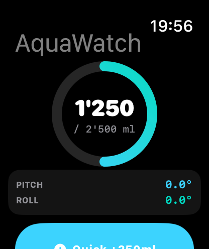
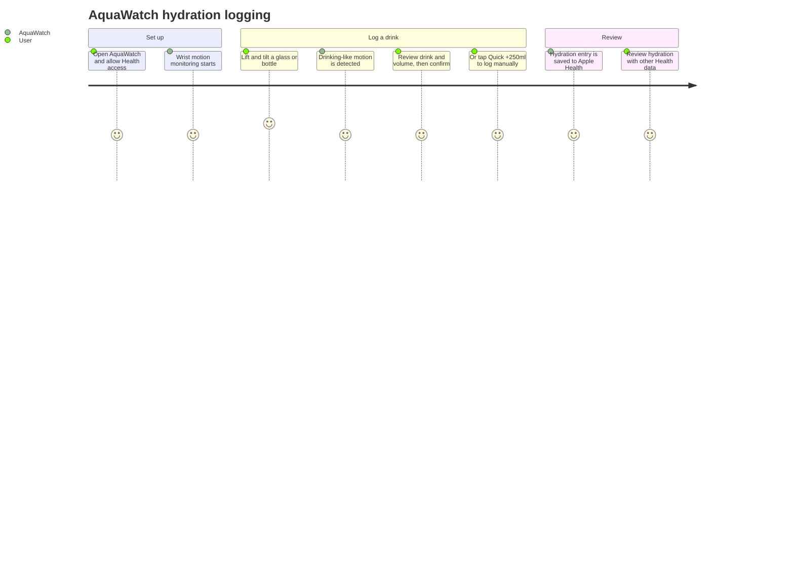
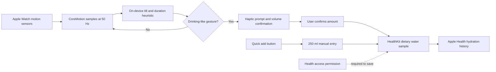

# AquaWatch

AquaWatch is an Apple Watch hydration-tracking prototype. It uses wrist motion to recognize a drinking-like gesture, prompts you to verify the drink, and can record the confirmed volume as dietary water in Apple Health.

## App screenshot

## Motive

Hydration tracking often depends on remembering to open an app and enter every drink. AquaWatch explores a lower-friction alternative: notice a likely sip from wrist movement, offer a quick confirmation, and keep manual logging one tap away. The goal is to make hydration habits easier to track without turning the watch into a complicated logging tool.

## Why integrate with Apple Health?

With permission, AquaWatch saves confirmed entries as dietary water in Apple Health. This can help people:

- Keep hydration records alongside other health information in one place.
- Review intake over time and notice personal routines.
- Make AquaWatch entries available to other apps that use Apple Health data, subject to the user's permissions.

HealthKit authorization is controlled by the user. This prototype writes dietary water samples; it does not calculate personalized hydration targets, read back a daily total, or provide medical advice.

## User journey

## Data flow

## Run in the Apple Watch simulator

1. Open `AquaWatch.xcodeproj` in Xcode.
2. Select the **AquaWatch** scheme and an Apple Watch simulator.
3. Press **Run** (⌘R).
4. Allow motion and Health access when prompted. On the main screen, use **Quick +250ml** to test a manual entry; motion-triggered logging can be tested by simulating a drinking-like wrist tilt.

The app requires watchOS 10 or later. A physical watch can also be selected as the run destination with signing configured for your Apple Developer team.
