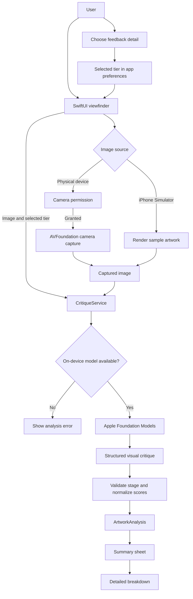

# ArtLens

ArtLens is a SwiftUI app for capturing artwork and getting stage-aware visual
feedback from Apple's on-device Foundation Models.

## Using the app

1. Launch ArtLens and allow camera access when prompted. The live viewfinder is
   designed for a canvas, sketchbook, or digital artwork displayed on a screen.
2. Use the selector to choose concise, balanced, or detailed feedback.
3. Frame the artwork and tap the shutter. The captured image is analyzed on
   device with Apple Foundation Models; no API key or backend is required.
4. Review the stage, composition feedback, and suggested next step.
5. Open **Detailed Breakdown** for the full visual critique and stage checklist.

> Apple Foundation Models is not Siri. Apps cannot invoke Siri itself as a
> general-purpose image-analysis API. The app uses Apple's on-device model and
> requires a compatible device with Apple Intelligence enabled and its model
> ready. The iPhone Simulator may report that the model is unavailable.
>
> Visual distinctiveness and similarity scores are subjective model estimates,
> not reverse-image search results, originality verification, or legal advice.
> Market value is not assessed; no comparable sales are fetched. The iPhone
> Simulator uses a labeled sample artwork because it has no live camera.

## Data flow



The image and selected detail level are analyzed on device. The result is
presented in the summary and detailed report; web matches and market value are
not fetched or assessed.

## Project structure

```text
ArtLens/
├── ArtLens.xcodeproj/          # Xcode project and build settings
└── ArtLens/
    ├── ArtLensApp.swift        # App entry point
    ├── MainCameraView.swift    # Viewfinder, model selector, and capture flow
    ├── CameraManager.swift     # Camera permission, session, and photo capture
    ├── AIModelTier.swift       # On-device critique detail selector
    ├── CritiqueService.swift   # Apple Foundation Models analysis
    ├── ArtworkAnalysis.swift   # Analysis result and report data models
    ├── SummarySheetView.swift  # Scan summary
    ├── DetailedReportView.swift # Detailed analysis sections
    ├── ReportComponents.swift  # KPI, visual-match, and report components
    ├── Info.plist              # App metadata and camera permission text
    ├── Assets.xcassets/        # App icon and color assets
    └── README.md               # This guide
```

## Requirements

- macOS with Xcode 27.1 or later (the project uses the Xcode 27.1 project
  format).
- An Apple Intelligence-compatible iPhone or iPad running iOS/iPadOS 27.0 or
  later, with Apple Intelligence enabled and the on-device model downloaded.
- An Apple ID for signing and installing on a physical device.
## Install and run on an iPhone or iPad

1. Open `ArtLens.xcodeproj` in this directory with Xcode.
2. In the project navigator, select the **ArtLens** project, then the **ArtLens**
   app target. Under **Signing & Capabilities**, select your development team.
   If Xcode reports that the bundle identifier is unavailable, change
   `com.thirtyapps.ArtLens` to a unique identifier.
3. Connect and unlock your iPhone or iPad, accept any **Trust This Computer**
   prompt, and select the device as the run destination in Xcode.
4. If prompted on the device, enable **Developer Mode** in Settings and restart
   the device.
5. Select **Product > Run** (or press **Cmd+R**). Xcode builds, signs, installs,
   and launches ArtLens on the selected device.
6. Allow camera access when the app prompts you. To change it later, use
   **Settings > Privacy & Security > Camera**.

For testing without a physical device, choose an available simulator instead.
Camera capture requires a device with a camera; simulator camera behavior may
be limited.
