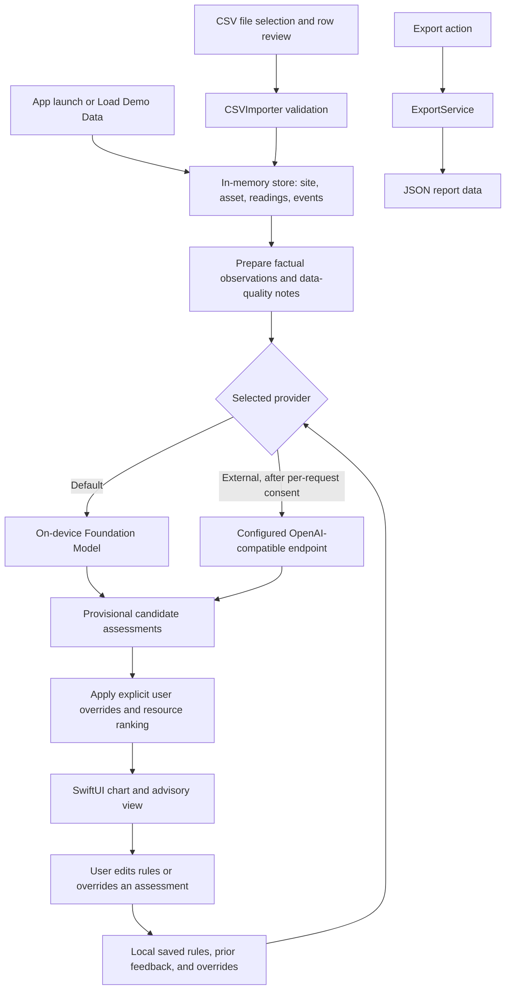
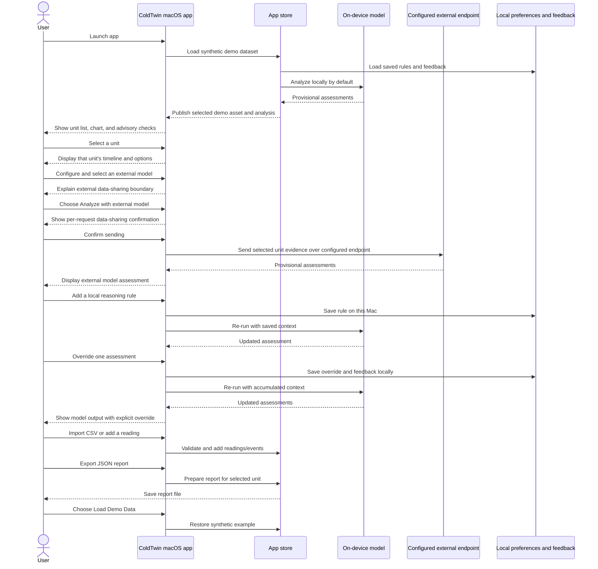

# ColdTwin

ColdTwin is a native macOS SwiftUI prototype for exploring refrigeration-unit temperature trends and maintenance checks. It organizes readings and user-recorded events around a cooler or freezer, highlights data-quality concerns, and presents provisional explanations with practical follow-up checks.

ColdTwin is an advisory aid, not a confirmed diagnostic system. It does not control equipment or replace a qualified refrigeration technician.

## Why it matters

Temperature excursions can put stored food at risk and lead to unnecessary product loss or equipment downtime. ColdTwin is designed to make the available evidence and its gaps visible, help a user decide what low-risk check to perform next, and make it easier to share an assessment with a technician.

## Inference and demo-data policy

- The app starts with **synthetic demo readings and events only**. They are labeled as synthetic and must not be mistaken for live equipment telemetry.
- By default, hypothesis assessments use Apple’s **on-device Foundation Model** through `SystemLanguageModel.default`. If it is unavailable, ColdTwin reports the problem; it does not silently fall back.
- Users may configure one or more **OpenAI-compatible models** and explicitly select one instead. External inference is never automatic. Every external analysis requires a separate confirmation describing the data sent. Remote endpoints must use HTTPS; HTTP is allowed only for localhost. API keys are stored in macOS Keychain.
- Users can add local reasoning preferences and override each model assessment. ColdTwin saves those preferences and the latest corrections on the Mac and includes them as context in future on-device requests.
- This is **local-memory personalization, not model training**: Foundation Models does not update its weights from ColdTwin feedback. Synthetic demo data remains a simulation and is always distinguished from real observations.
- When using an external endpoint, the confirmed request includes that unit's temperature values, timestamps and source labels, event notes, configured range, local reasoning rules, and recent feedback. The external provider's own privacy and retention terms apply.
- Hypotheses are not confirmed diagnoses. Check the readings and recommendations with an appropriately qualified person before taking action.

## Requirements

- macOS 26 or later
- An Apple Intelligence-capable Mac with Apple Intelligence enabled and the on-device model ready
- Xcode 26 or later

## Build, test, and run

From this directory:

```bash
swift test
swift run ColdTwinApp
```

Alternatively, open `Package.swift` in Xcode and run the `ColdTwinApp` scheme. The app loads a synthetic example the first time. Use **Load Demo Data** on the overview to reload the synthetic example; user-created sites and units are preserved.

## How to use

1. Launch the app and review the synthetic example on **Overview**. It contains one walk-in cooler, three temperature readings, and a logged door-open event. Use **Add Site** to create another location, then **Add Asset** to assign a cooler or freezer and its configured temperature limits to that site.
2. Select a unit in the sidebar or choose **Quick Check** to review its evidence, temperature timeline, and provisional assessment. Switch the display between Celsius and Fahrenheit, select a 6-hour, 24-hour, 7-day, or full-history chart window, or view the readings as a table. Data gaps and recorded events are shown separately from measured values.
3. Set available time, skills, and tools in **Resources Available** to rank checks by feasibility. Expand a diagnosis card to review its supporting/conflicting observations, assumptions, missing information, counterfactual, next check, expected results, and ranking factors.
4. Use **Analyze** to request an on-device Foundation Model assessment. If needed, use **Models** to add an OpenAI-compatible endpoint, select it under **Inference model**, then choose **Analyze with …** and confirm each external request.
5. Choose **Import CSV** to select a readings file, review valid, invalid, and duplicate rows, then import the valid rows. Required columns are `timestamp`, `asset_id`, `temperature`, and `unit` (`C` or `F`); `event` is optional. Asset IDs must match a unit already in the app. `TestData/sample-readings.csv` is a sample for the synthetic `cooler-07` demo; it includes valid rows plus duplicate and invalid rows to exercise the preview.
6. Use **Add Reading** to record an individual temperature observation.
7. Choose **Export** to save a JSON report for the selected unit. If model inference is unavailable, the export is labeled evidence-only and does not include model-assessed hypotheses.
8. Add or remove preferences under **Local reasoning rules** to guide future assessments. Each diagnosis card's assessment menu can override that hypothesis's status to “possible” or “needs more evidence”; this is an explicit user annotation, not a change to the evidence or model output. “Use model assessment” clears the override. Overrides and feedback are saved locally.

Sites, units, readings, events, and resource context persist locally on this Mac. Inference preferences and feedback are also stored locally.

## Data flow



## User interaction



## Architecture

- `Sources/ColdTwinCore/Models.swift`: domain models for sites, assets, readings, events, observations, and advisory options.
- `Sources/ColdTwinCore/DiagnosisEngine.swift`: deterministic factual observation preparation, data-quality notes, and resource-aware ranking.
- `Sources/ColdTwinCore/OnDeviceDiagnosisEngine.swift`: on-device Foundation Model inference, output validation, and explicit user-override application.
- `Sources/ColdTwinCore/OpenAICompatibleDiagnosisEngine.swift`: opt-in OpenAI-compatible requests, HTTPS/localhost endpoint validation, and response validation.
- `Sources/ColdTwinCore/KeychainCredentialStore.swift`: API-key storage in macOS Keychain.
- `Sources/ColdTwinCore/InferenceMemory.swift`: local custom rules, assessment overrides, feedback memory, and persistence.
- `Sources/ColdTwinCore/LocalInventoryStore.swift`: local persistence for sites, units, readings, events, and resource context.
- `Sources/ColdTwinCore/CSVImporter.swift`: core utility for validating CSV readings and event rows.
- `Sources/ColdTwinCore/ExportService.swift`: core utility for versioned JSON report data.
- `Sources/ColdTwinApp/ColdTwinApp.swift`: SwiftUI site overview, unit quick-check view, in-memory store, CSV file selection, reading entry, and JSON report export.
- `Sources/ColdTwinApp/CSVImportReviewView.swift`: row-by-row CSV import review and confirmation.
- `Tests/ColdTwinCoreTests/ColdTwinCoreTests.swift`: tests for the analysis rules, CSV validation, and JSON export.
