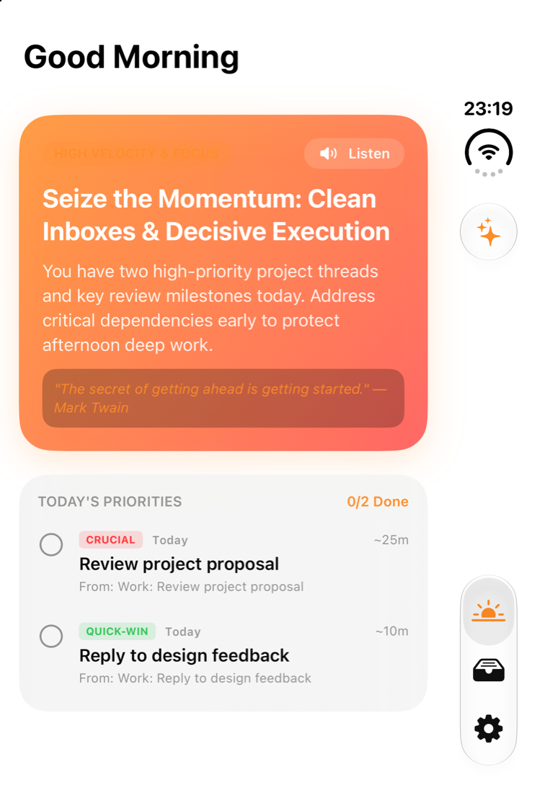
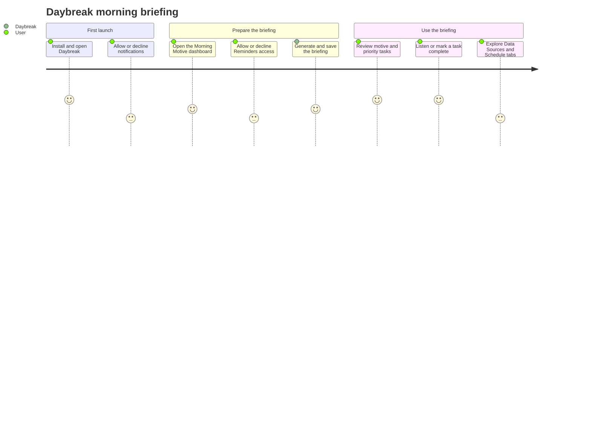
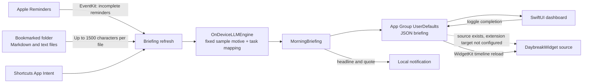
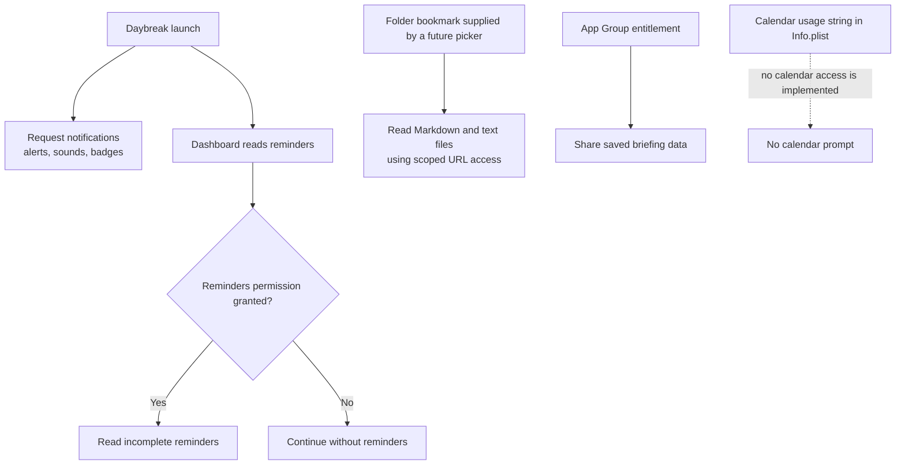

# Daybreak

Daybreak is an iOS SwiftUI prototype for a morning briefing and prioritized task list. The app target supports iOS 17 and later. The current Xcode project builds the iOS app; widget source is present in `DaybreakWidget/`, but a widget extension target has not yet been added to the project.

> **Prototype status:** `OnDeviceLLMEngine` currently returns a fixed sample motive and derives task rows from reminders and documents. It does not load an MLX model or perform generative AI inference. Email sync, calendar reading, and an in-app folder picker are also not implemented.

## App screenshot



The screenshot uses sample reminder content to show the populated dashboard.

## User journey



The Data Sources and Schedule & AI tabs currently display prototype information. They do not configure email, pick a folder, or change the actual notification schedule.

## Data flow



No email, calendar, or network data currently enters this flow. The email counts and blocker shown in the model are sample values. The background processing code schedules best-effort overnight work while charging; iOS controls when (or whether) it runs.

## Permissions and data access



| Access | When it is used | Notes |
| --- | --- | --- |
| Notifications | Requested on app launch | Used for the morning briefing alert. Users can decline or later change this in iOS Settings. |
| Reminders | Requested when the app fetches reminders | Reads incomplete reminders through EventKit. The app can still create a briefing if access is declined. |
| Files | Only if a security-scoped folder bookmark is available | The bookmark-reading service supports Markdown and plain-text files, but no folder picker currently saves a bookmark in the UI. |
| App Group | App storage entitlement | `group.com.daybreak.briefing` is configured for shared `UserDefaults`; a widget extension is not yet part of the Xcode project. |
| Calendar | Not currently used | `NSCalendarsUsageDescription` is present in `Info.plist`, but the app does not request or read calendar data. |
| Email / network | Not currently used | Email is only a placeholder in the Data Sources screen; the app has no email connector. |

## Requirements

- macOS with Xcode 16 or later and the iOS Simulator runtime installed.
- iOS 17 or later for a physical iPhone or iPad.
- An Apple Developer team and a valid App Group configuration to install a signed build on a physical device.

## Build and run in Xcode

1. Open `Daybreak.xcodeproj`.
2. Select the **Daybreak** scheme and an iOS 17+ simulator (or a connected iPhone/iPad).
3. For a physical device, select the **Daybreak** target, set your development team under **Signing & Capabilities**, and configure the `group.com.daybreak.briefing` App Group for that team.
4. Choose **Product > Run**.

## Build and install on the booted Simulator from the command line

```sh
xcodebuild \
  -project Daybreak.xcodeproj \
  -scheme Daybreak \
  -destination 'platform=iOS Simulator,name=<available simulator name>' \
  -derivedDataPath /tmp/DaybreakDerivedData \
  CODE_SIGNING_ALLOWED=NO \
  build

xcrun simctl install booted /tmp/DaybreakDerivedData/Build/Products/Debug-iphonesimulator/Daybreak.app
xcrun simctl launch booted com.daybreak.briefing
```

Find an installed simulator name with:

```sh
xcrun simctl list devices available
```

To install on a physical device, select a development team in Xcode and run the app from Xcode so it can be signed with your provisioning profile.

## Repository layout

- `Daybreak/` — iOS app UI, models, intents, and services.
- `DaybreakWidget/` — widget implementation sources; not currently wired to an Xcode extension target.
- `Daybreak.xcodeproj/` — app project and simulator/device build configuration.
- `Package.swift` — separate `DaybreakEngine` package manifest; it is not required to build the iOS app target.
