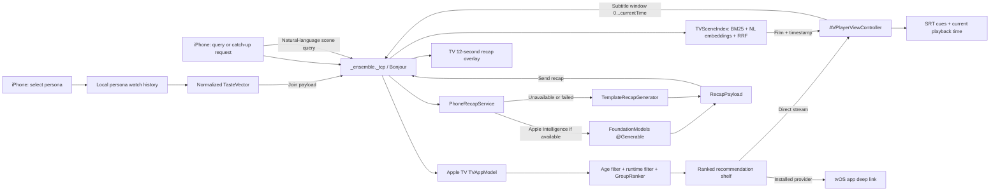
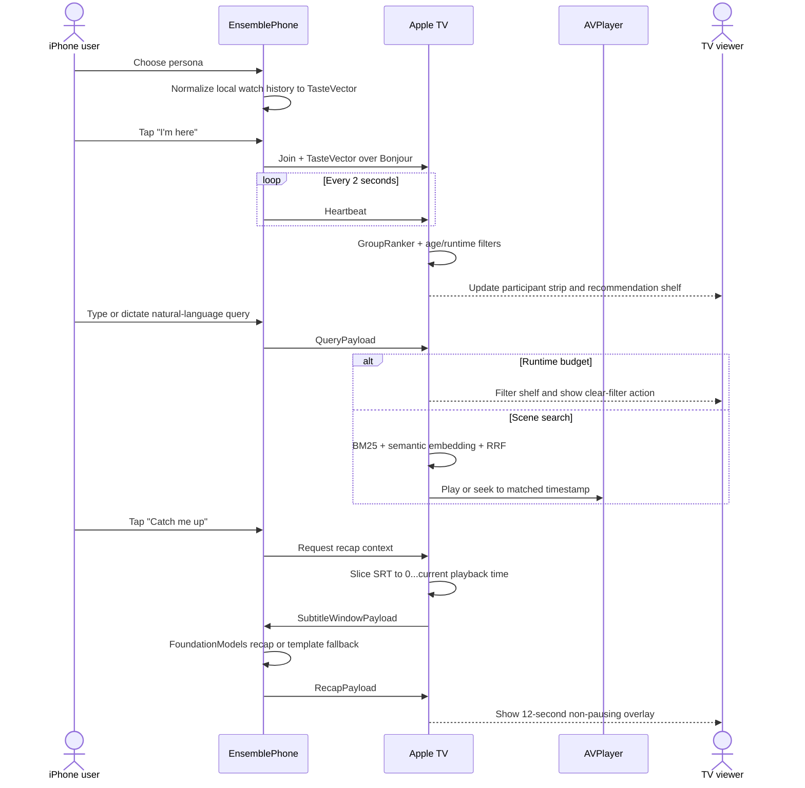

# Ensemble — Room-Aware Apple TV (tvOS 26) & iOS 26 Companion

Ensemble is a zero-backend, local-network MVP built with **Swift 6**, **SwiftUI**, and **Xcode 26** across two targets (`EnsembleTV` for tvOS 26, `EnsemblePhone` for iOS 26) backed by a shared Swift package (`EnsembleCore`).

---

## Architecture Overview

| Component | Target / Module | Key Frameworks & Behavior |
|---|---|---|
| **Shared Models, Ranker & Retrieval** | `EnsembleCore` (Swift Package) | Pure Swift 6 (`Sendable`). `GroupRanker` (`0.6 * mean + 0.4 * min`), hard age-rating & runtime filters, `SRTParser`, `BM25Index`, `RRFFusion (k = 60)`, `RecapWindowExtractor` (`0...currentTime`), `TemplateRecapGenerator`. |
| **Apple TV App** | `EnsembleTV` (tvOS 26) | `Network.framework` `NWListener` advertising `_ensemble._tcp`, `TVSceneIndex` (`BM25` + `NLEmbedding.sentenceEmbedding` fused with RRF), `AVPlayerViewController`, focus-engine home shelf, `"Catch up?"` toast, 12s non-pausing recap overlay. |
| **iPhone Companion** | `EnsemblePhone` (iOS 26) | `NWBrowser` + `NWConnection` with 2s heartbeats (6s TV expiry), local JSON persona → normalized `TasteVector` (raw history never leaves iPhone), `Speech` dictation, and **`FoundationModels`** on-device recap with `@Generable` + deterministic template fallback. |

### Data Flow



### User Interaction



### `FoundationModels` Platform Check
- `FoundationModels` (`SystemLanguageModel`, `LanguageModelSession`, `@Generable`) is **NOT available on tvOS**.
- `EnsemblePhone` imports `FoundationModels` under `#if canImport(FoundationModels)`, always checks `SystemLanguageModel.default.availability == .available`, and falls back cleanly to `TemplateRecapGenerator` whenever unavailable.

### Connected TV Apps & Deep-Link Handoff (`tvOS 26`)
- `EnsembleTV/Info.plist` declares `LSApplicationQueriesSchemes` (`videos`, `nflx`, `disneyplus`, `aiv`, `max`, `hulu`, `youtube`, `plex`, `infuse`, `jellyfin`, `vimeo`, `mubi`).
- `TVInstalledAppsService` uses `UIApplication.shared.canOpenURL(_:)` to detect which streaming apps are installed on the Apple TV 4K and shares that status with connected iPhones over `_ensemble._tcp`.
- Selecting a title launches playback inside `AVPlayerViewController` for direct open streams, or calls `UIApplication.shared.open(_:)` with the target app's custom deep link / Universal Link to hand off straight into Netflix, Disney+, Prime Video, Max, Hulu, YouTube, Apple TV, Plex, Infuse, Jellyfin, Vimeo, or MUBI.
- **tvOS Sandbox Note:** Apple does not allow third-party tvOS apps to enumerate arbitrary undeclared apps or read private watch histories/subtitles from external streaming apps; deep-link handoff opens the target app directly, while subtitle scene-jump and spoiler-free recaps operate on local/open-stream `.srt` media.

---

## 1. Wireless Apple TV 4K Pairing in Xcode 26

1. Connect your Mac and Apple TV 4K to the **same Wi-Fi network** (or Ethernet + Wi-Fi on the same subnet without client isolation).
2. On Apple TV 4K, open **Settings → Remotes and Devices → Remote App and Devices**.
3. On your Mac, open **Xcode 26 → Window → Devices and Simulators** (`⇧⌘2`).
4. Select the **Devices** tab, wait for your Apple TV 4K to appear under *Discovered*, click **Pair**, and enter the 6-digit PIN displayed on the TV screen.
5. Select your Development Team under **Signing & Capabilities** for both `EnsembleTV` and `EnsemblePhone`, then build & run `EnsembleTV` wirelessly onto the Apple TV 4K and `EnsemblePhone` onto 2+ iPhones.

---

## 2. Required Local Network & Speech Permissions

Both `EnsembleTV/Info.plist` and `EnsemblePhone/Info.plist` already declare:

- `NSLocalNetworkUsageDescription` — explains local `_ensemble._tcp` discovery for normalized taste weights and scene/recap sync.
- `NSBonjourServices` — `["_ensemble._tcp"]`.

`EnsemblePhone/Info.plist` additionally declares:
- `NSSpeechRecognitionUsageDescription`
- `NSMicrophoneUsageDescription`

> **Tip:** If you decline the Local Network prompt on first launch on iOS or tvOS, re-enable it under **Settings → Privacy & Security → Local Network → Ensemble**.

---

## 3. Which iPhones Support Apple Intelligence (`FoundationModels`)

On iOS 26, `SystemLanguageModel.default.availability` returns `.available` only when **both** hardware and user settings qualify:

- **Eligible iPhones:** iPhone 15 Pro, iPhone 15 Pro Max, all iPhone 16 models, iPhone 16e, and iPhone 17 / iPhone Air generation devices (A17 Pro / A18 / A19+ with 8 GB+ RAM).
- **Required Settings:** Apple Intelligence enabled in **Settings → Apple Intelligence & Siri**, and the on-device foundation model finished downloading.
- **Older iPhones (e.g., iPhone 14, iPhone 15, iPhone SE):** `SystemLanguageModel.default.availability` returns `.unavailable(.deviceNotEligible)` and `PhoneRecapService` automatically uses `TemplateRecapGenerator` (≤60 words, key characters extracted, zero crash).

---

## 4. 3-Minute Live Demo Script

**Setup (before starting):** Launch `EnsembleTV` on Apple TV 4K. Open `EnsemblePhone` on Phone A (select **Maya · Adult Action**) and Phone B (select **Mia · Child**) and Phone C or switch Phone B to **David · Adult Drama** as needed.

### Moment 1 — Group Re-Ranking & Child Filter (0:00 – 1:00)
1. Tap **"I left"** → **"I'm here"** on Phone A (**Maya**) and Phone B (**David**).
   - **Observe on TV (< 2s):** Room avatar strip shows `Maya` and `David`. The row header updates to **"For Maya & David"**, surfacing balanced Action/Drama/Sci-Fi titles (including `Tears of Steel` PG-13 and `Velvet Meridian` R) with `"why"` captions naming who each title best suits.
2. Have a third iPhone (or switched profile) tap **"I'm here"** as **Mia (Child)**.
   - **Observe on TV (< 1s):** Every PG-13 and R item disappears immediately; `Big Buck Bunny` (G), `Sintel` (PG), and `Clockwork Harbor` (G) move to the top.
3. Tap **"I left"** on Mia's phone.
   - **Observe on TV (< 1s):** PG-13 and R titles return to the shelf.

### Moment 2 — "Find the Moment" Natural-Language Scene Jump (1:00 – 2:00)
1. On Maya's iPhone, tap the microphone (or type) and submit:
   - `"something for all of us under 40 min"` → TV filters the shelf to titles `≤ 40 min`.
2. Next, submit:
   - `"the part where the dragon appears"` → Tap **Play on TV**.
   - **Observe on TV:** `TVSceneIndex` runs hybrid BM25 + `NLEmbedding.sentenceEmbedding` cosine fused via RRF (`k = 60`), launches `Sintel` inside `AVPlayerViewController`, and seeks directly within ±30s of the baby dragon scene (~3:05).

### Moment 3 — Spoiler-Free "Catch Me Up" for a Late Joiner (2:00 – 3:00)
1. While `Sintel` is playing past `5:00`, have **David** tap **"I'm here"** on his iPhone.
2. **Observe on TV:** A non-intrusive **"David just joined — Catch up?"** toast appears over playback.
3. Click **Catch up?** on TV (or tap **Catch me up** on David's iPhone).
4. **Observe the Privacy & Spoiler Boundary:** Apple TV slices `Sintel.srt` strictly to `0...currentTime`, sends only that window to David's iPhone, and David's iPhone runs `FoundationModels` `@Generable` (or `TemplateRecapGenerator` fallback on non-AI devices) to return a ≤60-word summary + `keyCharacters`. Apple TV displays the recap overlay for **12 seconds without pausing playback**.

---

## 5. Building & Running Tests (on macOS with Xcode 26)

```bash
# Run EnsembleCore unit tests (Ranker, SRTParser, BM25, RRF, Recap Cutoff)
swift test --package-path Ensemble/EnsembleCore

# Build tvOS 26 target (simulator)
xcodebuild -project Ensemble/Ensemble.xcodeproj -scheme EnsembleTV \
  -destination 'generic/platform=tvOS' build

# Build iOS 26 target (simulator)
xcodebuild -project Ensemble/Ensemble.xcodeproj -scheme EnsemblePhone \
  -destination 'generic/platform=iOS' build
```

### Local Verification Status
- `EnsembleCore` tests ran successfully on this macOS workspace: **10 tests across 4 suites passed**.
- The `EnsembleTV` and `EnsemblePhone` schemes both resolved their package dependencies and reached target signing. Native builds currently stop because no development team is configured in Xcode for the targets.
- Physical Apple TV 4K + iPhone Bonjour, microphone, Apple Intelligence, and playback behavior still require hardware or configured Apple simulators/devices.

---

## Creative Commons Credits
- **Big Buck Bunny (2008)** — © 2008 Blender Foundation | peach.blender.org (CC-BY 3.0)
- **Sintel (2010)** — © 2010 Blender Foundation | durian.blender.org (CC-BY 3.0)
- **Tears of Steel (2012)** — © 2012 Blender Foundation | mango.blender.org (CC-BY 3.0)
- **Elephants Dream (2006)** — © 2006 Blender Foundation & Netherlands Media Art Institute (CC-BY 2.5)
