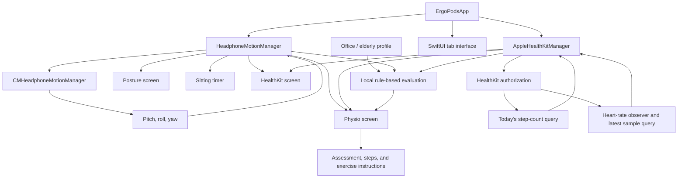
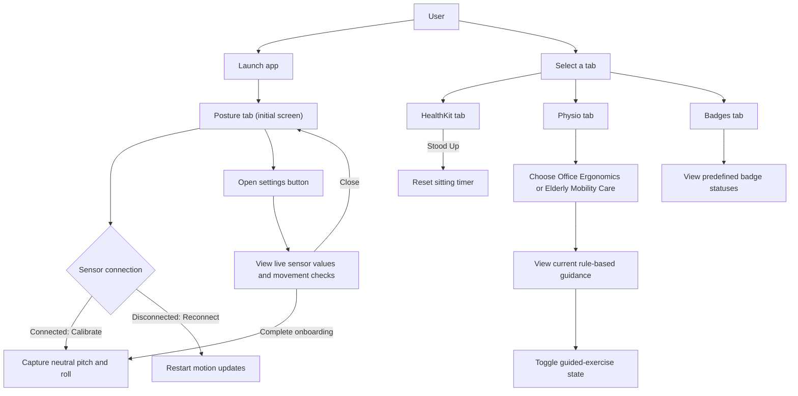

# ErgoPods

ErgoPods is an iOS SwiftUI prototype for posture tracking with AirPods motion, Apple Health metrics, and physiotherapy guidance.

## Project structure

- `ErgoPods/App/ErgoPodsApp.swift` creates the shared motion and HealthKit managers and injects them into the app.
- `ErgoPods/Managers/` contains the CoreMotion and HealthKit integrations.
- `ErgoPods/Views/` contains the Posture, HealthKit, Physio, Badges, and onboarding screens.
- `ErgoPods/Models/OnDevicePhysioReasoningModel.swift` contains the rule-based prescription logic.
- `ErgoPods/LiveActivity/DynamicIslandPostureWidget.swift` defines a Live Activity widget.
- `Package.swift` currently defines a Swift package library; it does not define a runnable iOS app target.

## Data flow



Motion angles are published by the motion manager; calibration stores pitch and roll baselines, and the published pitch is used by the posture UI and prescription rules. The sitting timer starts when the manager is created and advances once per second until the user resets it. HealthKit authorization is requested at manager initialization. When authorized, the current implementation queries today's step total and observes heart-rate updates.

## User interaction



The onboarding sheet is opened manually from the Posture screen; it is not shown automatically on first launch. Starting or pausing the exercise currently changes a UI state only; it does not run a countdown or audio cue.

## Build and run

The checked-in Swift package exposes a library, not an iOS app executable, and there is no `.xcodeproj` in this repository. Therefore the package can be compiled, but the app cannot currently be launched directly from the checked-in project structure.

To compile the package for the iOS Simulator:

```sh
swift build \
  --sdk "$(xcrun --sdk iphonesimulator --show-sdk-path)" \
  --triple arm64-apple-ios18.0-simulator
```

To run the app, create an iOS App target in Xcode and add the `ErgoPods` source files to that target. Set the deployment target to iOS 18 or later, configure the HealthKit capability, and include the privacy descriptions from `ErgoPods/Info.plist`. AirPods motion tracking requires compatible hardware paired to an iPhone; simulator builds do not validate that sensor flow.

## Current implementation notes

- Physiotherapy recommendations are produced by deterministic Swift rules, not a Core ML or Foundation Models inference call.
- HealthKit currently reads today's step total and latest heart rate. Other displayed health values (including resting heart rate and HRV) are initialized placeholders; no standing-hours query or HealthKit write is implemented.
- Badge states are predefined in the view and are not calculated from activity.
- The Live Activity widget type is defined but is not started or updated by the app.
