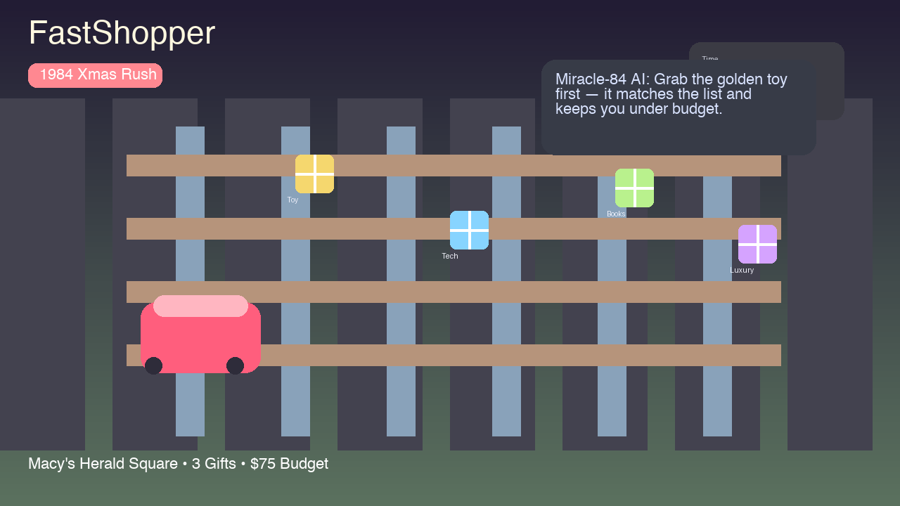

# FastShopper '84 🎄🎅

A high-performance standalone 2D top-down arcade shopping cart game for macOS built natively with **Swift 5.10+**, **SwiftUI**, **SpriteKit**, and an on-device AI Holiday Concierge (**"Miracle-84 AI"**).

Set during the **Christmas Eve 1984 rush across iconic Manhattan department stores** (Macy's Herald Square, Bloomingdale's, and Saks Fifth Avenue).

<p align="center">
  
</p>

## Quick start

1. Open Terminal in the project folder.
2. Run the game:
   ```bash
   swift run
   ```
3. If you want to launch the built binary directly, use:
   ```bash
   .build/arm64-apple-macosx/debug/FastShopper
   ```
   The exact binary path can vary by machine architecture, but the project root build output is always under `.build`.

## Key points

- **Running:** This project is a native macOS app, so it needs a Mac with macOS 14+ and Xcode command-line tools installed.
- **Goal:** Grab the right gifts before time runs out, while staying within each level's credit cap.
- **AI help:** Press **R** at any time for tactical guidance from the in-game Miracle-84 AI concierge.
- **Strategy:** Balance budget-friendly items with luxury upgrades when you have extra credit and a good combo opportunity.
- **Controls:** Use **WASD / Arrow Keys** to move, **Space** to grab or check out, and **P** to pause.

## How to play

1. Start a level and steer your cart through the store aisles.
2. Collect the gifts shown on your shopping list before the timer expires.
3. Stay under the level budget and avoid wasting credit on the wrong items.
4. Use the AI advisor when you're unsure which gift is the best value or match for your combo goals.
5. Finish each stage by checking out successfully and moving on to the next store.

---

## 🎮 1980s NYC Christmas Theme & Gameplay Loop

It's **December 24, 1984 in New York City**. A blizzard is blowing over Broadway, holiday lights are glowing in the store windows, and you have minutes before the department store closes for Christmas Eve!

### 3 Iconic NYC Levels
1. **Level 1: Macy's Herald Square Rush (1984)** — 3 Gifts • $75.00 Credit • 90 Seconds
2. **Level 2: Bloomingdale's Blizzard Frenzy** — 5 Gifts • $160.00 Credit • 75 Seconds
3. **Level 3: Saks Fifth Ave Midnight Miracle** — 7 Gifts • $350.00 Credit • 60 Seconds

### Brand & Quality Improvisation (1984 Manhattan Style)
Items on the store shelves come in 3 tiers:
- 🏷 **Canal St. Saver** (75% cost) — Budget-conscious knockoffs to stretch your remaining cash.
- ✨ **5th Ave Classic** (100% cost) — Standard quality department store presents.
- 👑 **Saks Luxury Edition** (170% cost, **+500 pts**) — Prestigious luxury gifts to spend surplus credits and boost your final score!

### 🎅 Miracle-84 AI (Macy's On-Device Mainframe Concierge)
- **Real-Time Vectoring**: Points guidance arrows and paces to the closest gift on your Christmas list.
- **Credit Reasoning**: Evaluates remaining cash per gift to tell you when to splurge on Saks Luxury vs save at Canal St.
- **Holiday Synergy Combos**:
  - *Creamy Spiced Eggnog + Glazed Gingerbread Man = "Yuletide Cheer" (+450 pts)*
  - *Walkman Portable Cassette + Polaroid 600 Camera = "Radical 1984 Tech Duo" (+550 pts)*
  - *Carved Wooden Nutcracker + Cabbage Patch Doll = "Christmas Morning Joy" (+500 pts)*
- **Consult on Demand**: Press **[R]** at any time to receive instant tactical dispatch.

---

## 🕹 Controls

| Action | Keyboard | Gamepad (Xbox / PS / MFi) | Mouse / Trackpad |
| :--- | :--- | :--- | :--- |
| **Move / Steer Cart** | `W`, `A`, `S`, `D` or `Arrow Keys` | Left Thumbstick | Aiming Vector |
| **Grab Item / Checkout** | `Spacebar` | `A` or `X` button | Action Button in HUD |
| **Consult Copilot** | `R` key | `Y` or `B` button | Consult Button in HUD |
| **Pause / Resume** | `P` or `Escape` | `Menu / Start` button | HUD Menu |
| **Mute / Unmute Audio** | `M` key | — | Menu Bar |
| **Toggle Fullscreen** | `Cmd + Enter` | — | Green Window Pill |

---

## 🚀 Running the Game

Run directly from the project directory:
```bash
swift run
```
Or run the compiled binary from the build output (path varies by architecture):
```bash
.build/arm64-apple-macosx/debug/FastShopper
```
On Intel Macs, the build folder is typically `.build/x86_64-apple-macosx/debug/FastShopper`.

---

## 🏗 Architecture (MVVM + ECS)

```
Sources/FastShopper/
├── App/
│   ├── FastShopperApp.swift       # Application lifecycle, macOS windowing & native menu commands
│   └── GameState.swift            # Observable single source of truth for economy, timer, score & targets
├── Models/
│   ├── Product.swift              # ProductCategory, BrandTier, ProductItem, ShoppingTarget
│   ├── LevelDefinition.swift      # Level 1, 2, and 3 configurations, budgets, and objectives
│   └── StoreLayout.swift          # Supermarket floor geometry, aisles, shelves, and checkout registers
├── Engine/
│   ├── GameScene.swift            # SpriteKit Scene: cart physics, retina rendering, particle effects
│   ├── CartController.swift       # Inertia physics, steering angles, shelf collision bounce
│   ├── InputManager.swift         # Multi-input coordinator: Keyboard, Mouse, and GameController (GCController)
│   ├── AudioSynthesizer.swift     # Procedural 8-bit sound generator using AVAudioEngine (zero audio files needed)
│   └── CopilotReasoner.swift      # On-device AI assistant foundation model & heuristic reasoning logic
└── Views/
    ├── GameContainerView.swift    # Root container linking SpriteKit canvas with SwiftUI overlays
    ├── HUDView.swift              # Status bar, animated timer, credit spend gauge, and action pills
    ├── CopilotHUDView.swift       # Live AI Copilot reasoning feed, thought trace, and shopping list checklist
    ├── MinimapView.swift          # Supermarket radar map showing player cart & store layout
    ├── Color+Hex.swift            # Hex color extension for SwiftUI
    └── OverlaysView.swift         # Start menu, Pause modal, Level Cleared receipt, Game Over, and Grand Victory
```
