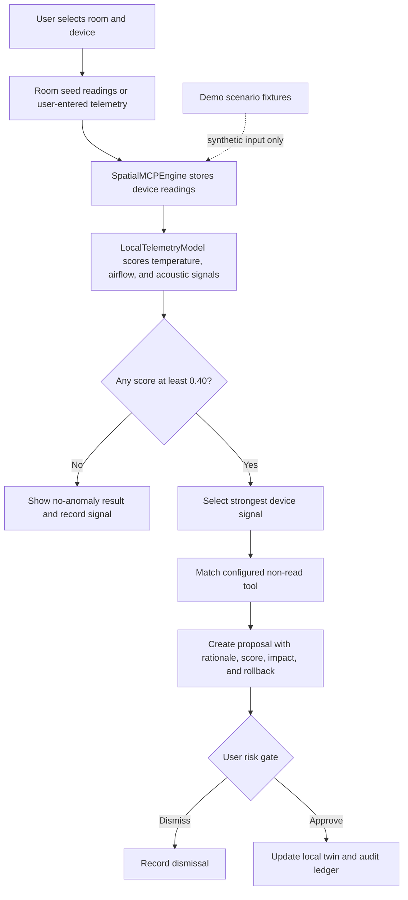
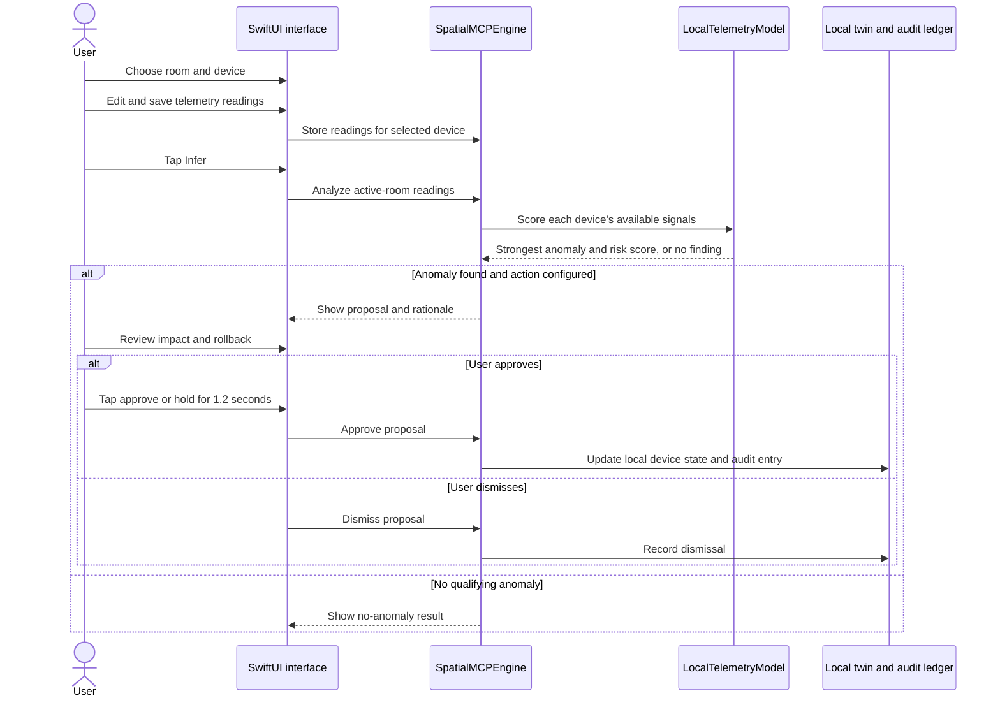

# FieldTwin

FieldTwin is an iOS spatial-maintenance prototype for inspecting equipment in a room-scale digital twin, evaluating telemetry locally, and reviewing risk-tiered maintenance actions before they are approved.

## What is novel

FieldTwin brings three maintenance concepts into one workflow:

- **Spatial context:** equipment is selectable in a room view, so a reading and its proposed action stay tied to a device.
- **Local model inference:** an interpretable telemetry scoring model ranks temperature, airflow, and acoustic anomalies from readings the user enters. The inference is calculated on-device; the app does not send telemetry to a cloud model.
- **Risk-calibrated human approval:** each recommendation presents its rationale, potential impact, and rollback plan. Higher-risk proposals require a press-and-hold confirmation.

The local model is a transparent scoring model, not a trained Core ML model. Scores are relative risk scores, not calibrated probabilities.

## Intended uses

- Triage thermal, ventilation, and acoustic readings for a server rack, workshop, or utility space.
- Explore how a spatial twin can connect a detected anomaly to a device-specific maintenance proposal.
- Prototype human approval and audit workflows before integrating facility telemetry or control hardware.
- Demonstrate offline-first inference with manually supplied readings.

**Prototype limitation:** do not use FieldTwin to operate real equipment. Device readings are entered by the user or loaded from sample room data; there is no live sensor feed or MCP transport. Approving a proposal updates the in-app twin and audit ledger only; it does not actuate hardware. Demo scenario fixtures are synthetic. The current SceneKit room view is not a live RoomPlan/LiDAR scan.

## Run

Open the `FieldTwin` Swift package in Swift Playgrounds or a compatible Xcode environment with the iOS 18 SDK, then run it on an iPhone or iPad. The package uses Apple's `AppleProductTypes` module, so a standard command-line `swift build` may not recognize its manifest outside the Swift Playgrounds/Xcode app-package environment.

## User workflow

1. Choose a room and select a device in the 3D view.
2. Tap **Telemetry**, enter temperature, airflow, and acoustic readings, then save.
3. Tap **Infer**. FieldTwin scores the active room's readings and reports the strongest signal.
4. Review the proposal's model rationale, score, impact, and rollback plan.
5. Approve or dismiss. Tier 3 proposals require a 1.2-second hold. Approval changes only the local twin and audit entry.
6. Use **Demo Scenario Fixtures** to load synthetic examples; these are separate from the user-entered telemetry inference path.

## Local telemetry model

For each device, the on-device model independently normalizes three anomaly signals and uses the strongest score:

- Temperature: `clamp((temperatureC - 55) / 30, 0, 1)`
- Airflow: `clamp((80 - airflowCfm) / 50, 0, 1)`; a zero airflow reading is treated as unavailable.
- Acoustic level: `clamp((acousticDb - 50) / 20, 0, 1)`

A score of **0.40 or higher** is reported as an anomaly. The highest-scoring device in the active room is matched to its highest-risk configured non-read tool to create a proposal. These thresholds are prototype defaults, not validated safety limits. The model currently does not use images, audio waveforms, historical trends, water-flow readings, or sensor confidence.

## Dataflow

## User-interaction sequence

## Project structure

- `Sources/FieldTwinApp.swift` — SwiftUI app entry point and shared state.
- `Sources/Models/SpatialModels.swift` — rooms, seeded device data, risk tiers, proposals, and audit entries.
- `Sources/Agent/LocalTelemetryModel.swift` — local, interpretable telemetry scoring.
- `Sources/Agent/SpatialMCPEngine.swift` — room state, telemetry updates, inference orchestration, demo fixtures, and proposal lifecycle.
- `Sources/Views/ContentView.swift` — room selection, telemetry editor, inference action, and companion sheet.
- `Sources/Spatial/RoomPlanLiDARView.swift` — SceneKit visualization of seeded device geometry.
- `Sources/Views/TrustCalibratedAROverlay.swift` — proposal review and tiered approval controls.
- `Sources/Sync/NearbyCompanionSync.swift` — companion authentication prototype; UWB values are currently placeholders.
