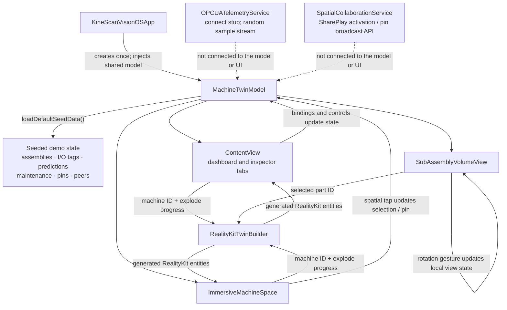
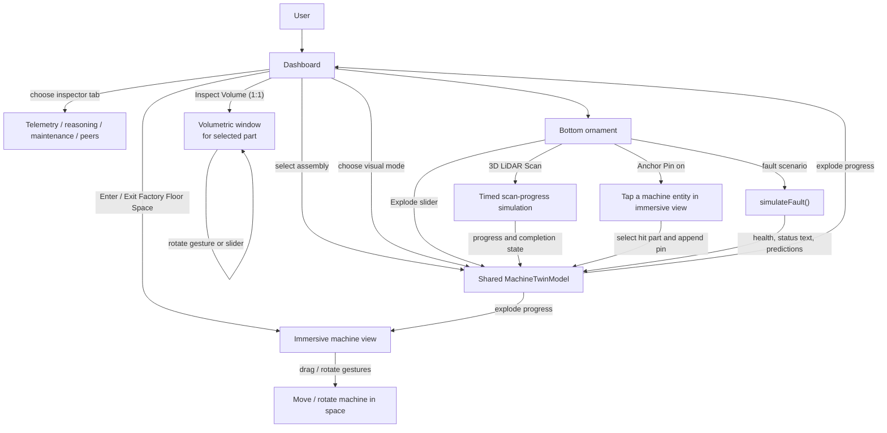

# KineScanVisionOS — Apple Vision Pro Industrial Spatial Digital Twin

Welcome to the **KineScanVisionOS** SwiftUI project for visionOS 2.0+. This demo brings high-precision 3D industrial manufacturing digital twins (5-Axis Horizontal Machining Center - HMC-500X) into Apple Vision Pro.

## Project Architecture

```
KineScanVisionOS/
├── Package.swift                                # SwiftPM manifest for visionOS 2.0+
├── Sources/
│   ├── KineScanVisionOSApp.swift                # App entrypoint (WindowGroup + ImmersiveSpace + Volumetric)
│   ├── Views/
│   │   ├── ContentView.swift                    # Primary 2D Spatial Dashboard window with Glass background
│   │   ├── ImmersiveMachineSpace.swift          # Mixed-immersion RealityView with gesture raycasting
│   │   ├── SubAssemblyVolumeView.swift          # 1:1 Volumetric tabletop inspection window
│   │   └── OrnamentsToolbarView.swift           # Floating bottom window ornaments
│   ├── Models/
│   │   └── MachineTwinModel.swift               # Observable model with seeded demo data and interactions
│   └── Services/
│       ├── RealityKitTwinBuilder.swift          # Procedural RealityKit ModelEntities & PBR materials
│       ├── SpatialCollaborationService.swift    # GroupActivities and pin-broadcast scaffold
│       └── OPCUATelemetryService.swift          # OPC-UA connection/subscription demo stub
├── Info.plist                                   # ARKit world sensing & hand tracking entitlements
└── README.md                                    # This setup documentation
```

## Data Flow

The app currently starts with local demo data in `MachineTwinModel`. The dashboard, immersive space, and volumetric window share that model through SwiftUI's environment.



**Demo scope:** telemetry values and machine details shown in the UI come from seeded model data. The OPC-UA service is currently a stub (including a random-value stream), and no live PLC, LiDAR, CoreML, cloud reasoning, or collaboration session is connected to the displayed model. The visual-mode picker currently stores its selection but does not change rendering.

## User Interaction



The pin action is a two-step interaction: enable **Anchor Pin** in the ornament, then tap a machine entity in the immersive view. **Bearing Spall** updates the seeded health, reasoning text, and predictions; the other scenario choices currently fall back to the nominal state.

## Quick Start in Xcode 16+

1. **Prerequisites**:
   - Mac running **macOS Sequoia 15.0+**
   - **Xcode 16.0+** with the **visionOS 2.0 SDK** installed.

2. **Open the Project**:
   - Extract the generated ZIP package.
   - Double-click `Package.swift` or open the folder directly in Xcode.
   - Select the target **`KineScanVisionOS`** and the destination **`Apple Vision Pro (Simulator)`** (or a connected Vision Pro device).

3. **Running the Demo**:
   - Press **⌘R** to Build and Run.
   - In the Vision Pro simulator:
     - **Main Window**: Browse seeded PLC-style I/O values, view the 3D machine preview, and explore demo failure predictions.
     - **Enter Immersive Space**: Click the button in the top toolbar to enter the full mixed-immersion space. The machine anchors right in front of you.
     - **Inspect Volume (1:1)**: Opens a dedicated 3D volumetric window to spin and inspect isolated parts on your tabletop.
     - **Bottom Ornament**: Drag the **Explode** slider to part the assemblies, start the simulated **3D LiDAR Scan** progress, and arm **Spatial Annotation Pins**.

## Key Features Implemented

- **Mixed-Immersion RealityView**: Renders a procedural RealityKit machine assembly in a mixed immersive space.
- **Glass Morphism UI**: Native visionOS `.glassBackgroundEffect()` and window ornaments.
- **Gesture Manipulation**: `RotateGesture3D`, `DragGesture`, and `SpatialTapGesture` for spatial inspection and pin placement.
- **Reasoning Demo**: Seeded failure predictions and a fault-scenario control update the displayed health and reasoning state; CoreML and cloud inference are not connected.
- **Telemetry Demo**: The dashboard uses seeded I/O values. `OPCUATelemetryService` is a stub and does not feed the model or UI.
- **Scan Demo**: The LiDAR control advances simulated progress; it does not capture a sensor scan.
- **Collaboration Scaffold**: A `GroupActivity` and pin-broadcast API are present, but SharePlay session management and external-device synchronization are not connected to the UI.
