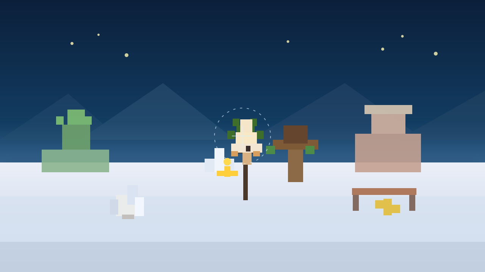

# LightMeinKraft 🎄
### A High-Performance Native macOS 3D Voxel Holiday Adventure

**LightMeinKraft** is a standalone, native macOS game written in Swift 6 and SwiftUI / SceneKit (Metal-backed). It features a voxel sandbox engine with procedural pixel-art textures, real-time lighting, 3D AABB physics, DDA raycasting, synthesized 8-bit audio, and a 2-level Christmas-themed adventure.

---

## 🎮 Game Overview & Core Loop

The game contains **2 festive levels** replicating classic Minecraft survival mechanics:

### ❄️ Level 1: Snowy Taiga & Star Portal
- **Setting**: Rolling winter hills, pine forests dusted with snow, frozen ice ponds, and candy cane deposits.
- **Objectives**:
  1. Mine 5 Snowy Pine Logs
  2. Craft 8 Pine Planks
  3. Mine 4 Candy Cane Blocks
  4. Craft 4 Holiday Torches
  5. Craft and place the **Golden Star Portal** to unlock Level 2!
- **Hazards**: Patrolling Snow Creepers (wearing Santa hats!) that hiss, swell, and explode when you get too close.

### 🎅 Level 2: Santa's Frozen Workshop
- **Setting**: Frost Netherrack cavern fortress with gingerbread walls, candy cane pillars, and the central Grand Christmas Tree.
- **Objectives**:
  1. Mine 6 Frost Netherrack or Gingerbread blocks
  2. Defeat the **Abominable Frost Grinch Boss** (50 HP, throws ice shards and melees)
  3. Retrieve the **Star of Wonder** and place it atop the Grand Christmas Tree to save Christmas!
- **Victory Condition**: Placing the Golden Star atop the Grand Tree triggers victory fanfare, festive statistics, and score bonuses.
- **Loss Condition**: Running out of hearts (20 HP) from mob attacks, creeper explosions, or fall damage displays the classic "You Died!" respawn screen.

---

## 🖼️ Mid-Game Screenshot



---

## 🕹️ Controls

| Action | Keyboard / Mouse | Gamepad (Xbox / PlayStation / MFi) |
|---|---|---|
| **Move** | `W`, `A`, `S`, `D` or Arrow Keys | Left Thumbstick |
| **Look Around** | Mouse movement (aim crosshair) | Right Thumbstick |
| **Jump** | `Space` | Button A (Cross) |
| **Sneak / Slow** | `Shift` | Button B (Circle) |
| **Mine / Attack** | Left Click | Right Trigger (RT / R2) |
| **Place Block / Eat** | Right Click | Left Trigger (LT / L2) |
| **Hotbar Slots** | `1` - `9` or Scroll Wheel | D-Pad Left / Right |
| **Crafting & Inventory** | `E` or `I` | Button X (Square) |
| **Pause Menu** | `Esc` or `Space` (when paused) | Menu Button |
| **Fullscreen Toggle** | `Cmd + Enter` | — |
| **Audio Mute** | `Cmd + M` | — |

---

## 🔨 Crafting Recipes (2x2 Grid)

Open the crafting grid with `E`:
- **1 Pine Log** ➔ **4 Pine Planks**
- **2 Pine Planks (vertical)** ➔ **4 Holiday Sticks**
- **1 Stick + 1 Candy Cane** ➔ **4 Holiday Torches**
- **2 Sticks + 2 Planks** ➔ **1 Pine Pickaxe**
- **1 Stick + 2 Candy Canes** ➔ **1 Candy Cane Blade** (High attack damage)
- **4 Candy Canes (full 2x2)** ➔ **1 Red Gift Box**
- **4 Pine Leaves (full 2x2)** ➔ **1 Green Gift Box**
- **2 Torches + 2 Candy Canes** ➔ **1 Golden Star** (Star Portal key)
- **1 Snow Grass** ➔ **4 Snowballs**

---

## 🏗️ Architecture & Project Structure

```
LightMeinKraft/
├── Package.swift                             // SPM manifest targeting macOS 14+
├── Sources/LightMeinKraft/
│   ├── App/
│   │   ├── LightMeinKraftApp.swift          // SwiftUI App lifecycle & macOS menus
│   │   └── AppDelegate.swift                // AppKit delegate, focus, auto-pause
│   ├── Models/
│   │   ├── BlockType.swift                  // Voxel definitions, hardness, lighting, score
│   │   ├── Item.swift                       // Inventory items, tools, weapons, consumables
│   │   ├── CraftingSystem.swift             // 2x2 crafting recipes & recipe matcher
│   │   ├── Player.swift                     // Position, health (hearts), hotbar & inventory
│   │   ├── Mob.swift                        // Snow Creepers, Frost Grinch Boss, Snowman
│   │   ├── Quest.swift                      // Level 1 & 2 quest definitions & objective tracking
│   │   └── GameState.swift                  // Central observable state & screen router
│   ├── Engine/
│   │   ├── VoxelWorld.swift                 // Procedural chunk terrain, mob AI, particles
│   │   ├── VoxelPhysics.swift               // 3D AABB physics, collision resolution, DDA raycast
│   │   ├── TextureGenerator.swift           // Self-contained procedural 16x16 pixel-art generator
│   │   ├── SoundManager.swift               // Real-time WAV audio buffer synthesizer (no audio files needed)
│   │   └── InputManager.swift               // Keyboard, mouse tracking, GameController framework
│   └── Views/
│       ├── GameContainerView.swift          // Root coordinator switching screens
│       ├── GameSceneView.swift              // NSViewRepresentable wrapping SCNView
│       ├── HUDOverlayView.swift             // Crosshair, Hearts bar, Hotbar, Boss bar, Quests
│       ├── InventoryView.swift              // 2x2 Crafting grid & 27-slot inventory GUI
│       ├── MainMenuView.swift               // Festive title, level cards, controls guide
│       ├── PauseMenuView.swift              // Pause menu overlay with controls cheat-sheet
│       └── GameOverView.swift               // "You Died" & "Christmas Saved" screens
└── Tests/LightMeinKraftTests/
    └── LightMeinKraftTests.swift            // Comprehensive Swift Testing suite
```

---

## 🚀 Build & Run

### 1. Run the Game
```bash
swift run
```

### 2. Build Release Executable
```bash
swift build -c release
./.build/release/LightMeinKraft
```

### 3. Run Unit Tests
```bash
swift test
```

### 4. Open in Xcode
```bash
open Package.swift
```
