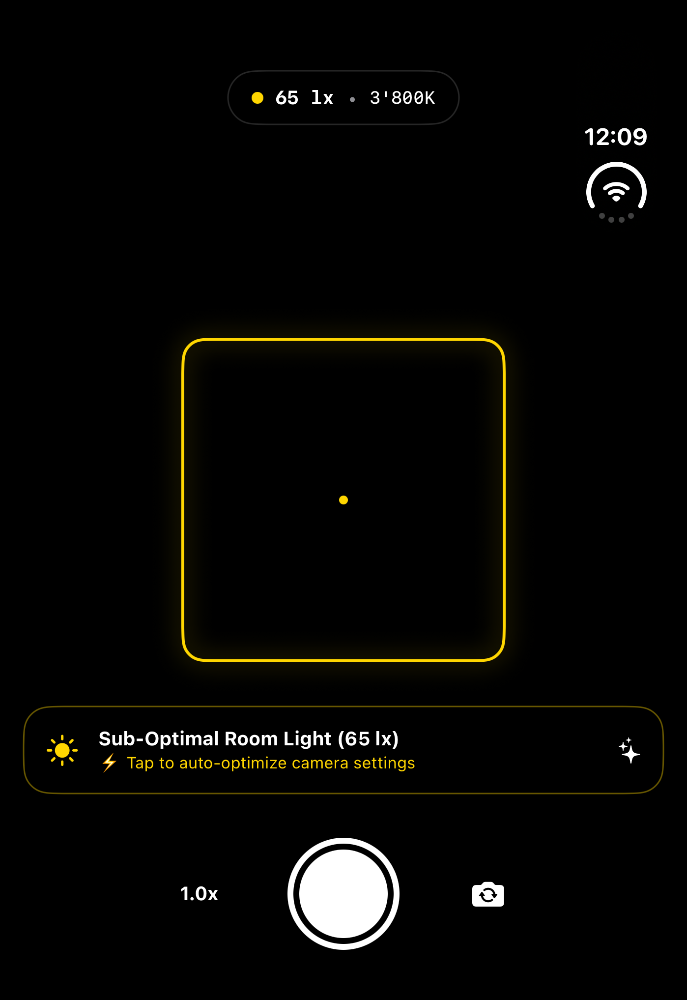
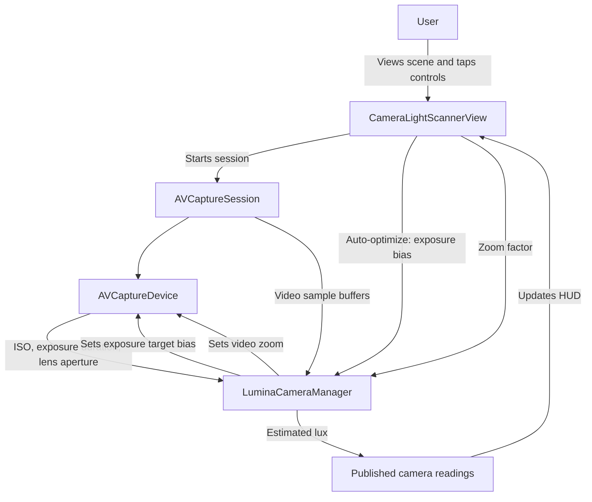

# Lumina Light Camera

Lumina Light Camera is an iOS camera-viewfinder concept that displays an estimated room-light reading and provides a one-tap exposure adjustment.



The simulator does not provide a camera feed, so the preview area appears black in this screenshot.

## User story

As someone setting up a space for a photo or video, I want to see a live camera view with an estimate of the ambient light and quickly raise the camera exposure, so I can judge and improve the lighting without leaving the viewfinder.

## Data flow



The lux value is an estimate calculated from camera exposure metadata; it is not a calibrated light-meter measurement. The Kelvin and contrast values shown by the current UI are placeholders, not live measurements.

## Requirements

- macOS with Xcode that supports the project's iOS 27.0 deployment target.
- An iPhone running iOS 27.0 or later for device testing. A camera-equipped device is needed to verify the live preview and camera controls.

## Build and run in the iOS Simulator

1. Open `LuminaLightCamera.xcodeproj` in Xcode.
2. Select the **LuminaLightCamera** scheme and an available iOS Simulator destination.
3. Press **Run** (⌘R).

Alternatively, from the repository root:

```sh
xcodebuild -project LuminaLightCamera.xcodeproj \
  -scheme LuminaLightCamera \
  -destination 'generic/platform=iOS Simulator' \
  build
```

The app builds and launches in the iOS 27.1 simulator. The simulator does not provide a physical camera feed, so live camera behavior must be checked on an iPhone.

## Install and run on iPhone

1. Connect the iPhone to your Mac (or pair it for wireless debugging) and unlock it. Accept the **Trust This Computer** prompt if shown.
2. Open `LuminaLightCamera.xcodeproj` in Xcode and select the **LuminaLightCamera** scheme.
3. In **Signing & Capabilities**, choose your Apple development team. Use a unique bundle identifier if your team requires one.
4. Select your iPhone as the run destination and press **Run** (⌘R). Xcode signs, installs, and launches the app.
5. On first launch, allow camera access when iOS asks.

The app's camera permission prompt explains that camera access is used for the viewfinder and lighting estimate. To distribute the app beyond development devices, configure the appropriate Apple Developer account, signing, and distribution method.

## Current limitations

- The camera-switch control is not implemented.
- The shutter control currently provides haptic feedback only; it does not capture or save a photo.
- Kelvin and contrast readings are placeholders, and the lux estimate is not calibrated.
