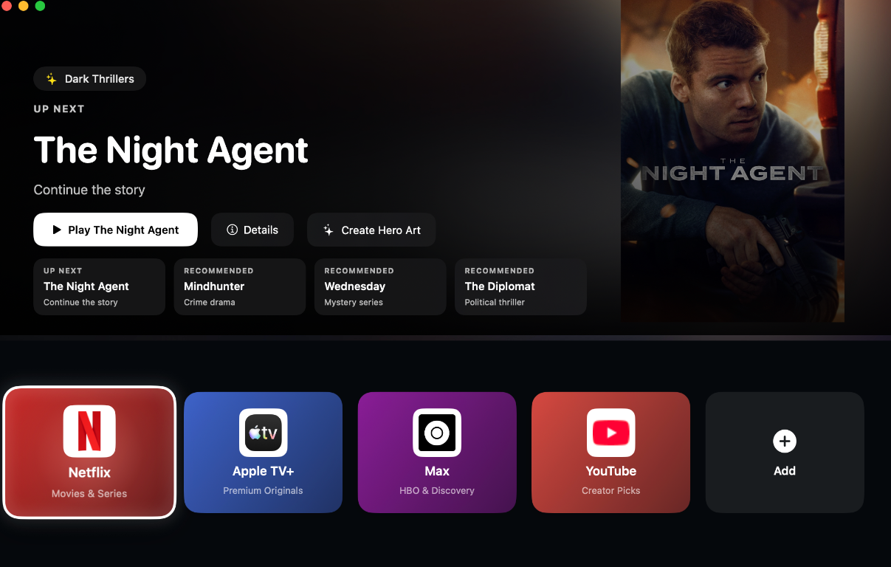
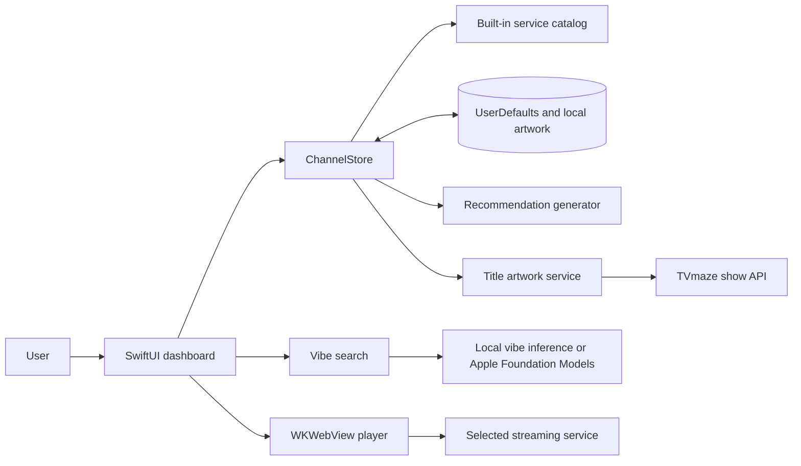

# MacOSMediaCenter

MacOSMediaCenter is a native SwiftUI app that brings a cinematic, lean-back streaming dashboard to macOS. Browse services, explore local recommendations, and open a selected service in an in-app web player.



## Features

- Cinematic hero banner and service dock with focus and parallax effects
- In-app web player with persistent website sessions
- Spotlight-style vibe search (`Command-K`)
- Add custom streaming services and generate local recommendations
- Create and save custom hero artwork with Image Playground on macOS 15.1+
- Use Apple Foundation Models for custom service vibe generation on macOS 26+; local inference is used when unavailable

## User journey

1. Launch the app to see the featured hero and available services.
2. Focus a service to preview its hero artwork and Up Next or recommended titles.
3. Select a service to open its website in the in-app player, or select a title to open its search page.
4. Use **Add** to save a custom service, or press `Command-K` to find a service by vibe.
5. Return to the dashboard with `Escape`; custom services and artwork remain available on this Mac.

Recommendations are starter picks, not personalized watch-history data. Streaming services do not provide a common recommendation feed to the app.

## Data flow



## Requirements

- macOS 13 or later
- Xcode 15 or later, or the Swift 5.10+ toolchain
- An internet connection for streaming websites, service logos, recommendations, and title artwork

Some optional capabilities have newer OS requirements: Image Playground requires macOS 15.1+, and Apple Foundation Models require macOS 26+. The app uses local inference when Foundation Models are unavailable.

## Install and run on macOS

### Run from Terminal

1. Install Xcode from the Mac App Store, then open it once to finish setup. Alternatively, install the Xcode Command Line Tools.
2. In Terminal, move to this project directory:

   ```sh
   cd path/to/30_day_30_ideas/tvOSDashboard
   ```

3. Build and launch the app:

   ```sh
   swift run MacOSMediaCenter
   ```

### Run from Xcode

1. Open `Package.swift` in Xcode.
2. Select the **MacOSMediaCenter** scheme.
3. Choose **My Mac** as the run destination and press `Command-R`.

The app needs outgoing network access to load streaming services and supporting online content. When using an Xcode app target with App Sandbox enabled, enable **Outgoing Connections (Client)** under **Signing & Capabilities**.

### Run tests

```sh
swift test
```

## Local data and privacy

Custom services and generated artwork are stored locally on this Mac. The app loads selected streaming services in an embedded web view; sign-in and playback behavior are subject to each provider's website and DRM support. No common cross-service watch history is collected.
