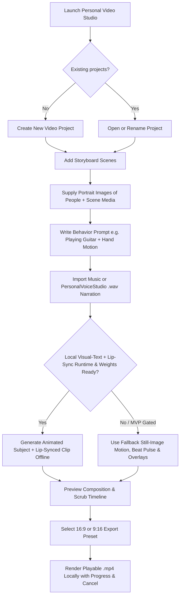
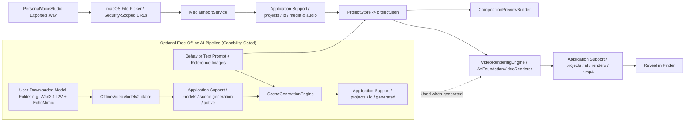

# Personal Video Studio

A native, **offline-first macOS SwiftUI video-composition studio** built as a clean sibling project to `PersonalVoiceStudio`.

`PersonalVideoStudio` helps you turn local portrait images of people, scripts/behavior descriptions, `.wav` narration (exported from `PersonalVoiceStudio` or recorded elsewhere), and background music into playable `.mp4` videos strictly on your Mac—with **no accounts, no cloud inference, no network-client entitlement, and no telemetry**.

---

## 1. Prerequisites & Build / Run / Test Instructions

- **Operating System**: macOS 14.0 (Sonoma) or later
- **Toolchain**: Xcode 15.3+ or Swift 5.10+ (`swift --version`)
- **Hardware**:
  - **Non-AI storyboard, motion, audio mix, and `.mp4` export**: Apple Silicon or Intel Mac
  - **Optional local Visual-Text Image-to-Video + Lip-Sync AI models**: Apple Silicon Mac with **16 GB–32+ GB unified memory**

### Build, Run, and Test in Xcode (Recommended)

1. Open `PersonalVideoStudio/PersonalVideoStudio.xcodeproj` in Xcode.
2. Wait for Xcode to resolve the local Swift package (`PersonalVideoStudioCore` and `PersonalVideoStudioUI`).
3. Select the **PersonalVideoStudio** scheme and **My Mac** destination, then press **Run (`Cmd + R`)** to launch the sandboxed `.app` bundle (or **Test (`Cmd + U`)** to run the unit tests).

### Build, Test, and Run via Swift Package Manager

From inside `PersonalVideoStudio/`:

```bash
swift build
swift test
swift run PersonalVideoStudioApp
```

---

## 2. Offline Guarantees & Privacy Architecture

- **Strict App Sandbox (`App/PersonalVideoStudio.entitlements`)**:
  - Enables `com.apple.security.app-sandbox` and `com.apple.security.files.user-selected.read-write`.
  - **No** `com.apple.security.network.client` or server network entitlement.
  - **No** microphone entitlement (`com.apple.security.device.audio-input` is omitted in the MVP).
- **Zero Cloud Calls or Telemetry**: No analytics SDKs, no remote model downloads, and no account sign-in.
- **Restrained Logging**: `os.Logger` logs only structural project IDs and error categories; scripts, behavior prompts, and media payloads are never logged.

---

## 3. Architecture & Data-Flow Diagrams

### User Interaction Flow



### Local Data Flow



---

## 4. Free / Open-Weight Offline Models for Visual-Text + Lip-Sync Generation

To generate a realistic scene from reference image(s) + a behavior text prompt (for example, *a woman strumming a guitar with hand movement in a warm studio while lip-syncing to music*) **100% free and offline on Apple Silicon**, two open-weight model stages fit the `SceneGenerationEngine` protocol:

| Stage | Purpose | Recommended Free / Open Models | License | Typical Mac RAM |
| :--- | :--- | :--- | :--- | :--- |
| **Stage 1: Visual-Text Image-to-Video** | Animates supplied people + objects per text prompt (e.g., guitar strumming, hand/body motion, camera/scene) | **Wan2.1-I2V / Wan2.2-I2V** (via Apple **MLX** `mlx-video` / `rapid-mlx`) or **LTX-Video** | **Apache 2.0** (Wan2.1/2.2) | 16–32+ GB unified memory |
| **Stage 2: Audio-Driven Portrait Lip-Sync** | Synchronizes mouth & facial expressions to supplied music or `.wav` narration | **EchoMimic / EchoMimicV3**, **Hallo2**, or **LatentSync-MLX** | **Apache 2.0** (EchoMimic) / **MIT** (Hallo2 core) | 16+ GB unified memory |

### Video Generation Requirements (Hardware, Disk, Model & Calibration)

`VideoGenerationRequirementsChecker` evaluates 6 preconditions inside **Local AI Models**:
1. **Apple Silicon (`arm64`)**: Required for Metal / MLX unified memory execution.
2. **Unified Memory**: Minimum **16 GB** (`ltx-echomimic`), recommended **24–32+ GB** (`wan2.1-echomimic`).
3. **Free Disk Space**: At least **20 GB+** recommended free space for downloaded weights, imported copy, and rendered `.mp4` exports.
4. **Offline Model Folder Validated**: `model_manifest.json` + `.safetensors`/`.gguf`/`.mlmodelc` weights verified without symlinks.
5. **Local MLX / CoreML Runtime Linked**: Capability-gated until a native diffusion + lip-sync runtime is linked.
6. **Scene Inputs & Calibration**: At least one portrait image, a non-empty `behaviorPrompt`, and an imported `.wav`/`.m4a`/`.mp3` audio track.

### Download and Import Offline Models (External Script)

Model weights are **never** downloaded inside the sandboxed app. Use the included external Python script (requires internet access only during this download step):

```bash
cd PersonalVideoStudio
bash Scripts/download_offline_models.sh wan2.1-echomimic
```

Or run the Python downloader directly with custom options:

```bash
python3 -m venv "$HOME/.venvs/pvs-video-models"
"$HOME/.venvs/pvs-video-models/bin/python" -m pip install --upgrade huggingface_hub
"$HOME/.venvs/pvs-video-models/bin/python" Scripts/download_offline_models.py --preset wan2.1-echomimic
```

The script downloads Stage 1 (`visual_text/`) and Stage 2 (`lipsync/`) into `~/Downloads/PersonalVideoStudio-OfflineModels/` and writes `model_manifest.json`.

Then inside **Personal Video Studio**:
1. Open **Local AI Models** and click **Import Local Model Folder…**.
2. Choose `~/Downloads/PersonalVideoStudio-OfflineModels`.
3. `OfflineVideoModelValidator` checks `model_manifest.json`, rejects symlinks, checks disk space headroom, and copies the bundle to `Application Support/PersonalVideoStudio/models/scene-generation/active/`.

### Portrait & Audio Calibration

Before generating or exporting:
- **Portrait Calibration (`PortraitAndAudioCalibrator`)**: Runs Apple `Vision` (`VNDetectFaceLandmarksRequest`) locally to verify pixel resolution (`>= 512 px` recommended), visible face area, and mouth landmark visibility.
- **Audio Calibration**: Decodes the imported `.wav`/`.m4a`/`.mp3` track via `AVAssetReader` to check RMS dB, peak dB (flagging silence or clipping), and extract a 10 Hz energy envelope for beat-synced motion and lip-sync timing.

---

## 5. Where Data Is Stored and How to Delete It

Inside the macOS App Sandbox container (or `~/Library/Application Support/PersonalVideoStudio/`):

- `projects/<project-id>/project.json` — Project metadata, scene timeline, behavior prompts, and audio references
- `projects/<project-id>/media/` — Copied portrait images and video clips
- `projects/<project-id>/audio/` — Copied narration (including `.wav` from `PersonalVoiceStudio`) and music tracks
- `projects/<project-id>/generated/` — Locally generated AI scene clips (when an active backend runs)
- `projects/<project-id>/renders/` — Locally rendered `.mp4` exports
- `models/scene-generation/active/` — Validated offline Visual-Text / Lip-Sync model folder

### Granular Deletion Controls
- Delete individual scenes, reference portraits, audio tracks, or rendered `.mp4` files inside the editor.
- Delete an entire project in **Projects** or **Privacy & Storage** (removes `project.json`, media, audio, generated clips, and renders).
- Remove imported model weights in **Local AI Models** or **Privacy & Storage**, or click **Reveal in Finder**.

---

## 6. Honest Capabilities & Current MVP Limitations

### What Works Out of the Box (No AI Model Required)
- Multi-project creation, opening, renaming, persistent storage, and granular deletion.
- Scene storyboard with multiple reference images, behavior text prompts saved per scene, custom durations, cut/cross-dissolve transitions, title/lyric overlays, and still-image motion (Ken Burns zoom/pan/pulse).
- Local `.wav` (including `PersonalVoiceStudio` exports), `.m4a`, `.mp3`, and `.aac` audio import, trimming, volume balance, and playback.
- Live preview scrubbing and non-blocking local `.mp4` export (`16:9` and `9:16` at 24/30/60 fps) with progress and cancellation.

### What Remains Capability-Gated / Unsupported in This MVP
- **Photorealistic Neural Visual-Text Video & Lip-Sync Execution**: While the `SceneGenerationEngine` protocol, `OfflineVideoModelValidator`, behavior prompt fields, multi-person reference storage, and hardware/memory readiness checks are implemented, **no MLX/CoreML diffusion or lip-sync runtime/weights are bundled in this MVP**. Invoking generation reports `VideoStudioError.aiGenerationUnavailable` cleanly and never fabricates fake video or calls cloud APIs.
