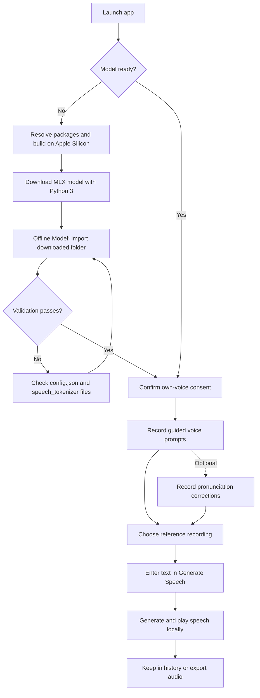
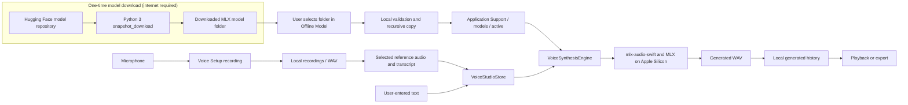

# Personal Voice Studio (macOS MVP)

An offline-first, native macOS Swift/SwiftUI application for recording a personal voice profile locally, capturing targeted pronunciation examples, and synthesizing spoken audio on-device on Apple Silicon without network access or cloud services.

---

## 1. What This MVP Does and Does Not Do

### What it does
- **Own-Voice Consent Gate**: Requires explicit confirmation that you are recording your own voice and explains local-only storage before recording begins.
- **Guided Voice Profile Setup**: Provides 18 original, varied prompts (short, medium, and long sentences; consonant clusters, sibilants, fricatives, nasals, diphthongs, numerals, currency, dates, questions, dialogue, and punctuation—no alphabet-only recitation or copyrighted song lyrics).
- **Capture Controls & Pause/Resume**: Supports Record, Stop, Replay, Redo, Delete Take, Pause & Save Progress, and Resume Setup across app launches.
- **Basic Capture Checks**: Measures clip duration, RMS level, and peak level to flag silent/empty recordings, unusually short takes, or clipping. *(These checks verify signal capture only and do not evaluate or guarantee voice cloning quality.)*
- **Targeted Pronunciation Corrections**: Lets you enter a word or phrase, add an optional spoken note, record a targeted local example, replay it, and delete it.
- **Text-to-Speech Workspace**: Provides a text editor, reference clip selector, capability-gated generation controls, local playback (play/pause/stop/scrub), local clip history, and export to `.wav` (PCM) or `.m4a` (AAC).
- **Offline Model Validator & Importer**: Validates and imports a user-supplied local model folder (`config.json`, tokenizer files, `.safetensors` weights) with disk-space verification and zero runtime network downloads.
- **Granular Deletion**: Supports deleting individual prompt takes, individual corrections, generated audio history, or the complete voice profile (and optionally imported model files).

### What it does not do
- **No cloud, telemetry, accounts, or analytics**: The macOS App Sandbox entitlements intentionally omit `com.apple.security.network.client`.
- **No video, camera, avatar, or singing**: Audio-only spoken speech.
- **No automatic retraining after corrections**: Corrections are stored locally as profile material for review and future local conditioning/fine-tuning workflows.
- **No user quality scoring or benchmarks**: No rating, MOS, or evaluation workflows.
- **No fake cloning or system TTS fallback**: If an open on-device voice-cloning model and Apple Silicon inference package are not ready, the app reports an explicit unavailable state and does not substitute `AVSpeechSynthesizer` or prerecorded clips.

---

## 2. First Install: Quick Start

### Prerequisites
- **macOS 14.0 (Sonoma) or newer**
- **Xcode 15.4 / 16.0 or newer** (for building the sandboxed `.app` bundle)
- **Apple Silicon Mac (`arm64`)** required for MLX speech synthesis (the UI, recording, playback, and SwiftPM tests also run on macOS)
- **Swift 5.10+**
- About **4 GB of free disk space** while downloading and importing the approximately 2 GB model (the app keeps its own copy).

### Build and launch
1. Open `PersonalVoiceStudio/PersonalVoiceStudio.xcodeproj` in Xcode.
2. Wait for Xcode to resolve the Swift packages, including `mlx-audio-swift`.
3. Select the **PersonalVoiceStudio** scheme and **My Mac** destination, then build and run with `Cmd + R`.

### Download and import the model
Model weights are not bundled with the app. Download the **MLX-converted** checkpoint—not the original Qwen checkpoint—using Python 3. This external download requires internet access:

```bash
python3 -m venv "$HOME/.venvs/hf-model-download"
"$HOME/.venvs/hf-model-download/bin/python" -m pip install --upgrade huggingface_hub
"$HOME/.venvs/hf-model-download/bin/python" - <<'PY'
from pathlib import Path
from huggingface_hub import snapshot_download

snapshot_download(
    repo_id="mlx-community/Qwen3-TTS-12Hz-0.6B-Base-8bit",
    local_dir=Path.home() / "Downloads" / "Qwen3-TTS-12Hz-0.6B-Base-8bit",
)
PY
```

After the download completes:
1. In the app, open **Offline Model** and click **Import Local Model Folder…**.
2. Choose `~/Downloads/Qwen3-TTS-12Hz-0.6B-Base-8bit` itself—the folder containing `config.json` and the `speech_tokenizer/` subfolder.
3. Wait for validation and import to finish. The model status should show **Ready for Offline Generation**. Importing copies the model into the app's local storage; generation then runs on-device without network access.
4. Open **Voice Setup**, confirm that you are recording your own voice, and complete the guided recordings. Then open **Generate Speech**, choose a reference recording, enter text, and generate.

If you imported the model with an earlier app build, remove that imported copy and import it again so the nested speech tokenizer files are included.

### Run unit and integration tests via SwiftPM
From inside `PersonalVoiceStudio/`:
```bash
swift test
```
Run on macOS with the Swift toolchain installed.

## 3. User Interaction, Data Flow, and Model

### User interaction



### Local data flow



The Python download is the only step in this flow that contacts Hugging Face. Imported weights, recordings, transcripts, and generated audio stay on the Mac; the app has no network-client entitlement.

### Open engine, model, and licenses
- **Inference SDK**: [`mlx-audio-swift`](https://github.com/Blaizzy/mlx-audio-swift) (`MLXAudioCore` + `MLXAudioTTS`) — **MIT License**, built on Apple **MLX** (**MIT License**). Its dependencies are declared in `Package.swift` and resolve through Xcode.
- **Model weights**: [`mlx-community/Qwen3-TTS-12Hz-0.6B-Base-8bit`](https://huggingface.co/mlx-community/Qwen3-TTS-12Hz-0.6B-Base-8bit), an MLX conversion of `Qwen/Qwen3-TTS-12Hz-0.6B-Base` — **Apache License 2.0** (Qwen Team, Alibaba Group). The original Qwen checkpoint is not the MLX folder expected by this app.
- **Architecture**: Speech generation is behind the `VoiceSynthesisEngine` protocol in `Sources/PersonalVoiceStudioCore/Inference/VoiceSynthesisEngine.swift`. The UI depends on `VoiceStudioStore` and `ModelCapabilities`; capabilities such as speaking rate or style presets are shown only when supported by the selected model.

---

## 4. Where Local Voice Data Is Stored and How to Delete It

Inside the macOS App Sandbox container (or `~/Library/Application Support/PersonalVoiceStudio/`):
- `profile.json` — Local profile metadata, consent timestamp, prompt index, and clip indexes
- `recordings/` — 24 kHz mono 16-bit PCM `.wav` prompt recordings
- `corrections/` — Targeted pronunciation example `.wav` files
- `generated/` — Locally generated `.wav` speech clips
- `models/active/` — Locally imported offline model weights

### How to delete local data
- **Single prompt take**: Click **Delete Take** on any prompt in **Voice Setup**.
- **Single correction**: Click the trash icon next to any saved correction in **Corrections**.
- **Generated audio history**: Click **Clear History** in **Generate Speech** or **Privacy & Data**.
- **Complete voice profile**: Open **Privacy & Data** and click **Delete Profile…** (with an optional toggle to also remove imported model weights).
- **Finder inspection**: Click **Reveal in Finder** in **Privacy & Data**.

---

## 5. Privacy Behavior & Known Limitations

- **Strict Offline Sandbox**: `App/PersonalVoiceStudio.entitlements` enables `com.apple.security.app-sandbox`, `com.apple.security.device.audio-input`, and `com.apple.security.files.user-selected.read-write`, with **no** network entitlements.
- **On-Demand Microphone Access**: Microphone access is only requested when the user presses Record.
- **Minimal Logging**: `os.Logger` avoids logging user scripts, prompt text, or audio payloads.
- **Known Limitations (MVP)**:
  - Model weights are not bundled due to size (~2 GB for the selected checkpoint) and must be downloaded and imported locally.
  - Until `mlx-audio-swift` is linked on Apple Silicon and local weights are imported, speech synthesis reports a clear unavailable state.
  - `Qwen3-TTS-12Hz-0.6B-Base` zero-shot synthesis produces an approximation of the speaker's voice from a reference clip and does not use targeted corrections for automatic weight retraining in this MVP.
  - Building and running `swift test` require macOS with the Swift toolchain; MLX synthesis requires Apple Silicon.
