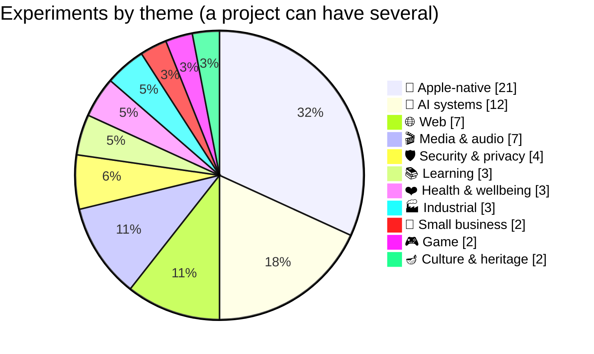

<!-- Generated by docs/lab/notebook.py — edit the data there, then run it from the repository root: python3 docs/lab/notebook.py -->
<p align="center"></p>

<p align="center">
<b>One idea a day. One build a day. Every result logged, measured and honestly judged.</b><br>
<sub>Challenge dates: October 26 – November 24, 2026 · 🧪 field notes by the challenge author</sub>
</p>

---

## 🧭 Pick your path through the lab

<details>
<summary><b>💼 I'm an investor or founder:</b> show me what could make money</summary>

Start with the top shelf: [Day 19 · FieldTwin](#day-19), [Day 5 · AmbientRAG](#day-5), [Day 16 · SnippetAI](#day-16), [Day 27 · Kavach](#day-27).<br>
Closest to launch (business ≥ 7 **and** MVP or better): [Day 27 · Kavach](#day-27), [Day 26 · Prod Preview](#day-26).
</details>

<details>
<summary><b>🔬 I'm a researcher or engineer:</b> show me the interesting technical ideas</summary>

Highest research value: [Day 27 · Kavach](#day-27), [Day 21 · Panji Search](#day-21), [Day 25 · Ensemble](#day-25), [Day 28 · Saathi](#day-28), [Day 29 · Drishya](#day-29), [Day 5 · AmbientRAG](#day-5).<br>
Themes: on-device AI with no cloud, citation-grounded generation, privacy-by-design sensing, and digital twins.
</details>

<details>
<summary><b>👀 I just want to see something cool</b></summary>

Try [Day 18 · KineScan](#day-18), [Day 25 · Ensemble](#day-25), [Day 28 · Saathi](#day-28), [Day 29 · Drishya](#day-29): a room-aware TV, a friend in your AirPods, papers turned into videos, and a factory machine you can walk around in Vision Pro.
</details>

<details>
<summary><b>🛠️ I want to build on one of these</b></summary>

Most complete codebases (tests, diagrams, screenshots): [Day 27 · Kavach](#day-27), [Day 26 · Prod Preview](#day-26), [Day 28 · Saathi](#day-28), [Day 29 · Drishya](#day-29), [Day 25 · Ensemble](#day-25), [Day 1 · Idea Calendar](#day-1).<br>
Each card below ends with a **Next experiment**: a good first contribution.
</details>

---

## 📏 How each experiment is measured

Every specimen is scored on three dials:

| Dial | Scale | What it asks |
| :--- | :---: | :--- |
| 🧪 **Maturity** | 1–5 | How finished is the build? Measured from the code: tests, docs, screenshots, real-world runs. |
| 🔬 **Research value** | 1–5 | How novel or instructive is the technique, regardless of money? |
| 💰 **Business value** | 1–10 | Is there a buyer, a reason to pay, and room in the market? |

<details>
<summary>🧪 What the maturity flasks mean</summary>

| Flask | Stage | Meaning |
| :---: | :--- | :--- |
| 💡 | **Spark** | idea or template only |
| ✏️ | **Sketch** | screens run on mock data; core feature partial |
| ⚗️ | **Prototype** | core feature works end to end; documented |
| 🧫 | **MVP** | tests + diagrams/screenshots; ready for real users to try |
| 🚀 | **Field-tested** | used for real outside the simulator |
</details>

---

## 🧫 Fig. 1 · The lab bench

<p align="center"></p>

> **How to read it:** right = more finished, up = more valuable, bigger bubble = more research value.
> Top-right is **ship it**; top-left needs **funding to finish the build**.
> Open the image on its own to hover over a bubble for its full name and scores.

## 🗂️ Fig. 2 · The specimen tray

<p align="center"></p>

## 🥧 What the lab worked on



---

## 🏆 The leaderboard

| Rank | Day | Specimen | 🧪 Maturity | 🔬 Research | 💰 Business |
| ---: | ---: | :--- | :--- | :---: | :--- |
| 1 | 19 | [FieldTwin](./FieldTwin/README.md) | ✏️ Sketch | ●●●●○ | ▰▰▰▰▰▰▰▰▰▰ 10/10 |
| 2 | 5 | [AmbientRAG Architect & Autonomous Interface](./AmbientRAGInterface/README.md) | ⚗️ Prototype | ●●●●○ | ▰▰▰▰▰▰▰▰▰▱ 9/10 |
| 3 | 16 | [SnippetAI](./SnippetAI/README.md) | ✏️ Sketch | ●●●○○ | ▰▰▰▰▰▰▰▰▰▱ 9/10 |
| 4 | 27 | [Kavach](./kavach/README.md) | 🚀 Field-tested | ●●●●○ | ▰▰▰▰▰▰▰▰▱▱ 8/10 |
| 5 | 20 | [ColdTwin](./ColdTwin/README.md) | ⚗️ Prototype | ●●●○○ | ▰▰▰▰▰▰▰▰▱▱ 8/10 |
| 6 | 2 | [PlantLens](./PlantLens/PlantLens/README.md) | ⚗️ Prototype | ●●○○○ | ▰▰▰▰▰▰▰▰▱▱ 8/10 |
| 7 | 3 | [German–Hindi Flashcards](./GermanHindiFlashcards/README.md) | ⚗️ Prototype | ●●○○○ | ▰▰▰▰▰▰▰▰▱▱ 8/10 |
| 8 | 7 | [CookLens](./CookLens/README.md) | ✏️ Sketch | ●●○○○ | ▰▰▰▰▰▰▰▰▱▱ 8/10 |
| 9 | 26 | [Prod Preview](./prod-preview/README.md) | 🧫 MVP | ●●●○○ | ▰▰▰▰▰▰▰▱▱▱ 7/10 |
| 10 | 12 | [SpatialRoomAI](./SpatialRoomAI/README.md) | ✏️ Sketch | ●●●○○ | ▰▰▰▰▰▰▰▱▱▱ 7/10 |
| 11 | 11 | [SovereignSocial](./SovereignSocial/README.md) | ✏️ Sketch | ●●○○○ | ▰▰▰▰▰▰▰▱▱▱ 7/10 |
| 12 | 28 | [Saathi](./Saathi/README.md) | 🧫 MVP | ●●●●○ | ▰▰▰▰▰▰▱▱▱▱ 6/10 |
| 13 | 29 | [Drishya](./drishya/README.md) | 🧫 MVP | ●●●●○ | ▰▰▰▰▰▰▱▱▱▱ 6/10 |
| 14 | 9 | [Daybreak](./Daybreak/README.md) | ⚗️ Prototype | ●●○○○ | ▰▰▰▰▰▰▱▱▱▱ 6/10 |
| 15 | 15 | [ErgoPods](./ErgoPods/README.md) | ✏️ Sketch | ●●●○○ | ▰▰▰▰▰▰▱▱▱▱ 6/10 |
| 16 | 17 | [Sanctuary](./Sanctuary/README.md) | ⚗️ Prototype | ●●●○○ | ▰▰▰▰▰▱▱▱▱▱ 5/10 |
| 17 | 10 | [AquaWatch](./AquaWatch/README.md) | ✏️ Sketch | ●●●○○ | ▰▰▰▰▰▱▱▱▱▱ 5/10 |
| 18 | 25 | [Ensemble](./Ensemble/README.md) | 🧫 MVP | ●●●●○ | ▰▰▰▰▱▱▱▱▱▱ 4/10 |
| 19 | 6 | [MacOSMediaCenter](./MacOSMediaCenter/README.md) | ⚗️ Prototype | ●○○○○ | ▰▰▰▰▱▱▱▱▱▱ 4/10 |
| 20 | 18 | [KineScanVisionOS](./KineScanVisionOS/README.md) | ✏️ Sketch | ●●●○○ | ▰▰▰▰▱▱▱▱▱▱ 4/10 |
| 21 | 24 | [RankLab Autopsy](./ranklab-autopsy/README.md) | ⚗️ Prototype | ●●●●○ | ▰▰▰▱▱▱▱▱▱▱ 3/10 |
| 22 | 4 | [ArtLens](./ArtLens/ArtLens/README.md) | ✏️ Sketch | ●●●○○ | ▰▰▰▱▱▱▱▱▱▱ 3/10 |
| 23 | 1 | [30 Days · 30 Apps](./Idea_calendar/README.md) | 🧫 MVP | ●○○○○ | ▰▰▱▱▱▱▱▱▱▱ 2/10 |
| 24 | 8 | [LuminaLightCamera](./LuminaLightCamera/README.md) | ✏️ Sketch | ●○○○○ | ▰▰▱▱▱▱▱▱▱▱ 2/10 |
| 25 | 21 | [Mithila Panji Search](./mithila-panji-search/README.md) | 🧫 MVP | ●●●●○ | ▰▱▱▱▱▱▱▱▱▱ 1/10 |
| 26 | 22 | [PersonalVoiceStudio](./PersonalVoiceStudio/README.md) | 🧫 MVP | ●●●○○ | ▰▱▱▱▱▱▱▱▱▱ 1/10 |
| 27 | 23 | [PersonalVideoStudio](./PersonalVideoStudio/README.md) | 🧫 MVP | ●●○○○ | ▰▱▱▱▱▱▱▱▱▱ 1/10 |
| 28 | 14 | [LightMeinKraft](./LightMeinKraft/README.md) | ⚗️ Prototype | ●●○○○ | ▰▱▱▱▱▱▱▱▱▱ 1/10 |
| 29 | 13 | [FastShopper '84](./FastShopperGame/README.md) | ⚗️ Prototype | ●○○○○ | ▰▱▱▱▱▱▱▱▱▱ 1/10 |
| — | 30 | _To be decided_ | 🫙 brewing… | — | — |

---

## 🔍 Specimen cards

> Click any card to open it: pitch, scores, the lab's verdict, and the next experiment to run.

### 🥇 Top shelf: strong business case (8–10)

<a id="day-19"></a>
<details>
<summary><b>Day 19 · FieldTwin</b> &nbsp; ▰▰▰▰▰▰▰▰▰▰ 10/10 &nbsp; ✏️ Sketch</summary>

> Inspect equipment in a room-scale digital twin, score telemetry on the device, and approve risk-tiered maintenance.

| 🧪 Maturity | 🔬 Research value | 💰 Business value |
| :--- | :--- | :--- |
| ✏️ **Sketch** (2/5)<br><sub>screens run on mock data; core feature partial</sub> | 🔬🔬🔬🔬▫️ 4/5 | ▰▰▰▰▰▰▰▰▰▰ 10/10 |

**Lab verdict:** Maintenance teams have budgets and real downtime costs; on-device scoring helps sell to sites with strict IT rules.<br>
**Next experiment:** Pilot with one facility and real sensor feeds.<br>
**Tags:** `🍎 Apple-native` `🏭 Industrial` `🧠 AI systems` &nbsp;·&nbsp; 📂 [FieldTwin](./FieldTwin/README.md)

</details>

<a id="day-5"></a>
<details>
<summary><b>Day 5 · AmbientRAG Architect & Autonomous Interface</b> &nbsp; ▰▰▰▰▰▰▰▰▰▱ 9/10 &nbsp; ⚗️ Prototype</summary>

> A blueprint and workbench for RAG systems where the UI never touches the vector database or model directly.

| 🧪 Maturity | 🔬 Research value | 💰 Business value |
| :--- | :--- | :--- |
| ⚗️ **Prototype** (3/5)<br><sub>core feature works end to end; documented</sub> | 🔬🔬🔬🔬▫️ 4/5 | ▰▰▰▰▰▰▰▰▰▱ 9/10 |

**Lab verdict:** Every company is building RAG; a clean, swappable reference architecture sells as consulting and templates.<br>
**Next experiment:** Package it as a starter kit with evals and one-click deploy.<br>
**Tags:** `🌐 Web` `🧠 AI systems` &nbsp;·&nbsp; 📂 [AmbientRAG Architect & Autonomous Interface](./AmbientRAGInterface/README.md)

</details>

<a id="day-16"></a>
<details>
<summary><b>Day 16 · SnippetAI</b> &nbsp; ▰▰▰▰▰▰▰▰▰▱ 9/10 &nbsp; ✏️ Sketch</summary>

> Import a video and let on-device vision plus Apple Intelligence pick the highlights, then edit and export a reel.

| 🧪 Maturity | 🔬 Research value | 💰 Business value |
| :--- | :--- | :--- |
| ✏️ **Sketch** (2/5)<br><sub>screens run on mock data; core feature partial</sub> | 🔬🔬🔬▫️▫️ 3/5 | ▰▰▰▰▰▰▰▰▰▱ 9/10 |

**Lab verdict:** Short-form video is a huge, paying market; creators want faster editing.<br>
**Next experiment:** Add audio cues (laughs, cheers) to the highlight picker and one-tap vertical export.<br>
**Tags:** `🍎 Apple-native` `🧠 AI systems` `🎬 Media & audio` &nbsp;·&nbsp; 📂 [SnippetAI](./SnippetAI/README.md)

</details>

<a id="day-27"></a>
<details>
<summary><b>Day 27 · Kavach</b> &nbsp; ▰▰▰▰▰▰▰▰▱▱ 8/10 &nbsp; 🚀 Field-tested</summary>

> A local guard inside AI coding sessions that stops secrets, PII, prompt injection and risky commands before they reach a cloud model.

| 🧪 Maturity | 🔬 Research value | 💰 Business value |
| :--- | :--- | :--- |
| 🚀 **Field-tested** (5/5)<br><sub>used for real outside the simulator</sub> | 🔬🔬🔬🔬▫️ 4/5 | ▰▰▰▰▰▰▰▰▱▱ 8/10 |

**Lab verdict:** AI-agent security is a fast-growing budget line; tuning out false alarms decides adoption.<br>
**Next experiment:** Cut false positives on everyday developer commands (seen in real use) and add team policies.<br>
**Tags:** `🛡️ Security & privacy` `🧠 AI systems` &nbsp;·&nbsp; 📂 [Kavach](./kavach/README.md)

</details>

<a id="day-20"></a>
<details>
<summary><b>Day 20 · ColdTwin</b> &nbsp; ▰▰▰▰▰▰▰▰▱▱ 8/10 &nbsp; ⚗️ Prototype</summary>

> Explains fridge and freezer temperature trends and suggests the next low-risk check.

| 🧪 Maturity | 🔬 Research value | 💰 Business value |
| :--- | :--- | :--- |
| ⚗️ **Prototype** (3/5)<br><sub>core feature works end to end; documented</sub> | 🔬🔬🔬▫️▫️ 3/5 | ▰▰▰▰▰▰▰▰▱▱ 8/10 |

**Lab verdict:** Spoiled stock is expensive for restaurants and pharmacies; a clear, honest advisor has buyers.<br>
**Next experiment:** Connect to a real temperature logger and add alert rules.<br>
**Tags:** `🍎 Apple-native` `🏭 Industrial` &nbsp;·&nbsp; 📂 [ColdTwin](./ColdTwin/README.md)

</details>

<a id="day-2"></a>
<details>
<summary><b>Day 2 · PlantLens</b> &nbsp; ▰▰▰▰▰▰▰▰▱▱ 8/10 &nbsp; ⚗️ Prototype</summary>

> Point your iPhone at a plant: get its name and a health check from Gemini 2.5 Flash.

| 🧪 Maturity | 🔬 Research value | 💰 Business value |
| :--- | :--- | :--- |
| ⚗️ **Prototype** (3/5)<br><sub>core feature works end to end; documented</sub> | 🔬🔬▫️▫️▫️ 2/5 | ▰▰▰▰▰▰▰▰▱▱ 8/10 |

**Lab verdict:** Proven demand (gardening apps earn well), but crowded; win on diagnosis quality and care reminders.<br>
**Next experiment:** Add a care calendar and a 'what's wrong with my leaf' follow-up chat.<br>
**Tags:** `🍎 Apple-native` `🧠 AI systems` &nbsp;·&nbsp; 📂 [PlantLens](./PlantLens/PlantLens/README.md)

</details>

<a id="day-3"></a>
<details>
<summary><b>Day 3 · German–Hindi Flashcards</b> &nbsp; ▰▰▰▰▰▰▰▰▱▱ 8/10 &nbsp; ⚗️ Prototype</summary>

> Goethe A1–C2 German vocabulary with Hindi translations, pronunciation and Anki-style spaced repetition.

| 🧪 Maturity | 🔬 Research value | 💰 Business value |
| :--- | :--- | :--- |
| ⚗️ **Prototype** (3/5)<br><sub>core feature works end to end; documented</sub> | 🔬🔬▫️▫️▫️ 2/5 | ▰▰▰▰▰▰▰▰▱▱ 8/10 |

**Lab verdict:** An underserved language pair with a fast-growing audience of Indians moving to Germany.<br>
**Next experiment:** Exam-mode mock tests per Goethe level and an offline mobile build.<br>
**Tags:** `🌐 Web` `📚 Learning` &nbsp;·&nbsp; 📂 [German–Hindi Flashcards](./GermanHindiFlashcards/README.md)

</details>

<a id="day-7"></a>
<details>
<summary><b>Day 7 · CookLens</b> &nbsp; ▰▰▰▰▰▰▰▰▱▱ 8/10 &nbsp; ✏️ Sketch</summary>

> Photograph your ingredients and get recipe ideas, using Apple's on-device image classifier.

| 🧪 Maturity | 🔬 Research value | 💰 Business value |
| :--- | :--- | :--- |
| ✏️ **Sketch** (2/5)<br><sub>screens run on mock data; core feature partial</sub> | 🔬🔬▫️▫️▫️ 2/5 | ▰▰▰▰▰▰▰▰▱▱ 8/10 |

**Lab verdict:** Big everyday market; needs better ingredient recognition than a general classifier gives.<br>
**Next experiment:** Swap rule-based recipes for on-device generation and add a pantry list.<br>
**Tags:** `🍎 Apple-native` `🧠 AI systems` &nbsp;·&nbsp; 📂 [CookLens](./CookLens/README.md)

</details>

### 🥈 Middle shelf: promising, with conditions (5–7)

<a id="day-26"></a>
<details>
<summary><b>Day 26 · Prod Preview</b> &nbsp; ▰▰▰▰▰▰▰▱▱▱ 7/10 &nbsp; 🧫 MVP</summary>

> Turns a cloud proof-of-concept into a plain-language scorecard, What-If simulator and sign-off for non-technical stakeholders.

| 🧪 Maturity | 🔬 Research value | 💰 Business value |
| :--- | :--- | :--- |
| 🧫 **MVP** (4/5)<br><sub>tests + diagrams/screenshots; ready for real users to try</sub> | 🔬🔬🔬▫️▫️ 3/5 | ▰▰▰▰▰▰▰▱▱▱ 7/10 |

**Lab verdict:** Clear B2B buyer (consultancies, platform teams); needs deep cloud access, which slows security reviews.<br>
**Next experiment:** Add AWS and Azure providers and a read-only connector that is easy to approve.<br>
**Tags:** `🌐 Web` `🧠 AI systems` `💼 Small business` &nbsp;·&nbsp; 📂 [Prod Preview](./prod-preview/README.md)

</details>

<a id="day-12"></a>
<details>
<summary><b>Day 12 · SpatialRoomAI</b> &nbsp; ▰▰▰▰▰▰▰▱▱▱ 7/10 &nbsp; ✏️ Sketch</summary>

> Capture a room, get a declutter checklist, compare a new layout and estimate the decor budget.

| 🧪 Maturity | 🔬 Research value | 💰 Business value |
| :--- | :--- | :--- |
| ✏️ **Sketch** (2/5)<br><sub>screens run on mock data; core feature partial</sub> | 🔬🔬🔬▫️▫️ 3/5 | ▰▰▰▰▰▰▰▱▱▱ 7/10 |

**Lab verdict:** Home-improvement buyers spend money; furniture retailers could pay for referrals.<br>
**Next experiment:** Use RoomPlan for real measurements instead of sample layouts.<br>
**Tags:** `🍎 Apple-native` `🧠 AI systems` &nbsp;·&nbsp; 📂 [SpatialRoomAI](./SpatialRoomAI/README.md)

</details>

<a id="day-11"></a>
<details>
<summary><b>Day 11 · SovereignSocial</b> &nbsp; ▰▰▰▰▰▰▰▱▱▱ 7/10 &nbsp; ✏️ Sketch</summary>

> On-device social-media strategy for small business owners, with a biometric lock and encrypted vault.

| 🧪 Maturity | 🔬 Research value | 💰 Business value |
| :--- | :--- | :--- |
| ✏️ **Sketch** (2/5)<br><sub>screens run on mock data; core feature partial</sub> | 🔬🔬▫️▫️▫️ 2/5 | ▰▰▰▰▰▰▰▱▱▱ 7/10 |

**Lab verdict:** Small businesses pay for marketing help; privacy is a fresh angle in that space.<br>
**Next experiment:** Finish Secure Enclave key storage and add post scheduling.<br>
**Tags:** `🍎 Apple-native` `💼 Small business` `🛡️ Security & privacy` &nbsp;·&nbsp; 📂 [SovereignSocial](./SovereignSocial/README.md)

</details>

<a id="day-28"></a>
<details>
<summary><b>Day 28 · Saathi</b> &nbsp; ▰▰▰▰▰▰▱▱▱▱ 6/10 &nbsp; 🧫 MVP</summary>

> A friend in your AirPods who tells you about the place you're walking through, then turns the walk into a podcast. Location never stored.

| 🧪 Maturity | 🔬 Research value | 💰 Business value |
| :--- | :--- | :--- |
| 🧫 **MVP** (4/5)<br><sub>tests + diagrams/screenshots; ready for real users to try</sub> | 🔬🔬🔬🔬▫️ 4/5 | ▰▰▰▰▰▰▱▱▱▱ 6/10 |

**Lab verdict:** Distinctive and privacy-first; tourism boards are natural partners, but consumer audio guides are hard to monetise.<br>
**Next experiment:** Run a real walk on iPhone + Apple Watch and tune the companion's timing.<br>
**Tags:** `🍎 Apple-native` `🎬 Media & audio` `🪔 Culture & heritage` `🛡️ Security & privacy` &nbsp;·&nbsp; 📂 [Saathi](./Saathi/README.md)

</details>

<a id="day-29"></a>
<details>
<summary><b>Day 29 · Drishya</b> &nbsp; ▰▰▰▰▰▰▱▱▱▱ 6/10 &nbsp; 🧫 MVP</summary>

> Turns a research paper into a narrated, cited video podcast with diagrams and charts, plus grounded Q&A, in English and 11 Indian languages.

| 🧪 Maturity | 🔬 Research value | 💰 Business value |
| :--- | :--- | :--- |
| 🧫 **MVP** (4/5)<br><sub>tests + diagrams/screenshots; ready for real users to try</sub> | 🔬🔬🔬🔬▫️ 4/5 | ▰▰▰▰▰▰▱▱▱▱ 6/10 |

**Lab verdict:** Strong demand and real differentiation in citations; video costs are high and big players are close.<br>
**Next experiment:** Measure cost per video and offer a university or publisher tier.<br>
**Tags:** `🌐 Web` `🧠 AI systems` `📚 Learning` &nbsp;·&nbsp; 📂 [Drishya](./drishya/README.md)

</details>

<a id="day-9"></a>
<details>
<summary><b>Day 9 · Daybreak</b> &nbsp; ▰▰▰▰▰▰▱▱▱▱ 6/10 &nbsp; ⚗️ Prototype</summary>

> A morning briefing and prioritised task list built from your reminders.

| 🧪 Maturity | 🔬 Research value | 💰 Business value |
| :--- | :--- | :--- |
| ⚗️ **Prototype** (3/5)<br><sub>core feature works end to end; documented</sub> | 🔬🔬▫️▫️▫️ 2/5 | ▰▰▰▰▰▰▱▱▱▱ 6/10 |

**Lab verdict:** People pay for good planners, but switching from their current one is hard.<br>
**Next experiment:** Ship the widget target (the source is already there).<br>
**Tags:** `🍎 Apple-native` &nbsp;·&nbsp; 📂 [Daybreak](./Daybreak/README.md)

</details>

<a id="day-15"></a>
<details>
<summary><b>Day 15 · ErgoPods</b> &nbsp; ▰▰▰▰▰▰▱▱▱▱ 6/10 &nbsp; ✏️ Sketch</summary>

> Posture tracking from AirPods head motion, with Apple Health metrics and physio guidance.

| 🧪 Maturity | 🔬 Research value | 💰 Business value |
| :--- | :--- | :--- |
| ✏️ **Sketch** (2/5)<br><sub>screens run on mock data; core feature partial</sub> | 🔬🔬🔬▫️▫️ 3/5 | ▰▰▰▰▰▰▱▱▱▱ 6/10 |

**Lab verdict:** Real pain point for desk workers; would need clinical credibility to charge well.<br>
**Next experiment:** Validate the slouch signal against a physiotherapist's assessment.<br>
**Tags:** `🍎 Apple-native` `❤️ Health & wellbeing` &nbsp;·&nbsp; 📂 [ErgoPods](./ErgoPods/README.md)

</details>

<a id="day-17"></a>
<details>
<summary><b>Day 17 · Sanctuary</b> &nbsp; ▰▰▰▰▰▱▱▱▱▱ 5/10 &nbsp; ⚗️ Prototype</summary>

> A calm evening check-in that listens and mirrors your feelings instead of giving advice.

| 🧪 Maturity | 🔬 Research value | 💰 Business value |
| :--- | :--- | :--- |
| ⚗️ **Prototype** (3/5)<br><sub>core feature works end to end; documented</sub> | 🔬🔬🔬▫️▫️ 3/5 | ▰▰▰▰▰▱▱▱▱▱ 5/10 |

**Lab verdict:** Wellbeing apps sell, but mental-health products carry heavy trust and safety duties.<br>
**Next experiment:** Add clear crisis-help routing and a weekly mood reflection.<br>
**Tags:** `🍎 Apple-native` `❤️ Health & wellbeing` &nbsp;·&nbsp; 📂 [Sanctuary](./Sanctuary/README.md)

</details>

<a id="day-10"></a>
<details>
<summary><b>Day 10 · AquaWatch</b> &nbsp; ▰▰▰▰▰▱▱▱▱▱ 5/10 &nbsp; ✏️ Sketch</summary>

> Apple Watch notices a drinking gesture, asks you to confirm, and logs the water to Apple Health.

| 🧪 Maturity | 🔬 Research value | 💰 Business value |
| :--- | :--- | :--- |
| ✏️ **Sketch** (2/5)<br><sub>screens run on mock data; core feature partial</sub> | 🔬🔬🔬▫️▫️ 3/5 | ▰▰▰▰▰▱▱▱▱▱ 5/10 |

**Lab verdict:** Clever, low-friction tracking; a niche inside an already-crowded hydration market.<br>
**Next experiment:** Measure gesture-detection accuracy on real wrists before adding features.<br>
**Tags:** `🍎 Apple-native` `❤️ Health & wellbeing` &nbsp;·&nbsp; 📂 [AquaWatch](./AquaWatch/README.md)

</details>

### 📦 Bottom drawer: great for learning and portfolios (1–4)

<a id="day-25"></a>
<details>
<summary><b>Day 25 · Ensemble</b> &nbsp; ▰▰▰▰▱▱▱▱▱▱ 4/10 &nbsp; 🧫 MVP</summary>

> Apple TV picks what the whole room will enjoy from everyone's phones, and recaps what you missed.

| 🧪 Maturity | 🔬 Research value | 💰 Business value |
| :--- | :--- | :--- |
| 🧫 **MVP** (4/5)<br><sub>tests + diagrams/screenshots; ready for real users to try</sub> | 🔬🔬🔬🔬▫️ 4/5 | ▰▰▰▰▱▱▱▱▱▱ 4/10 |

**Lab verdict:** A showstopper demo that works best as a platform feature; streaming apps own the data.<br>
**Next experiment:** Use it as a portfolio piece or pitch it to a streaming service.<br>
**Tags:** `🍎 Apple-native` `🧠 AI systems` `🎬 Media & audio` &nbsp;·&nbsp; 📂 [Ensemble](./Ensemble/README.md)

</details>

<a id="day-6"></a>
<details>
<summary><b>Day 6 · MacOSMediaCenter</b> &nbsp; ▰▰▰▰▱▱▱▱▱▱ 4/10 &nbsp; ⚗️ Prototype</summary>

> A cinematic, lean-back streaming dashboard for the Mac with vibe search and an in-app web player.

| 🧪 Maturity | 🔬 Research value | 💰 Business value |
| :--- | :--- | :--- |
| ⚗️ **Prototype** (3/5)<br><sub>core feature works end to end; documented</sub> | 🔬▫️▫️▫️▫️ 1/5 | ▰▰▰▰▱▱▱▱▱▱ 4/10 |

**Lab verdict:** Pleasant, but it wraps other companies' services, which limits what it can charge for.<br>
**Next experiment:** Cross-service 'continue watching' and remote control from the iPhone.<br>
**Tags:** `🍎 Apple-native` `🎬 Media & audio` &nbsp;·&nbsp; 📂 [MacOSMediaCenter](./MacOSMediaCenter/README.md)

</details>

<a id="day-18"></a>
<details>
<summary><b>Day 18 · KineScanVisionOS</b> &nbsp; ▰▰▰▰▱▱▱▱▱▱ 4/10 &nbsp; ✏️ Sketch</summary>

> A machining-centre digital twin you can walk around in Apple Vision Pro.

| 🧪 Maturity | 🔬 Research value | 💰 Business value |
| :--- | :--- | :--- |
| ✏️ **Sketch** (2/5)<br><sub>screens run on mock data; core feature partial</sub> | 🔬🔬🔬▫️▫️ 3/5 | ▰▰▰▰▱▱▱▱▱▱ 4/10 |

**Lab verdict:** Great demo for trade fairs; the headset's install base is still small.<br>
**Next experiment:** Feed it live machine telemetry instead of scripted data.<br>
**Tags:** `🍎 Apple-native` `🏭 Industrial` &nbsp;·&nbsp; 📂 [KineScanVisionOS](./KineScanVisionOS/README.md)

</details>

<a id="day-24"></a>
<details>
<summary><b>Day 24 · RankLab Autopsy</b> &nbsp; ▰▰▰▱▱▱▱▱▱▱ 3/10 &nbsp; ⚗️ Prototype</summary>

> A workbench for recommender systems: recall-vs-latency trade-offs, position-bias fixes and simulated A/B tests.

| 🧪 Maturity | 🔬 Research value | 💰 Business value |
| :--- | :--- | :--- |
| ⚗️ **Prototype** (3/5)<br><sub>core feature works end to end; documented</sub> | 🔬🔬🔬🔬▫️ 4/5 | ▰▰▰▱▱▱▱▱▱▱ 3/10 |

**Lab verdict:** Great teaching tool; data scientists are used to free courses.<br>
**Next experiment:** Add unit tests for the maths (NDCG, CUPED, χ²), then package it as a paid workshop or interview-prep module.<br>
**Tags:** `🌐 Web` `📚 Learning` `🧠 AI systems` &nbsp;·&nbsp; 📂 [RankLab Autopsy](./ranklab-autopsy/README.md)

</details>

<a id="day-4"></a>
<details>
<summary><b>Day 4 · ArtLens</b> &nbsp; ▰▰▰▱▱▱▱▱▱▱ 3/10 &nbsp; ✏️ Sketch</summary>

> Photograph a sketch or canvas and get stage-aware feedback from Apple's on-device model.

| 🧪 Maturity | 🔬 Research value | 💰 Business value |
| :--- | :--- | :--- |
| ✏️ **Sketch** (2/5)<br><sub>screens run on mock data; core feature partial</sub> | 🔬🔬🔬▫️▫️ 3/5 | ▰▰▰▱▱▱▱▱▱▱ 3/10 |

**Lab verdict:** Lovely for hobbyists, but artists rarely pay for critique apps.<br>
**Next experiment:** Track one artwork across sessions and show progress over time.<br>
**Tags:** `🍎 Apple-native` `🧠 AI systems` &nbsp;·&nbsp; 📂 [ArtLens](./ArtLens/ArtLens/README.md)

</details>

<a id="day-1"></a>
<details>
<summary><b>Day 1 · 30 Days · 30 Apps</b> &nbsp; ▰▰▱▱▱▱▱▱▱▱ 2/10 &nbsp; 🧫 MVP</summary>

> A public, read-only gallery for this very challenge: a calendar of ideas, live snapshots and usage notes, in English and German.

| 🧪 Maturity | 🔬 Research value | 💰 Business value |
| :--- | :--- | :--- |
| 🧫 **MVP** (4/5)<br><sub>tests + diagrams/screenshots; ready for real users to try</sub> | 🔬▫️▫️▫️▫️ 1/5 | ▰▰▱▱▱▱▱▱▱▱ 2/10 |

**Lab verdict:** Useful plumbing for the challenge itself; little market outside it.<br>
**Next experiment:** Auto-import each project's README and screenshots so the gallery updates itself.<br>
**Tags:** `🌐 Web` &nbsp;·&nbsp; 📂 [30 Days · 30 Apps](./Idea_calendar/README.md)

</details>

<a id="day-8"></a>
<details>
<summary><b>Day 8 · LuminaLightCamera</b> &nbsp; ▰▰▱▱▱▱▱▱▱▱ 2/10 &nbsp; ✏️ Sketch</summary>

> A camera viewfinder that shows an estimated room-light reading and a one-tap exposure boost.

| 🧪 Maturity | 🔬 Research value | 💰 Business value |
| :--- | :--- | :--- |
| ✏️ **Sketch** (2/5)<br><sub>screens run on mock data; core feature partial</sub> | 🔬▫️▫️▫️▫️ 1/5 | ▰▰▱▱▱▱▱▱▱▱ 2/10 |

**Lab verdict:** A neat feature, but the built-in Camera app already covers most of it.<br>
**Next experiment:** Suggest where to move the lamp, not just how bright the room is.<br>
**Tags:** `🍎 Apple-native` `🎬 Media & audio` &nbsp;·&nbsp; 📂 [LuminaLightCamera](./LuminaLightCamera/README.md)

</details>

<a id="day-21"></a>
<details>
<summary><b>Day 21 · Mithila Panji Search</b> &nbsp; ▰▱▱▱▱▱▱▱▱▱ 1/10 &nbsp; 🧫 MVP</summary>

> Search digitised Mithila genealogy records (Panji) across Roman and Devanagari spellings, with cited family links.

| 🧪 Maturity | 🔬 Research value | 💰 Business value |
| :--- | :--- | :--- |
| 🧫 **MVP** (4/5)<br><sub>tests + diagrams/screenshots; ready for real users to try</sub> | 🔬🔬🔬🔬▫️ 4/5 | ▰▱▱▱▱▱▱▱▱▱ 1/10 |

**Lab verdict:** High cultural and research value; a community project, not a business.<br>
**Next experiment:** Invite community corrections with source checks.<br>
**Tags:** `🌐 Web` `🪔 Culture & heritage` &nbsp;·&nbsp; 📂 [Mithila Panji Search](./mithila-panji-search/README.md)

</details>

<a id="day-22"></a>
<details>
<summary><b>Day 22 · PersonalVoiceStudio</b> &nbsp; ▰▱▱▱▱▱▱▱▱▱ 1/10 &nbsp; 🧫 MVP</summary>

> Record your own voice profile and synthesise speech entirely offline on a Mac, behind a consent gate.

| 🧪 Maturity | 🔬 Research value | 💰 Business value |
| :--- | :--- | :--- |
| 🧫 **MVP** (4/5)<br><sub>tests + diagrams/screenshots; ready for real users to try</sub> | 🔬🔬🔬▫️▫️ 3/5 | ▰▱▱▱▱▱▱▱▱▱ 1/10 |

**Lab verdict:** Thoughtfully built, but the operating system now offers a similar feature for free.<br>
**Next experiment:** Pair it with Video Studio as one offline creator kit.<br>
**Tags:** `🍎 Apple-native` `🎬 Media & audio` `🛡️ Security & privacy` &nbsp;·&nbsp; 📂 [PersonalVoiceStudio](./PersonalVoiceStudio/README.md)

</details>

<a id="day-23"></a>
<details>
<summary><b>Day 23 · PersonalVideoStudio</b> &nbsp; ▰▱▱▱▱▱▱▱▱▱ 1/10 &nbsp; 🧫 MVP</summary>

> Turn portraits, a script, your narration and music into an .mp4, all offline on the Mac.

| 🧪 Maturity | 🔬 Research value | 💰 Business value |
| :--- | :--- | :--- |
| 🧫 **MVP** (4/5)<br><sub>tests + diagrams/screenshots; ready for real users to try</sub> | 🔬🔬▫️▫️▫️ 2/5 | ▰▱▱▱▱▱▱▱▱▱ 1/10 |

**Lab verdict:** Solid craft; competes with mature free editors.<br>
**Next experiment:** Pair it with Voice Studio as one offline creator kit.<br>
**Tags:** `🍎 Apple-native` `🎬 Media & audio` &nbsp;·&nbsp; 📂 [PersonalVideoStudio](./PersonalVideoStudio/README.md)

</details>

<a id="day-14"></a>
<details>
<summary><b>Day 14 · LightMeinKraft</b> &nbsp; ▰▱▱▱▱▱▱▱▱▱ 1/10 &nbsp; ⚗️ Prototype</summary>

> A native macOS voxel holiday adventure with its own lighting, physics and 8-bit audio.

| 🧪 Maturity | 🔬 Research value | 💰 Business value |
| :--- | :--- | :--- |
| ⚗️ **Prototype** (3/5)<br><sub>core feature works end to end; documented</sub> | 🔬🔬▫️▫️▫️ 2/5 | ▰▱▱▱▱▱▱▱▱▱ 1/10 |

**Lab verdict:** An impressive engine exercise; its mechanics borrow heavily from an existing game.<br>
**Next experiment:** Give it original mechanics and art before showing it publicly.<br>
**Tags:** `🍎 Apple-native` `🎮 Game` &nbsp;·&nbsp; 📂 [LightMeinKraft](./LightMeinKraft/README.md)

</details>

<a id="day-13"></a>
<details>
<summary><b>Day 13 · FastShopper '84</b> &nbsp; ▰▱▱▱▱▱▱▱▱▱ 1/10 &nbsp; ⚗️ Prototype</summary>

> A 2D arcade shopping-cart dash through 1984 Christmas Eve department stores, with an AI concierge.

| 🧪 Maturity | 🔬 Research value | 💰 Business value |
| :--- | :--- | :--- |
| ⚗️ **Prototype** (3/5)<br><sub>core feature works end to end; documented</sub> | 🔬▫️▫️▫️▫️ 1/5 | ▰▱▱▱▱▱▱▱▱▱ 1/10 |

**Lab verdict:** Fun seasonal game; one-off games rarely earn back their time.<br>
**Next experiment:** Keep it as a portfolio piece.<br>
**Tags:** `🍎 Apple-native` `🎮 Game` &nbsp;·&nbsp; 📂 [FastShopper '84](./FastShopperGame/README.md)

</details>

### 🫙 Still brewing

<details>
<summary><b>Day 30 · To be decided</b> &nbsp; 🫙 brewing…</summary>

> Tomorrow's experiment. The bench is cleared.
</details>

---

## 📝 Lab notes

- **Scores are judgement calls**, made on 29 projects in late November 2026 from each project's code and README. Business value weighs the buyer, willingness to pay, competition and distribution; it says nothing about how fun or well made a project is.
- **Maturity is measured from the code**: tests, documentation, screenshots or frames, and whether it has run outside a simulator. Only Kavach has been used for real so far.
- Every project lives in its own folder here; none has a published standalone repository yet.

<details>
<summary>🛠️ How this page is made</summary>

All scores, pitches and verdicts live in [`docs/lab/notebook.py`](docs/lab/notebook.py). Edit the `SPECIMENS` list and run it **from the repository root** (the folder that holds this README):

```bash
cd 30_day_30_ideas && python3 docs/lab/notebook.py
```

It regenerates this README and the hand-drawn figures in `docs/lab/` (plain SVG, no dependencies).
</details>

<p align="center"><sub>🧪 Made in a messy lab, one day at a time.</sub></p>
