# Saathi — Privacy-First Audio Companion for Solo Travelers

Saathi is an iOS audio guide that narrates nearby history in your ear during a time-boxed walk, weaving together public historical facts and your own opted-in memories. It runs its language intelligence, speech recognition, and ranking completely on-device, snapping outbound place lookups to a coarse ~250 m grid so your exact location never leaves your phone. Every action works seamlessly by voice (and AirPods head gestures) or by touch with live captions and citations.

---

## Privacy Guarantee: What Saathi Does vs. Never Does

| What Saathi Does | What Saathi Never Does |
| :--- | :--- |
| Requests When-In-Use location (works with **Allow Once**) + temporary full accuracy only during an active session | Never requests Always location or runs location updates outside an active session |
| Keeps exact coordinates in RAM only; deletes them the moment your walk ends | Never writes coordinates to disk, UserDefaults, logs, crash reports, iCloud, or memory episodes |
| Reads your Outdoor Walk workout totals (distance, time, steps, climb) from Apple Watch or iPhone via HealthKit, read-only | Never reads the workout route (GPS trace) and never writes health data |
| Snaps outbound Wikipedia/Wikidata queries to ~250 m grid tile centres, with a memory-only tile cache that is wiped when the session ends | Never sends exact GPS coordinates, device IDs, or personal data over the network, and never keeps a history of visited tiles on disk |
| Processes Photos, Calendar, and user-picked Journaling Suggestions strictly on-device | Never uploads personal memories or reads third-party Wallet passes |
| Shows an end-of-session **Privacy Receipt** and a one-tap link to Settings to turn off location access | Never runs a backend server, user accounts, or analytics/telemetry |

---

## Installation (macOS + Xcode 26)

> **Verified build**: the app compiles with no errors or warnings, and the SwiftPM core tests pass on macOS (Xcode 27.1, iOS Simulator SDK). Features that need hardware (AirPods spatial audio, on-device speech, Translation packs, Apple Intelligence) still have to be checked on a real iPhone.

### Requirements
- **Mac**: macOS with **Xcode 26 or later**. XcodeGen (`brew install xcodegen`) is only needed if you change `project.yml`; the generated `Saathi.xcodeproj` is checked in.
- **Target Device**: iPhone supporting **Apple Intelligence** running **iOS 26.0+** (AirPods Pro / Max / 4 recommended for spatial audio and head gestures, not required)
- **Developer Account**: Apple Developer account for signing, iCloud, and Journaling Suggestions entitlements

### Signing & Capabilities
What's configured in the repo (`Saathi/Config/Info.plist`, `Saathi/Config/Saathi.entitlements`, `Saathi/SaathiDebug.entitlements`):
1. **Background Modes**: `audio` and `location` (Info.plist)
2. **HealthKit (read-only)**: `com.apple.developer.healthkit` in both entitlements files. Automatic signing registers the capability on the App ID the first time you build to a device.
3. **App Intents / Siri**: embedded `StartSaathiIntent` ("Start Saathi here"), no extra entitlement needed

**Not yet configured, so add them in Xcode → Signing & Capabilities before using those features:**
- **iCloud** (CloudKit) for "Save to iCloud": add the capability with a container, then put that container ID in Info.plist under `SaathiICloudContainer`. Without the key the button shows "iCloud isn't set up" instead of touching CloudKit, because using an unentitled container crashes the app. "Keep on device" always works.
- **Journaling Suggestions** (`com.apple.developer.journal.allow`) for the Journaling picker.

### Required `Info.plist` Usage Strings
| Key | Exact User-Facing Text |
| :--- | :--- |
| `NSLocationWhenInUseUsageDescription` | `Saathi uses your location only during an active walk session to narrate nearby historic places. Exact coordinates stay in memory and are never saved.` |
| `NSLocationTemporaryUsageDescriptionDictionary` → `SaathiLiveTourAccuracy` | `Saathi needs temporary precise location to tell which monument you are facing and position audio accurately.` |
| `NSMicrophoneUsageDescription` | `Saathi listens for your voice questions and commands while a walk session is active. Audio is processed on-device.` |
| `NSSpeechRecognitionUsageDescription` | `Saathi transcribes your spoken questions on-device so you can ask about nearby places hands-free.` |
| `NSPhotoLibraryUsageDescription` | `If you opt in, Saathi matches your past photos taken near your current stop so your narration can mention your own memories.` |
| `NSCalendarsUsageDescription` / `NSCalendarsFullAccessUsageDescription` | `If you opt in, Saathi checks today's calendar events on-device to tailor your walk and memory episode.` (iOS 17+ requires the full-access key for `requestFullAccessToEvents`.) |
| `NSHealthShareUsageDescription` | `Saathi reads your Outdoor Walk workout from Apple Watch or iPhone to know when your walk ends and to add its distance, time and steps to your memory episode. Saathi reads totals only, never your route, and never writes health data.` |
| `NSMotionUsageDescription` | `Saathi counts your steps and notices when you stop walking or get into a vehicle, so it can wrap up your walk on its own. With AirPods, it also uses headphone motion to point landmark audio in the right direction and detect nods or shakes.` |

### Running on Device vs. Simulator with GPX
1. Open `Saathi/Saathi.xcodeproj` directly in **Xcode 26** (or optionally regenerate it with `cd Saathi && make generate` if you modify `project.yml`).
2. Select your signing team under **Saathi → Signing & Capabilities**, and choose either:
   - **Real iPhone (iOS 26 + Apple Intelligence)**: Full on-device `FoundationModels`, `SpeechAnalyzer`, Apple `Translation` packs, `CMHeadphoneMotionManager` spatial audio, and `JournalingSuggestionsPicker`.
   - **iOS Simulator (Mock Mode + GPX)**: Select a GPX route from `Saathi/Simulation/` (`Hampi_Vittala.gpx`, `OldDelhi_RedFort_ChandniChowk.gpx`, or `Rome_Forum_Colosseum.gpx`) in Xcode's **Debug → Simulate Location** menu, or pass `-MockMode` launch argument to run offline using recorded fixtures.

---

## How to Use

1. **First-Run Permissions**: Choose your preferred **Narration Language** and **Listening Language** (defaulting to device locale), then toggle individual opt-ins for **Photos**, **Calendar**, and **Journaling Suggestions**. Location is requested only when you start a walk ("Allow Once" works fully).
2. **Start a Walk**: Say *"Hey Siri, Start Saathi here"* or tap **Start Walk**. There is **no duration to pick**. The top bar shows how long you've been walking, plus live distance and steps.
   - **Real-time companion**: Saathi narrates landmarks as you reach them (within ~300 m). In the quiet stretches between landmarks it keeps you company with notable places *around you*, a few kilometres away, e.g. "about 700 metres to your north: the Tungabhadra River…". After about 4 minutes of silence it picks the most relevant untold place (configurable).
   - **The walk ends on its own**, whichever comes first:
     1. **Your Apple Watch or iPhone Outdoor Walk / Hike workout ends.** Saathi sees the saved workout in HealthKit and wraps up immediately.
     2. **You stop walking**: stationary for 10 minutes, or in a vehicle for 2 minutes. Saathi asks *"Shall I wrap up your walk?"* (nod/Yes to end, shake/No to keep going) and ends after 5 more minutes without an answer, unless you start walking again.
     3. **A 6-hour safety cap**, so location never runs indefinitely.
     4. Or tap **End** / say *"end session"* at any time.
   - **Then the podcast**: the Memory Episode is created as before, now opening with your walk's totals, e.g. *"You walked 4.2 kilometres in 1 hour 35 minutes, about 6,120 steps, climbing 38 metres. Your Apple Watch recorded the walk."* The totals come from the watch/iPhone workout, or from the iPhone pedometer if you didn't record a workout.
3. **Voice Commands** (English is always accepted as a fallback alongside your chosen listening language):

| Intent | English | Hindi / Hinglish Examples |
| :--- | :--- | :--- |
| More detail | `"Tell me more"` | `"Aur batao"`, `"Iske baare mein aur"` |
| Skip stop | `"Skip"` | `"Aage badho"`, `"Skip karo"` |
| Quiet mode | `"Quiet for 20 minutes"` | `"Chup"`, `"20 minute baad mein"` |
| Personal photos | `"What did I photograph here?"` | `"Yahan kya photo li"`, `"Meri photos dikhao"` |
| Direction | `"Where is it?"` | `"Yeh kahan hai"`, `"Kidhar hai"` |
| End walk | `"End session"` | `"Band karo"`, `"Session khatam"` |

4. **Head Gestures (AirPods)**: When Saathi asks *"Want the full story?"*, **nod** for yes or **shake your head** for no.
5. **Touch Mode (Silent Places & Accessibility)**: Switch to Touch Mode for live captioned cards, source citations (Wikipedia CC BY-SA & OSM ODbL), mirrored command buttons, VoiceOver & Dynamic Type support, and a nearby-places map that **never draws or stores a path trail**.
6. **Ending & Memory Episode**: When your session ends, Saathi stops location updates immediately, shows your **Privacy Receipt**, offers a shortcut to Settings to turn off location access, and creates a 3–5 minute **Memory Episode** (places by name & time, personal moments, linked PhotoKit references, and one closing reflection—with zero coordinates). Choose **Keep on Device**, **Save to iCloud**, or **Discard**.

---

## Verify the Privacy Claims Yourself

1. **Run the Automated Privacy & Unit Tests**:
   ```bash
   cd Saathi
   make core-test      # fast: engine + privacy tests on macOS via SwiftPM, no simulator
   make test           # same tests inside the iOS Simulator (first available iPhone)
   make privacy-test   # privacy suite only
   ```
   - **Container scan** fills `Documents`, `Library`, `Caches`, `tmp` and `UserDefaults` with a simulated walk's episode and cache entries, then fails if any latitude/longitude pattern appears, including coordinates saved under renamed keys such as `"coarseLat"`.
   - **Network interceptor** records every outbound request (one Wikipedia + one Wikidata call per tile) and checks that hosts are on the allowlist (`*.wikipedia.org`, `www.wikidata.org`), coordinates are at tile precision, and headers carry only the generic `Saathi/1.0` User-Agent.
   - **Location stop** check: the update loop exits within 2 seconds of cancellation. This is a model of the loop; also confirm on device with the location indicator (step 4).
2. **Read the Privacy Receipt**: it lists every anonymous tile ID queried (`tile_lat_lon_250m`). Its "coordinates stored" count comes from a live scan of the app container at session end, not a hard-coded 0.
3. **Inspect the App Container**: In Xcode → *Window → Devices and Simulators* → download the `Saathi` container. You should find no tile cache at all (it is memory-only), and saved episodes contain place names and times only.
4. **Watch the iOS Location Indicator**: The blue location pill/arrow disappears immediately when the walk ends (workout ended, wrap-up confirmed, safety cap, or **End**), and you can tap **Turn Off Location Access** on the Privacy Receipt to jump straight to iOS Settings.

---

## Maintenance

- **Tile Cache**: memory-only and per session, so there is nothing to clear. It resets when a session starts and again when it ends.
- **Data Sources & Attribution**: Wikipedia (geosearch, intro extract, coordinates) and Wikidata (sitelink counts for notability) are queried in `PublicSourceClient.swift`. If the chosen language's Wikipedia has no geotagged articles for a tile, Saathi falls back to English Wikipedia. Keep the licence strings in `SourceProvider.licenceNotice` intact.
- **Tuning Ranker, Companion & Walk End**: edit `Saathi/Config/SaathiConfig.json`. The app loads it at launch and falls back to built-in defaults if the file is missing or invalid.
  - `rankerWeights`, `interruptionBudgetSeconds`, `dwellThresholdSeconds`, `maxCandidateRadiusMeters`, `tileSizeMeters`: landmark narration.
  - `companionIdleSeconds` (default 240) and `areaRadiusMeters` (default 5000): how long Saathi stays quiet between landmarks before talking about places around you, and how far it looks.
  - `walkEnd`: `stationaryAskAfterSeconds` (600), `vehicleAskAfterSeconds` (120), `autoEndAfterAskSeconds` (300), `maxSessionSeconds` (21600, the 6-hour cap).
  - Mock mode compresses these timings (narrations a few seconds apart, simulated GPX walk every 8 s) so demos and UI tests finish quickly.
- **SDK & Model Updates**: Check `SystemLanguageModel.default.availability` and `supportsLocale(_:)`. If unavailable or not downloaded, Saathi automatically falls back to template narration built strictly from retrieved facts.
- **Known Limitations**:
  - **Wallet**: PassKit restricts apps to reading only passes issued by the same developer team; third-party tickets/boarding passes cannot be read (and are out of scope).
  - **Indoor Accuracy**: GPS accuracy degrades inside stone temples or monuments; tile lookups still function, while precise spatial direction relies on outdoor line-of-sight.
  - **Translation Framework Simulator Limit**: Apple's `Translation` framework requires a physical iOS device and does not run language pack downloads in the iOS Simulator.
  - **Battery**: Continuous CoreLocation + on-device speech + spatial audio uses noticeable power; `CLLocationUpdate.liveUpdates(.otherNavigation)` automatically pauses when stationary.
  - **Spatial direction calibration**: AirPods report head yaw relative to where your head pointed when tracking started, not compass north. Narration is placed in 3D, but "left/right of the landmark" is only accurate if you start facing roughly north. Fusing the iPhone compass heading is the next step.
  - **Not implemented yet**: OpenStreetMap/Overpass lookups and the curated RSS notice. The config flag exists but nothing fetches the feed. Wikipedia and Wikidata are the only live sources.
  - **On-device speech**: the legacy recognizer is used only when it can run on-device; otherwise the app stays in touch mode rather than sending audio to Apple's servers. The `SpeechAnalyzer` path still needs testing on a device for audio-format compatibility and language-asset download.
  - **Apple Watch timing**: there is no Saathi watch app, so the iPhone learns about the watch workout only when the watch saves it to HealthKit. That is usually within seconds of ending the workout, but it can lag if the watch and iPhone aren't syncing. Starting Saathi automatically when a watch workout *starts* would need a watch companion app and is not implemented.
  - **Background delivery**: if iOS suspends Saathi, the workout-ended signal is picked up when the app next runs. HealthKit background delivery is not enabled yet. Location and audio background modes usually keep the app alive during a walk.
  - **Episode language**: the episode intro (including walk totals) is written in English and is not yet run through on-device translation.

---

## Architecture & Flow Diagrams

### Dataflow (On-Device vs. Public Network)

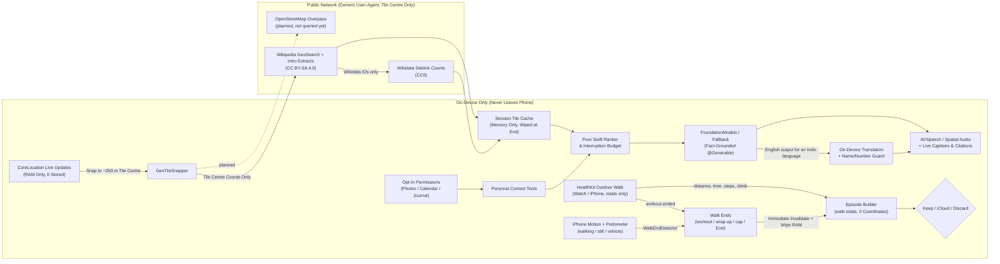

### User Interaction Sequence

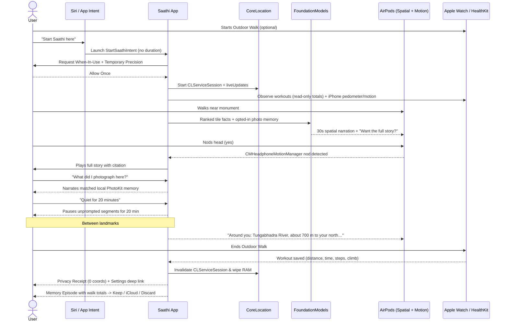

### Session Lifecycle

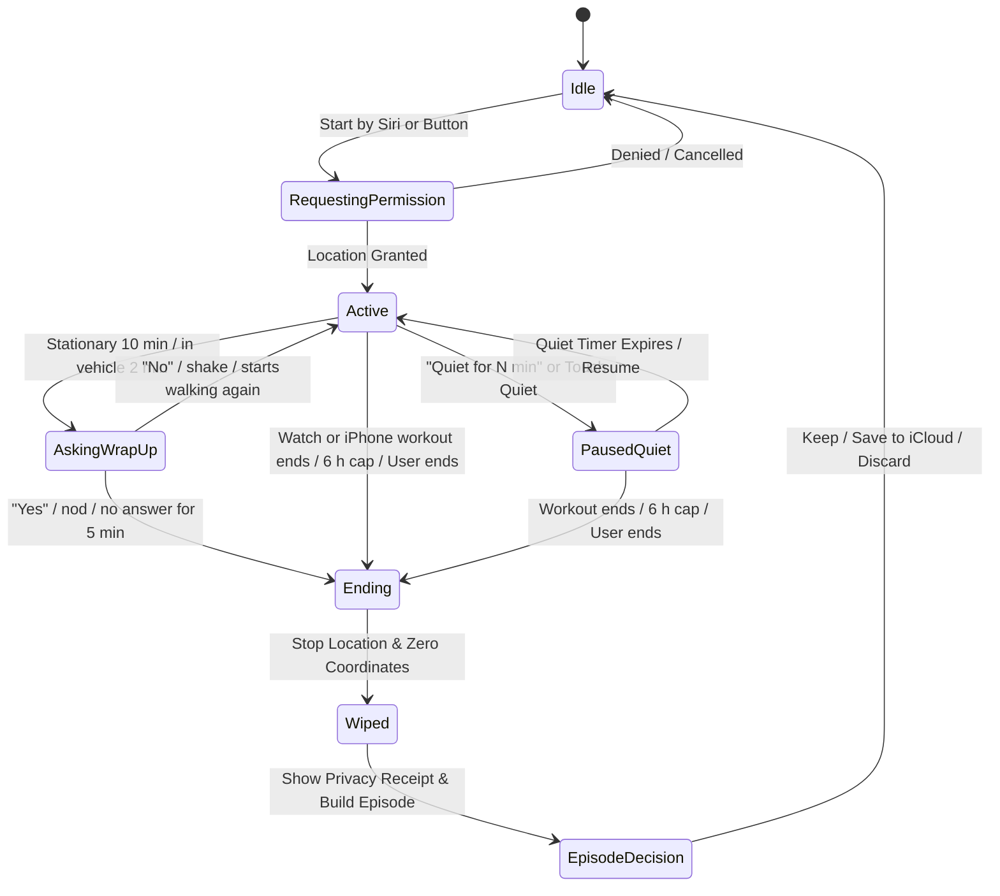

---

## Languages & Multilingual Pipeline

Saathi supports **13 language modes**: English (India), Hindi, Bengali, Marathi, Telugu, Tamil, Gujarati, Kannada, Malayalam, Punjabi, Odia, Urdu (full right-to-left layout), and **Hinglish / mixed** code-switched speech. Users pick separate **Narration** and **Listening** languages (defaulting to device locale).

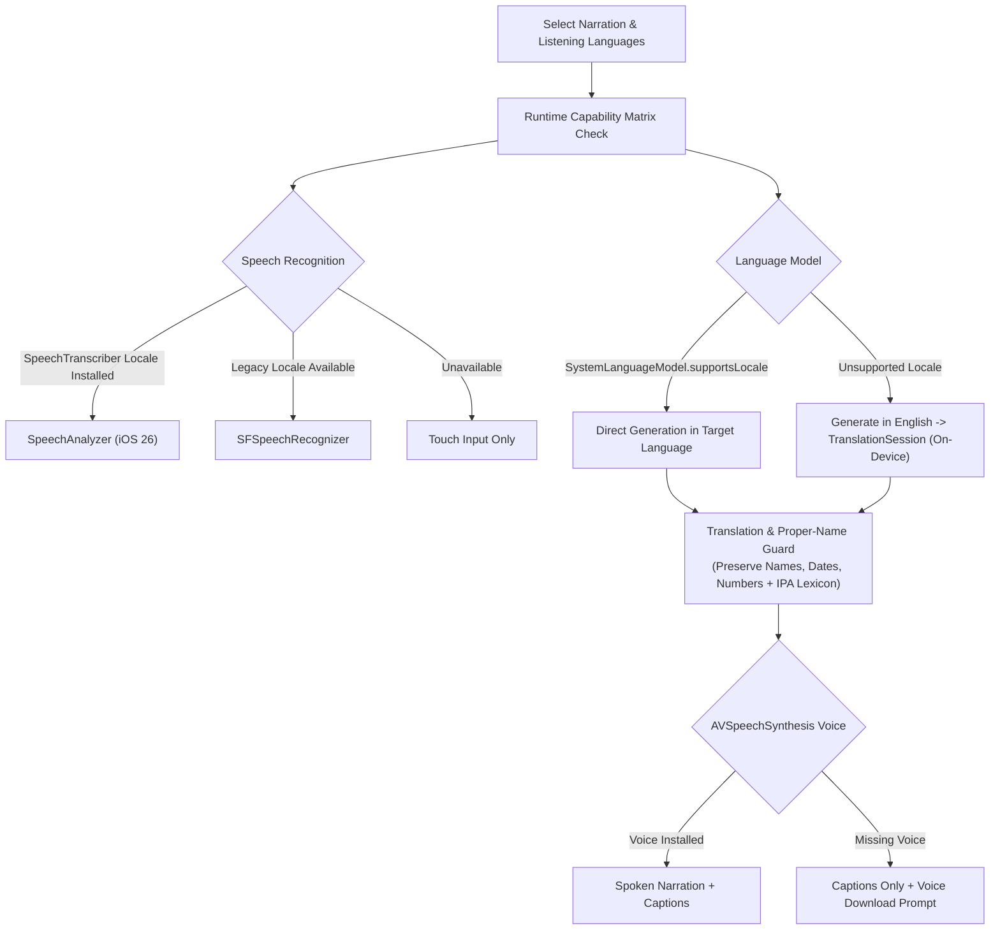

### Capability Matrix (Exported Template)
Generate the live table for your physical iPhone in **Settings → Language Capability Debug → Export Markdown**:

| Language | Locale | Speech Input | Model Path | TTS Voice | Badge |
| :--- | :--- | :--- | :--- | :--- | :--- |
| English (India) | `en-IN` | Verify on device | Verify on device | Verify on device | ✅ / 🟡 / 📝 |
| Hindi | `hi-IN` | Verify on device | Verify on device | Verify on device | ✅ / 🟡 / 📝 |
| Hinglish (Mixed) | `hi-Latn` | Verify on device | Verify on device | Verify on device | 🟡 |
| Bengali | `bn-IN` | Verify on device | Verify on device | Verify on device | ✅ / 🟡 / 📝 |
| Marathi | `mr-IN` | Verify on device | Verify on device | Verify on device | ✅ / 🟡 / 📝 |
| Telugu | `te-IN` | Verify on device | Verify on device | Verify on device | ✅ / 🟡 / 📝 |
| Tamil | `ta-IN` | Verify on device | Verify on device | Verify on device | ✅ / 🟡 / 📝 |
| Gujarati | `gu-IN` | Verify on device | Verify on device | Verify on device | ✅ / 🟡 / 📝 |
| Kannada | `kn-IN` | Verify on device | Verify on device | Verify on device | ✅ / 🟡 / 📝 |
| Malayalam | `ml-IN` | Verify on device | Verify on device | Verify on device | ✅ / 🟡 / 📝 |
| Punjabi | `pa-IN` | Verify on device | Verify on device | Verify on device | ✅ / 🟡 / 📝 |
| Odia | `or-IN` | Verify on device | Verify on device | Verify on device | ✅ / 🟡 / 📝 |
| Urdu (RTL) | `ur-IN` | Verify on device | Verify on device | Verify on device | ✅ / 🟡 / 📝 |

### Downloading Voices & Translation Packs
- **Enhanced/Premium Voices**: iOS *Settings → Accessibility → Spoken Content → Voices* (or tap the prompt inside Saathi's Language Picker).
- **Translation Packs**: Saathi uses `TranslationSession.prepareTranslation()` with explicit user consent before downloading offline language models.

### Adding a New Language
1. Add the enum case and metadata to `SaathiCore/Sources/SaathiCore/Models/SaathiLanguage.swift`.
2. Add localized UI strings to `Saathi/Saathi/Config/Localizable.xcstrings` (setting `layoutDirection` naturally via SwiftUI for RTL locales).
3. Add voice command patterns to `VoiceCommandGrammar.swift`.
4. Add IPA pronunciations for heritage landmarks in `Saathi/Saathi/Config/pronunciations.json`.

---

## Key Frames (`docs/frames/`)

These screenshots are generated, not hand-made. `cd Saathi && make frames` runs the XCUITest flow in `-MockMode` on the first available iPhone simulator, pre-grants motion permission, and writes every frame to `docs/frames/`. Re-run it after any UI change.

| | |
| :---: | :---: |
| 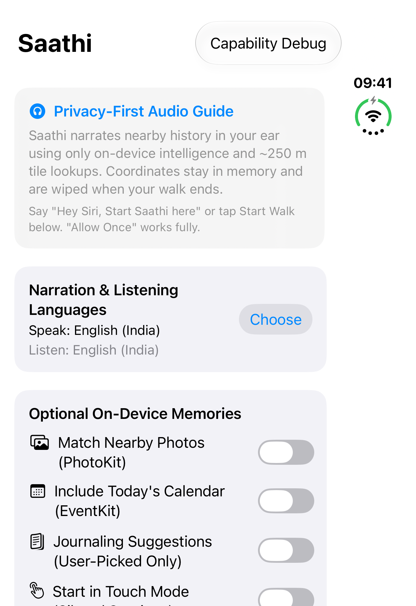<br>**1. Onboarding.** Each personal source (Photos, Calendar, Journaling) is a separate opt-in. | 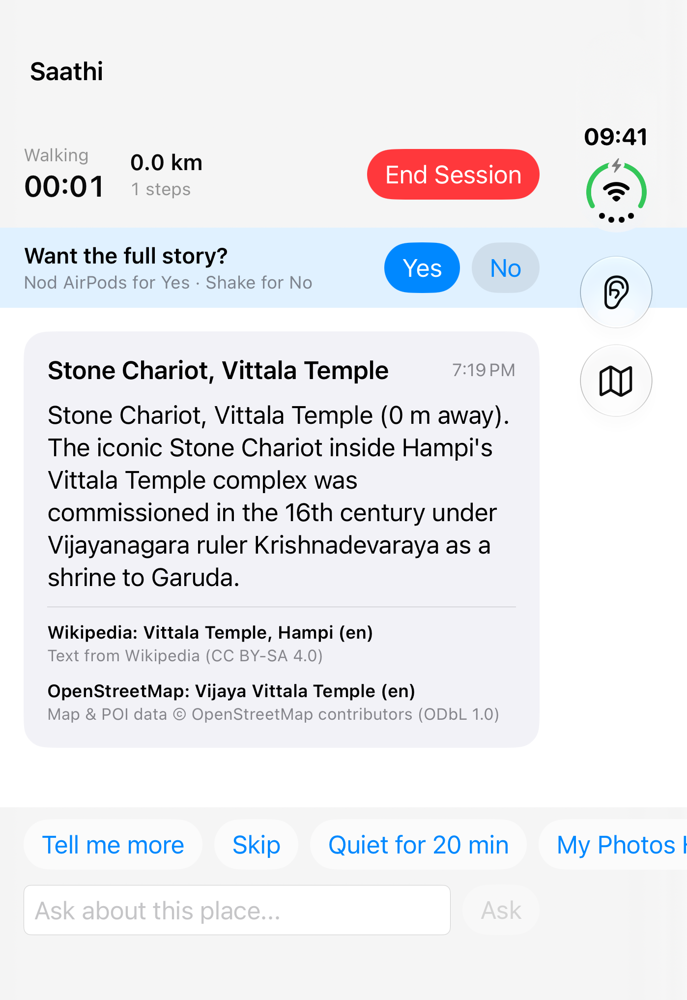<br>**2. Live session.** Open-ended walk clock with live distance and steps, a cited narration card, and a nod/shake prompt. |
| 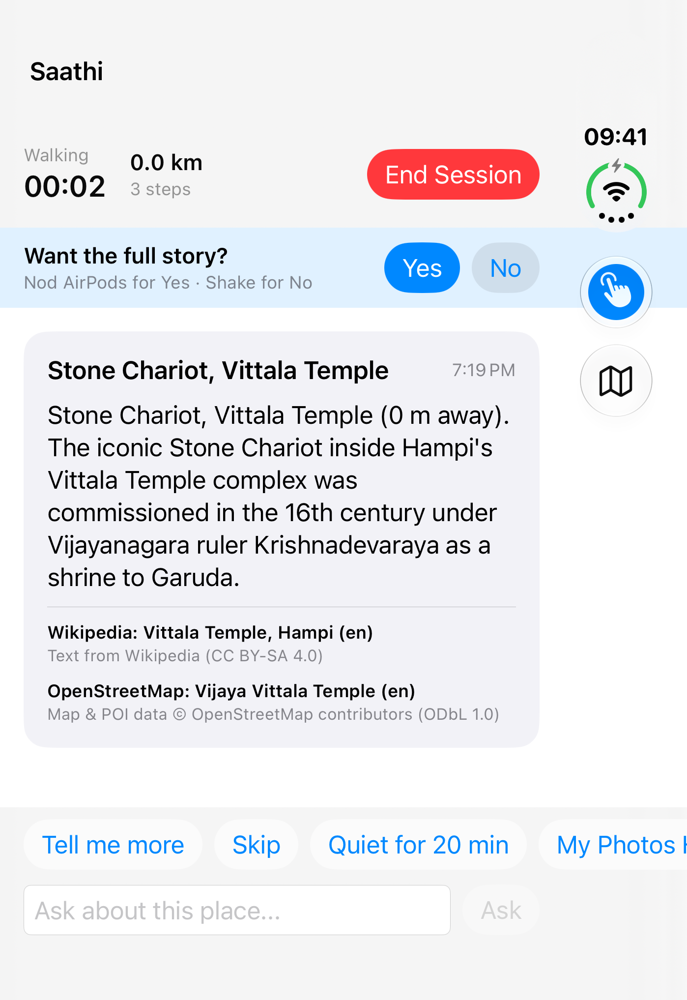<br>**3. Touch mode.** Captions and source licences, with no speaking or listening needed. | 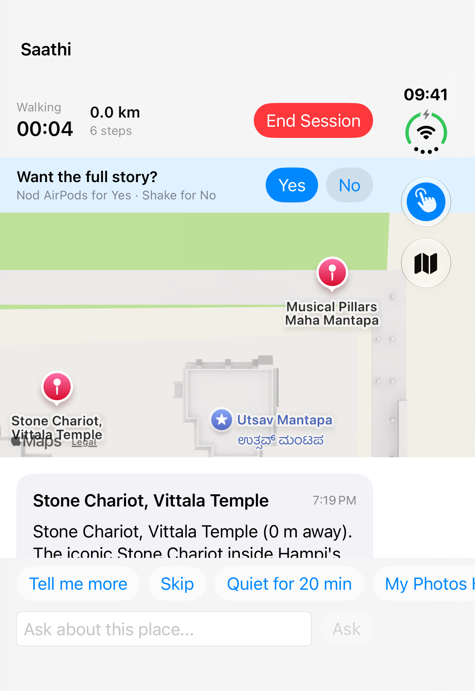<br>**4. Map.** Nearby monuments only; no path trail is drawn or stored. |
| 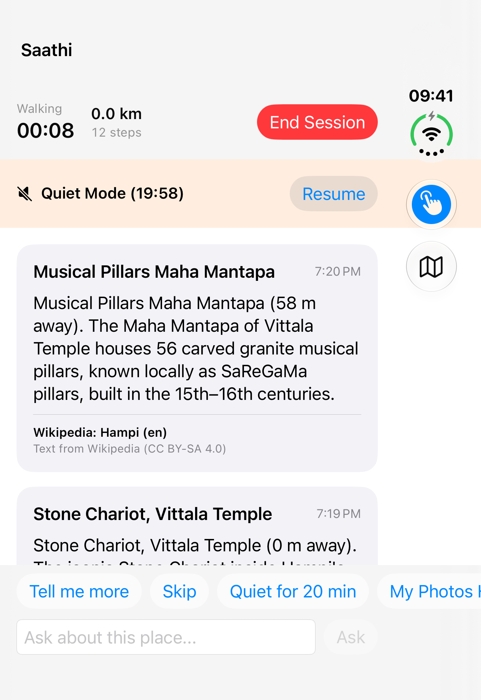<br>**5. Quiet mode.** "Quiet for 20 minutes" is honoured, with a Resume button. | 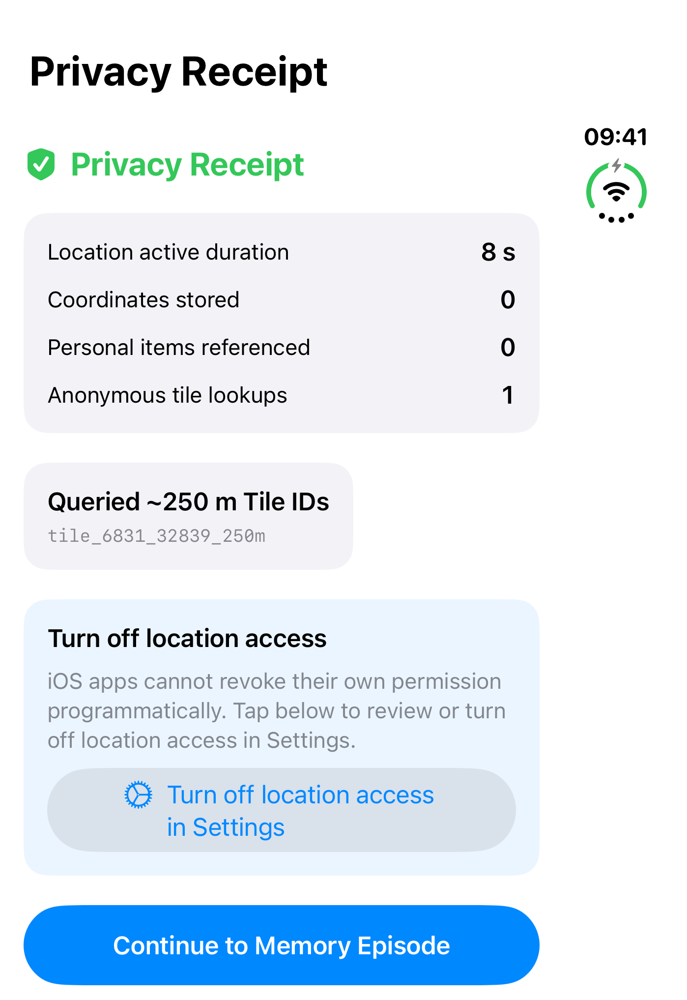<br>**6. Privacy receipt.** "Coordinates stored: 0" comes from a live container scan, plus the Settings link. |
| 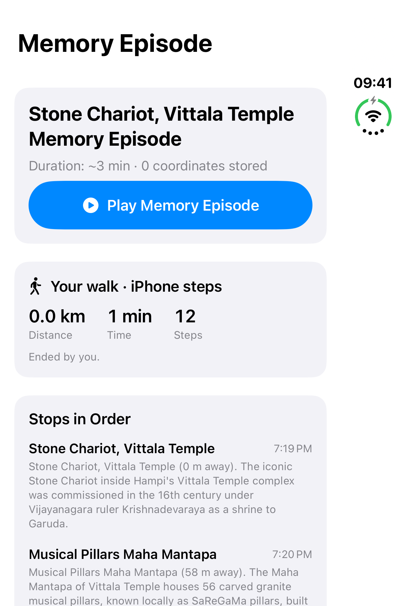<br>**7. Memory episode.** Opens with the walk totals (distance, time, steps); keep on device, save to iCloud, or discard. | 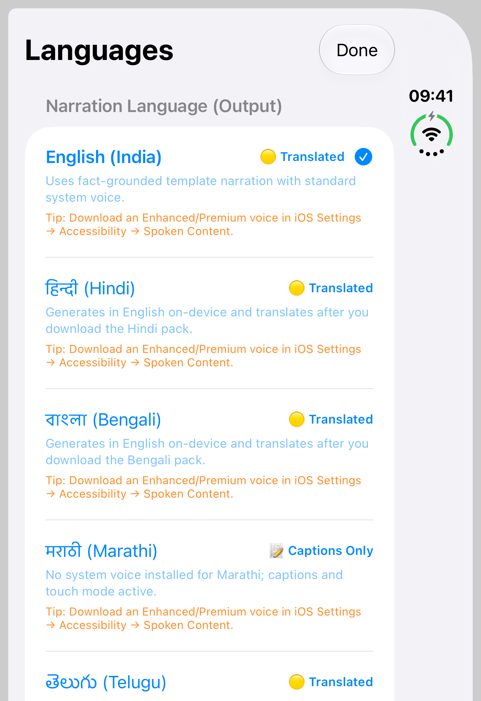<br>**8. Language picker.** Each language shows what this iPhone supports (voice / translated / captions). |
| 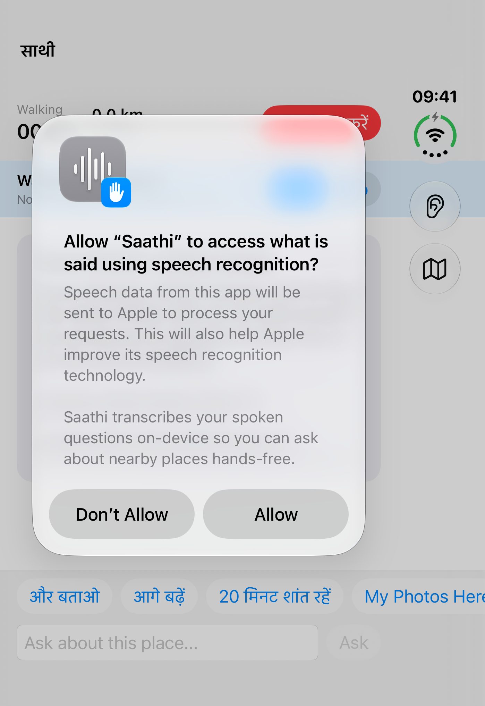<br>**9. Hindi.** Hindi interface; in mock mode English text isn't translated (a device translates on-device). | 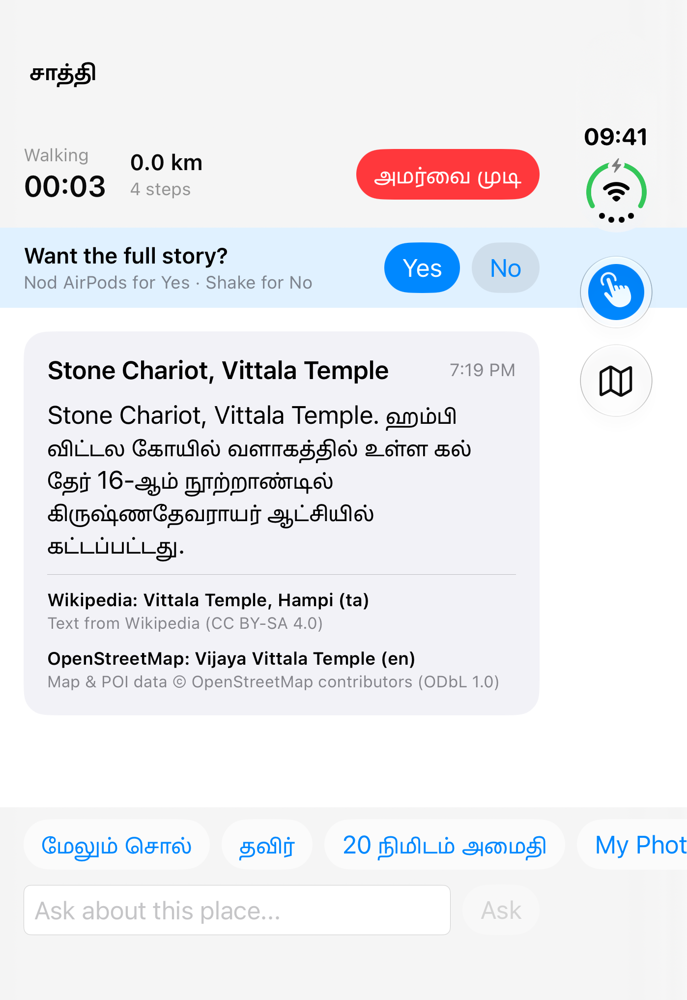<br>**10. Tamil touch mode.** Proper names stay in their original form. |
| 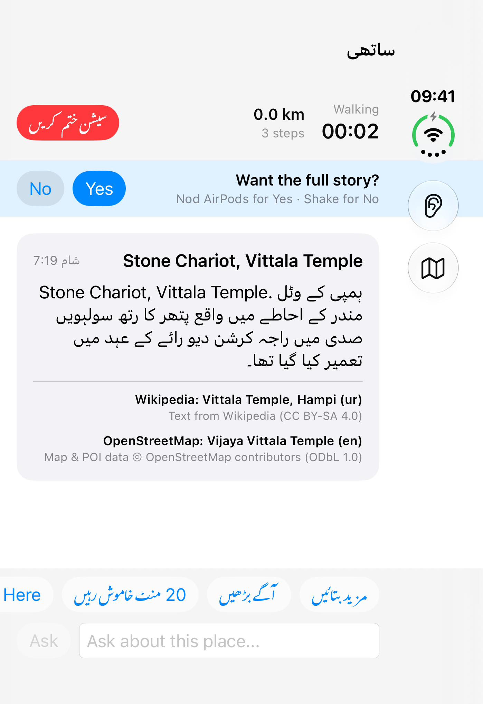<br>**11. Urdu.** Full right-to-left layout. | 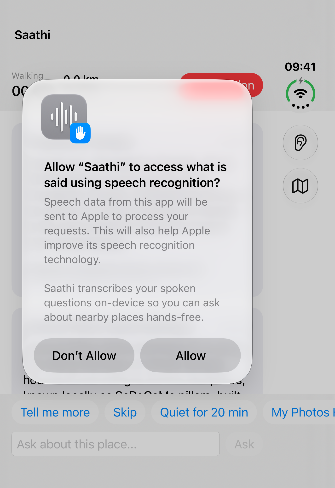<br>**12. Between landmarks.** On the simulated Hampi walk, Saathi keeps talking about places around you instead of going silent. |

---

## Data Sources, Licences & Accessibility

- **Wikipedia** (GeoSearch, Page Summaries, Interlanguage Links): [CC BY-SA 4.0](https://creativecommons.org/licenses/by-sa/4.0/)
- **Wikidata** (Sitelink notability counts): [CC0 1.0](https://creativecommons.org/publicdomain/zero/1.0/)
- **OpenStreetMap / Overpass**: [ODbL 1.0](https://opendatacommons.org/licenses/odbl/1-0/)
- **Accessibility**: Full VoiceOver labels and hints across every voice/touch control, Dynamic Type scaling, zero-audio Touch Mode parity, and full RTL layout for Urdu.

## Roadmap
- Multi-city curated heritage walking loops
- Offline tile packs for low-connectivity monuments
- Airport layover mode with flight-aware walk budgets
- Additional regional Indian dialects and community pronunciation contributions
