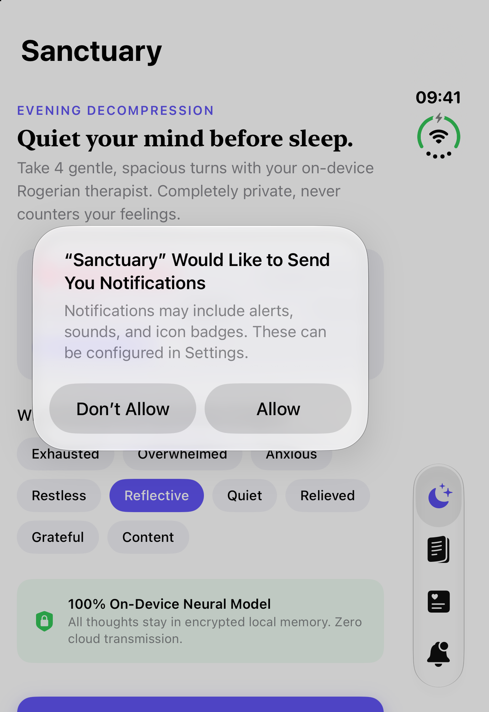
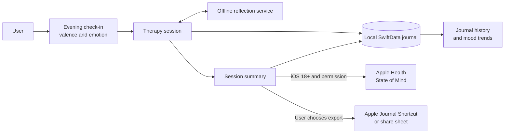
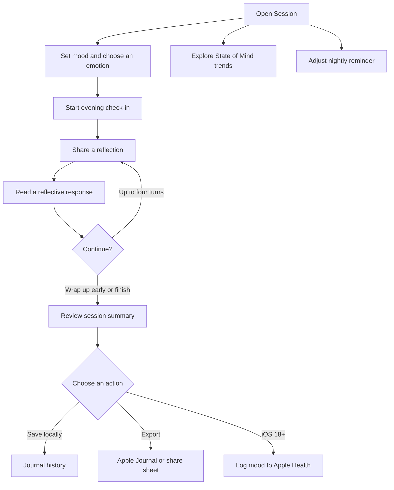

# Sanctuary

Sanctuary is a private evening check-in for people who want a calmer way to notice and reflect on the day's emotions before sleep. Its Rogerian, non-directive conversations are designed to listen and mirror feelings rather than prescribe advice. Reflections stay on-device, with optional Apple Health and Apple Journal integrations.

> **Model status:** The current service is an offline, rule-based prototype. The MLX model-loading hook is not yet implemented, so the app does not currently run a neural foundation model.

## How it works

The check-in records a starting mood and emotion, then guides the user through up to four reflective turns. Sanctuary keeps the conversation and summary in SwiftData. When the user chooses to wrap up, it creates a short reflection card; on iOS 18 and later, the final mood can also be logged to Apple Health. The user can export the reflection to Apple Journal through Shortcuts or share it with another app.

## User interaction

## Features

- **Person-centered reflection:** A short, turn-based evening conversation that avoids unsolicited advice.
- **Local-first journaling:** Session messages, mood, and summaries are stored with SwiftData on the device.
- **Apple Health:** Optional State of Mind logging on iOS 18 and later.
- **Apple Journal export:** Send a formatted reflection using the configured Shortcuts action or the iOS share sheet.
- **Nightly routine:** Configure a local evening reminder.

## Run in Xcode

1. Open `Sanctuary.xcodeproj` in Xcode 15 or newer.
2. Select the **Sanctuary** scheme and an iOS Simulator or iPhone.
3. Build and run with **⌘R**.

The app's deployment target is iOS 17. Apple Health State of Mind support requires iOS 18 or later. HealthKit access also requires the relevant capability and usage descriptions when configuring a signing target.
