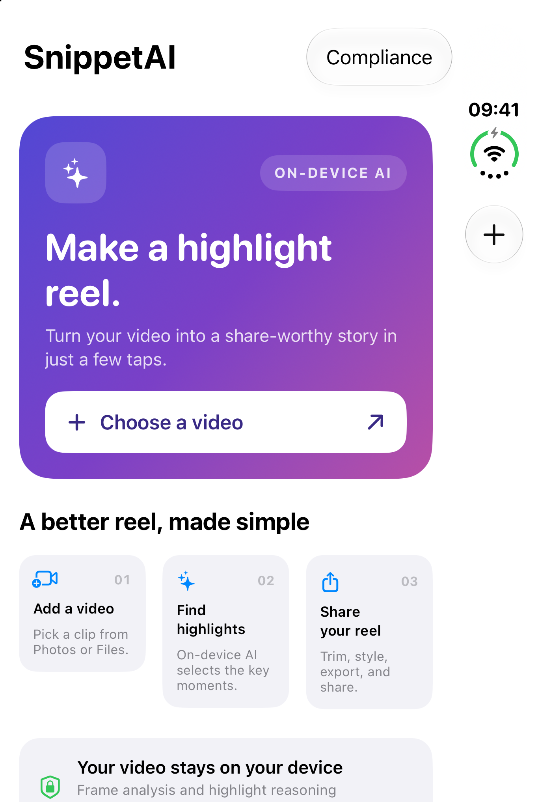
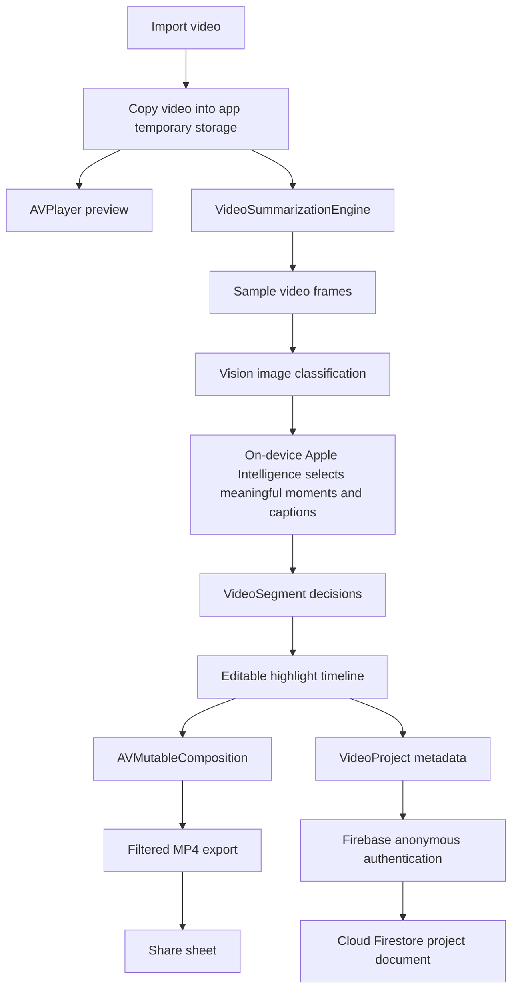
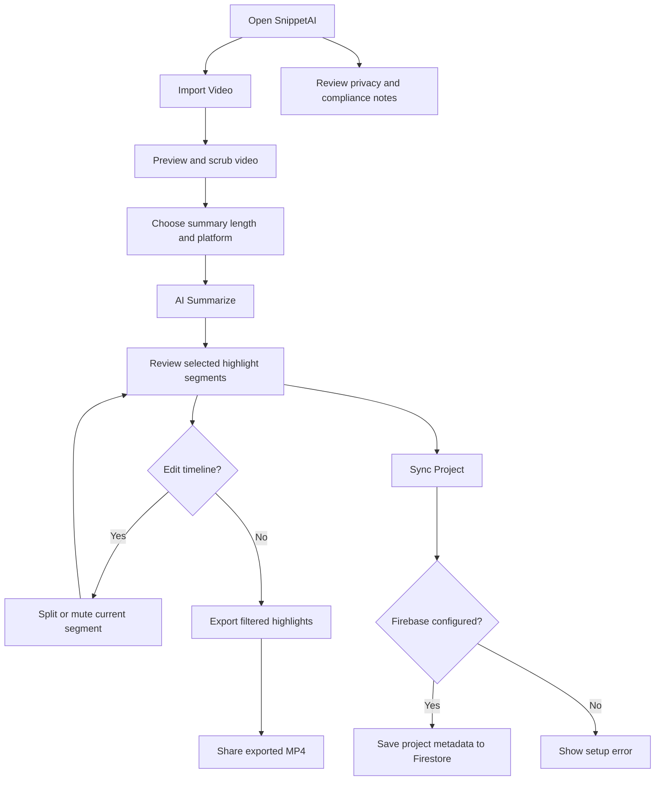

# SnippetAI

SnippetAI is an iOS video-highlights editor. Import a video, use on-device
Vision image classification and Apple Intelligence reasoning to select
highlights, edit the resulting timeline, export a filtered reel, and optionally
sync project metadata to Firebase.



## Dataflow



Video selection, frame analysis, highlight reasoning, timeline editing, and
MP4 export run locally. The app analyzes up to 60 sampled frames with Vision,
then asks the system Foundation Model for a highlight selection, reasons, and
captions. It sends frame labels—not the source video—to the on-device model.
There is no heuristic or canned-result fallback: summarization reports an
error if Apple Intelligence is unavailable or the model response is invalid.
Firebase sync saves project metadata and segment details; the source video
itself is not uploaded. Sync requires an app-specific
`GoogleService-Info.plist` and Anonymous authentication enabled in Firebase.

## User interaction



## Build and run

Open `SnippetAI.xcodeproj`, select the `SnippetAI` scheme and an iOS Simulator
or device, and build. Firebase Auth, Core, and Firestore are declared as Swift
Package Manager dependencies and the resolved versions are tracked in the
workspace.

To enable cloud sync:

1. Register the iOS app in Firebase using bundle identifier
   `com.thirtyapps.SnippetAI`.
2. Add the generated `GoogleService-Info.plist` to the `SnippetAI` app target.
3. Enable Anonymous sign-in in Firebase Authentication and create a Firestore
   database.

Without that plist the app still launches and local editing/export work; sync
shows a configuration error rather than silently skipping the save.

Build from the command line:

```sh
xcodebuild -project SnippetAI.xcodeproj \
  -scheme SnippetAI \
  -configuration Debug \
  -sdk iphonesimulator \
  -destination 'generic/platform=iOS Simulator' \
  build
```

The analysis uses Vision's image classifier and the system Foundation Model; no
bundled Core ML model or saved analysis values are required. The model selects
from frame descriptions on each run. Audio and speech transcription are not
currently analyzed.
