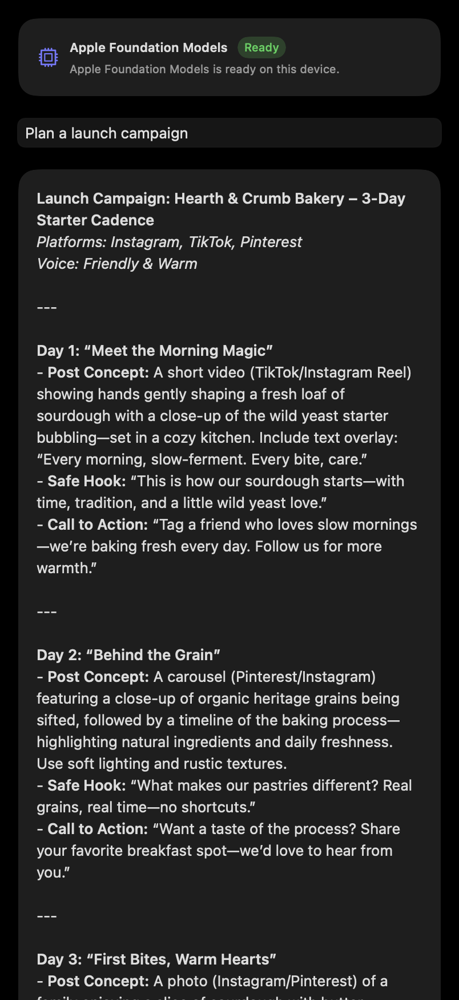
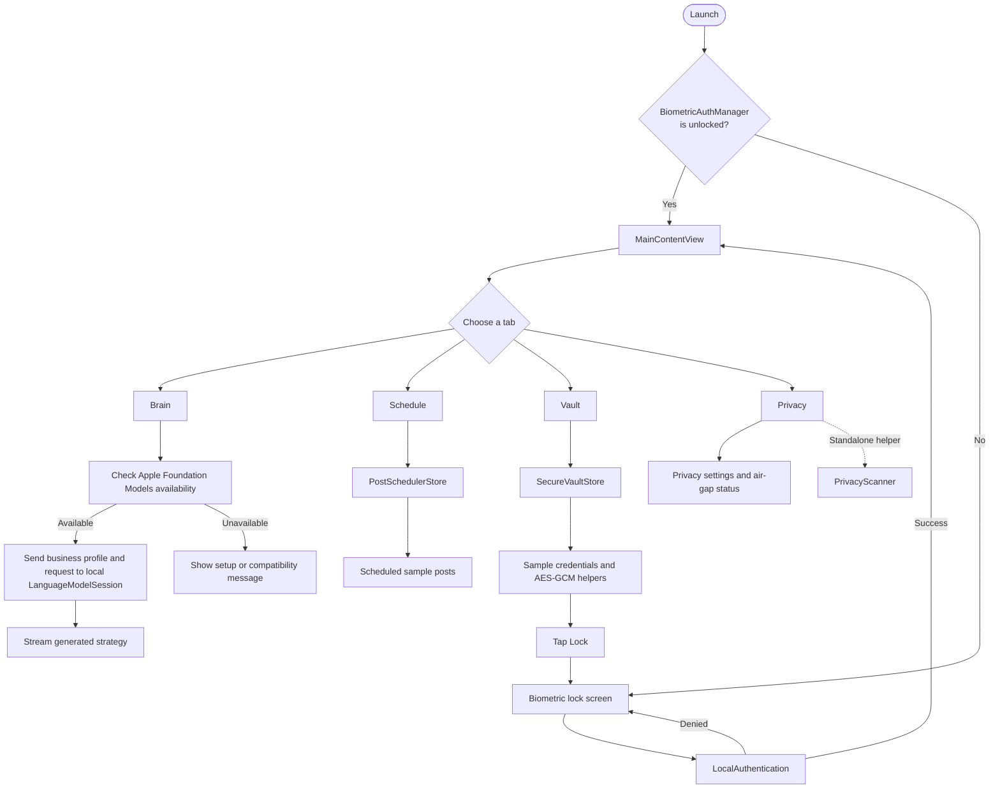

# SovereignSocial

SovereignSocial is a SwiftUI prototype for privacy-conscious social media planning by small business owners. On supported Apple devices, the Brain screen uses Apple's Foundation Models framework to generate strategies on device.

## Features

- **On-device strategy generation:** Uses `SystemLanguageModel` and `LanguageModelSession` from Apple's Foundation Models framework. Generation is available on eligible devices running iOS 26 or macOS 26 or later with Apple Intelligence enabled and the model ready. The app reports when these requirements are not met; it does not substitute a canned response.
- **Credential vault:** Includes CryptoKit AES-GCM encrypt/decrypt helpers and sample credentials. Key creation and Secure Enclave storage are not implemented.
- **Biometric lock:** Uses LocalAuthentication where biometrics are available, with a simulator fallback.
- **Privacy scanner:** A standalone helper that checks text for phone-number and residential-address patterns. It is not yet connected to a post editor.
- **Privacy settings:** Demonstrates platform-scope and media-privacy toggles; platform account integrations are not included.

## Screenshot

The image below shows the Brain screen with a strategy generated by Foundation Models on the macOS host. It is rendered from the app's SwiftUI view at an iPhone portrait viewport size; it is not an iOS Simulator capture.



## App flow



## Requirements

- Swift 6.0+
- Xcode 26.0+ (for the Foundation Models SDK)
- macOS 14+ to run the macOS app
- iOS 17+ deployment target
- iOS 26+ or macOS 26+ on a supported device, with Apple Intelligence enabled, for strategy generation

## Build, run, and test

Run these commands from the repository root:

```sh
swift test
swift run SovereignSocialApp
```

`swift run` launches the macOS app. To check that the iOS Simulator target compiles:

```sh
swift build --triple arm64-apple-ios17.0-simulator --product SovereignSocialApp
```

The package does not currently include an Xcode project or workspace for launching the iOS app directly in Simulator.
