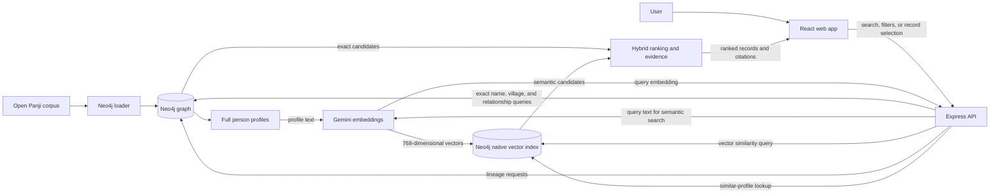
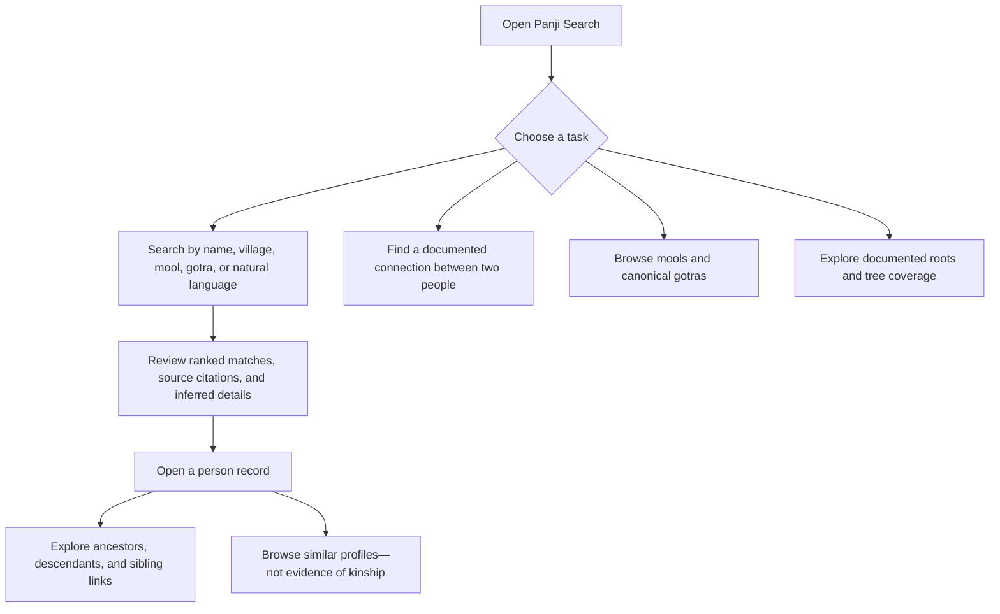
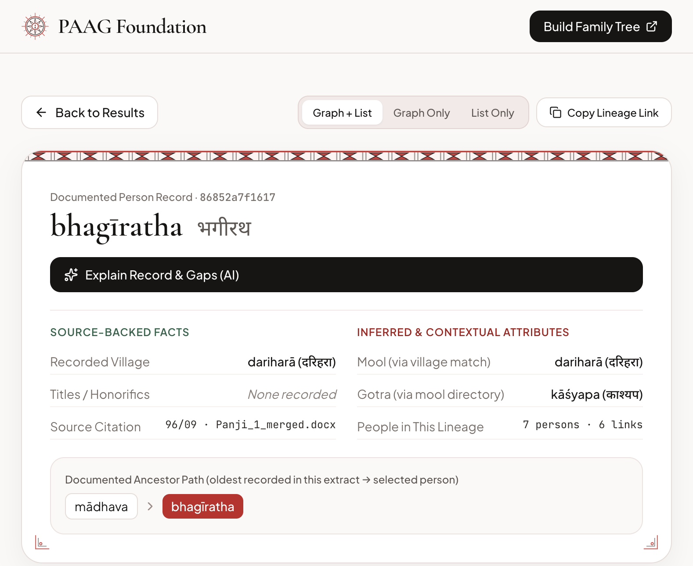

# Mithila Panji Search — PAAG Foundation

An AI-assisted Mithila genealogy search app for **PAAG Foundation (Panji Ancestry & Graph)** (`https://www.paag.org.in`), backed strictly by a **Neo4j** graph database loaded from the open [`jharajiv/mithila-panji`](https://github.com/jharajiv/mithila-panji) (`main`) corpus.

## Purpose & User Value

The app helps people explore digitized Mithila Panji records by searching names across Roman and Devanagari spellings, villages, *mools*, and *gotras*. It brings source citations, family links, and interactive lineage views together, while clearly distinguishing recorded facts from inferred context. Semantic matches and inferred relationships are discovery aids—not proof of kinship. The corpus is a partial historical extract, so it can help users investigate family history but cannot guarantee a complete family tree.

## Architecture & Key Capabilities

- **Strict Neo4j Backend (`neo4j-driver`)**: Queries a live Neo4j database (Neo4j AuraDB or self-hosted Bolt instance) with **zero local JSON fallback**. If Neo4j credentials are missing or the database is unreachable, `/api/*` data endpoints respond with HTTP `503`.
- **Ancestor Search & Transparent Evidence**: Natural-language or structured search across Roman (with IAST diacritic folding and common variant normalization) and Devanagari names, recorded villages, inferred *mools*, and inferred *gotras*—always separating **source-backed facts** from **inferred** relationships.
- **Hybrid Semantic Search**: Combines exact name and village matching with Gemini profile embeddings stored in a native Neo4j vector index. Profiles include recorded villages and titles, inferred mool/gotra context, and documented or inferred relatives. Exact matches stay prominent; similarity is a discovery aid, never proof of kinship.
- **Interactive Lineage Graph & Generation Directory**: Explore ancestors (`CHILD_OF`), descendants, explicit siblings (`SIBLING_OF`), and shared-parent inferred siblings.
- **Similar Ancestor Suggestions**: Each person record can suggest semantically similar profiles using the same full-profile embeddings.
- **Neo4j Graph Enhancements**:
  1. **Shortest-Path Relationship Finder**: Runs Neo4j `shortestPath` over `CHILD_OF | SIBLING_OF` edges between any two people and checks for common documented ancestors.
  2. **Mools & Canonical Gotras Browser**: Inspects `(Mool)-[:IN_GOTRA]->(Gotra)` relationships, highlighting cross-gotra *mools* shared across two or more *gotras*.
  3. **Documented Family Tree Coverage**: Ranks root ancestors (`NOT (root)-[:CHILD_OF]->()`) by total documented descendants and maximum generation depth.
- **Optional Server-Side Gemini Assistant**: Interprets conversational queries and summarizes retrieved Neo4j records without inventing unrecorded genealogical facts. Automatically falls back to deterministic query parsing and record summaries when `GEMINI_API_KEY` is omitted.

## Data Flow



## User Interaction



## Screenshot



*Example person-record view. Source citations and inferred attributes are displayed separately.*

---

## Quick Start

### 1. Install Dependencies

```bash
npm install
```

### 2. Configure Environment Variables

Copy `.env.example` to `.env` and fill in your Neo4j connection details (e.g., from a free [Neo4j AuraDB](https://neo4j.com/cloud/aura-free/) cloud instance or local Neo4j 5 server):

```env
NEO4J_URI="neo4j+s://YOUR_NEO4J_AURA_ID.databases.neo4j.io"
NEO4J_USERNAME="neo4j"
NEO4J_PASSWORD="YOUR_NEO4J_PASSWORD"
NEO4J_DATABASE="neo4j"
APP_URL="https://panji-search.example.com"

# Server-side Gemini embeddings and optional AI assistance
GEMINI_API_KEY="MY_GEMINI_API_KEY"
GEMINI_MODEL="gemini-4-hydrogen"
```

Never place Neo4j or Gemini credentials in `VITE_*` variables or client-side code.

### 3. Load Upstream Data & Indexes into Neo4j

Run the idempotent TypeScript loader CLI (`scripts/load-neo4j.ts`):

```bash
# Load from the verified local snapshot in data/upstream/
npm run neo4j:load

# Or fetch the latest CSVs directly from GitHub jharajiv/mithila-panji main first:
npm run neo4j:load -- --fetch

# Optional clean reload (deletes existing Panji nodes before reloading):
npm run neo4j:load -- --fetch --reset
```

The loader applies unique constraints on `Person.id`, `Village.id`, `Mool.id`, `Gotra.id`, and `CorpusMetadata.id`, creates folded/phonetic search indexes, and batch-merges all 1,888 persons, 505 villages, 135 mools, 20 gotras, and all `FROM_VILLAGE`, `OF_MOOL_GUESS`, `IN_GOTRA`, `CHILD_OF`, and `SIBLING_OF` edges.

After loading the graph, create the 768-dimensional Neo4j native vector index and embed full person profiles:

```bash
npm run neo4j:embed
```

This idempotent command embeds only new or changed profiles. It sends profile text from the public corpus to Gemini; configure `GEMINI_API_KEY` server-side. The profile text distinguishes documented relatives from inferred shared-parent siblings. If Gemini's daily quota is reached, completed batches are retained and the command can be rerun after the quota resets. `/api/health` reports vector-index coverage; exact search remains available for the full corpus while semantic search uses the profiles embedded so far. If query embedding is rate-limited, that search returns exact-only results with a visible warning.

### 4. Run Locally

```bash
# Development (Express + Vite middleware on http://localhost:3000)
npm run dev

# Production build + start
npm run build
npm start
```

### 5. Verification Commands

```bash
npm test          # Vitest unit & strict-503 API integration tests
npm run lint      # TypeScript type-check (tsc --noEmit)
npm run build     # Vite production client bundle
```

The usage guide includes natural-language examples for describing family context. Similar-profile suggestions appear on each person record after vector indexing is ready.

---

## Data Source, Attribution & License

- **Upstream Repository**: [`jharajiv/mithila-panji`](https://github.com/jharajiv/mithila-panji) (`main`, snapshot documented in `data/UPSTREAM_SNAPSHOT.md`).
- **Underlying Print Source**: Thakur, Gajendra; Jha, Nagendra Kumar; Jha, Panjikar Vidyanand. *Genome Mapping (450 A.D. to 2009 A.D.) — Mithilak Panji Prabandh*, Vol. I–III. Shruti Publication, New Delhi, 2009. ISBN `978-81-907729-6-9`.
- **Data License**: Creative Commons Attribution-ShareAlike 4.0 International (**CC BY-SA 4.0**), per upstream `data/LICENSE-DATA.md`.
- **Scope Notice**: This corpus is a partial digitized research extract and does **not** represent every Maithil family or a complete generational atlas.
