# Prod Preview

Prod Preview is a browser-based, platform-independent review service that turns live Google Cloud Proof-of-Concept (POC) environments into a plain-language executive scorecard. Non-technical stakeholders can inspect an auto-generated system map, verify every scoped requirement against live measurements and billing projections with attached evidence, simulate 10×–100× scaling or regional outages in a What-If sandbox, and record requirement-level sign-offs exported as a Steering Committee PDF.

## Who Is This For

| Persona | Primary Goals | Key Capabilities Used |
| :--- | :--- | :--- |
| **Stakeholder** (VP, Product Lead, DPO, InfoSec) | Verify whether a POC meets latency, uptime, EU residency, security, and budget goals without reading cloud consoles. | Plain-language Architecture Map, Evidence-backed Scorecard, What-If Simulator, Sign-Off & PDF Export, Expiring Invite Links. |
| **Engineer** (Cloud / Platform Lead) | Map business requirements to automated checks, enforce LLM data-residency governance, and isolate POCs with auto-teardown. | YAML/text intake, Pluggable LLM provider switching & Compare Mode, Draft Approval Queue, Terraform state & re-check triggers. |

---

## Quickstart

Run the full stack locally with zero GCP credentials required (preloaded with `MockProvider` demo POCs):

```bash
docker compose up --build
```

Open **`http://localhost:8080`** in any modern browser. Three demo POCs—led by **Retail Checkout Redesign** in `europe-west1` (Belgium)—are preloaded automatically.

*(When running in Node/Vite development mode on port 3000: `npm install && npm run dev`.)*

---

## Dataflow Diagram

Measured telemetry paths are styled with solid emerald strokes; projected simulation and AI-drafting paths are styled with dashed amber strokes.

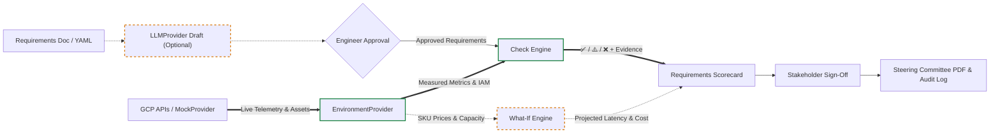

---

## User Interaction Diagram

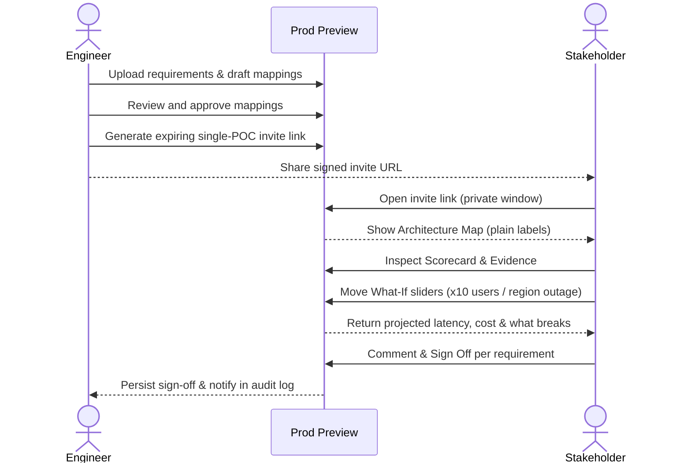

---

## Environment Lifecycle

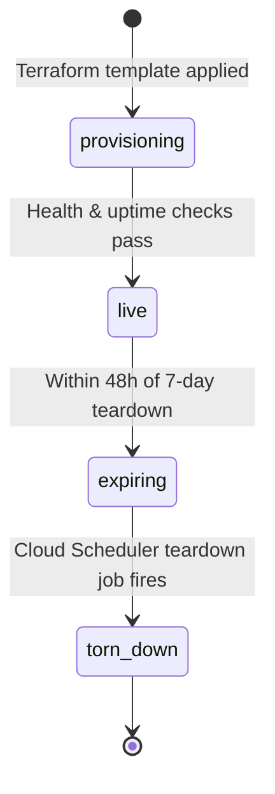

---

## Key Frames

Screenshots are captured automatically in mock mode using Playwright (`make frames` → `scripts/capture_frames.mjs`) at desktop (`1440×900`) and phone (`375×812`) viewports:

0. **Authentication** (`docs/frames/00_authentication.png`) — *Users enter through password, registration, Google Workspace, or demo sign-in before protected POC routes become available.*
   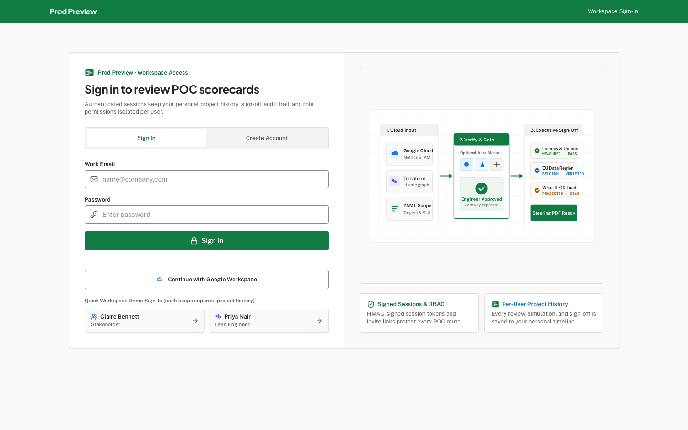

1. **POC List** (`docs/frames/01_poc_list.png`) — *Stakeholders see every active POC's lifecycle state, teardown countdown, requirement pass rate, and sign-off completion at a glance.*
   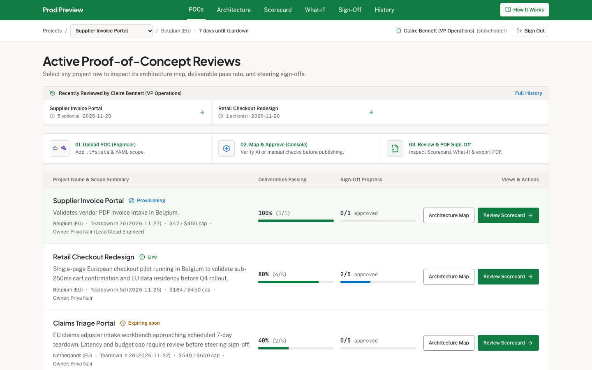

2. **Architecture Map** (`docs/frames/02_architecture_map.png`) — *Stakeholders learn how the system works in plain business terms and where customer data resides without GCP jargon.*
   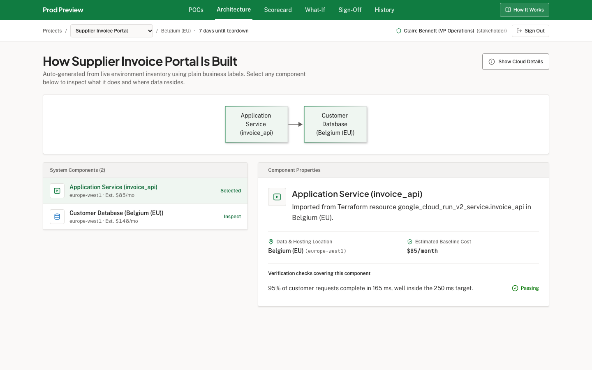

3. **Requirements Scorecard (Desktop & 375px Mobile)** (`docs/frames/03_scorecard_desktop.png`, `docs/frames/03_scorecard_mobile.png`) — *Stakeholders inspect each ✅/⚠️/❌ requirement with measured vs. projected labels, raw evidence, and explicitly out-of-scope items.*
   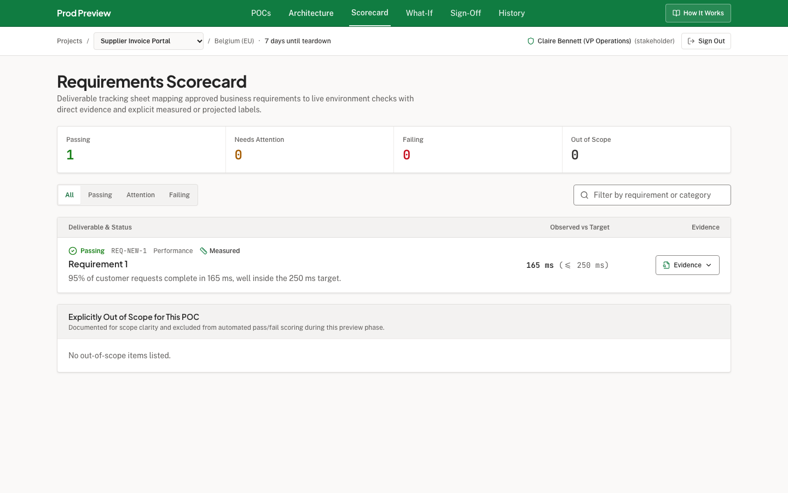
   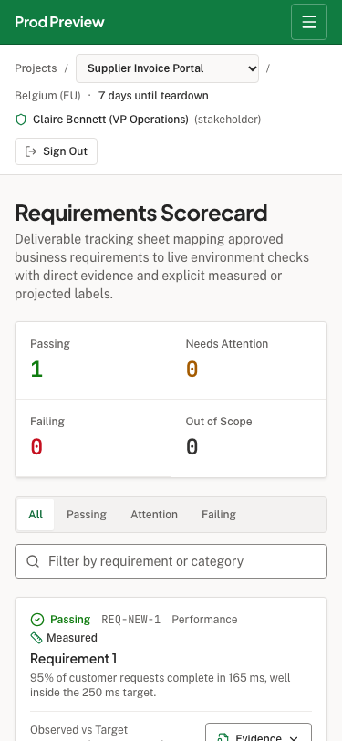

4. **What-If Simulator** (`docs/frames/04_what_if.png`) — *Stakeholders test 10× user growth or a primary region outage and immediately learn projected latency, monthly cost, and what breaks first.*
   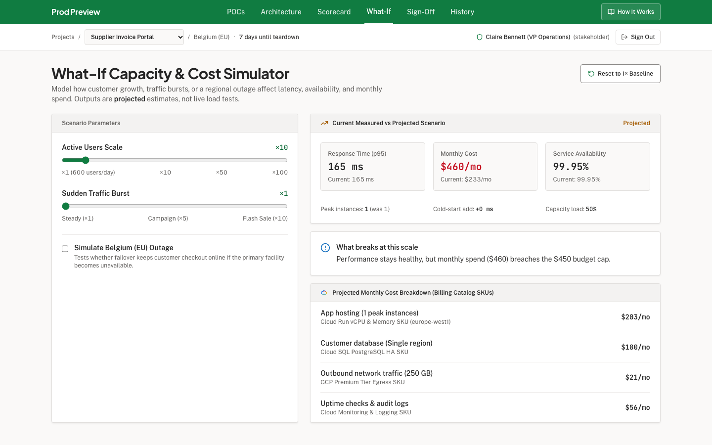

5. **Sign-Off & Steering PDF** (`docs/frames/05_signoff.png`) — *Stakeholders approve or request changes per requirement and export a Steering Committee PDF with an LLM audit appendix.*
   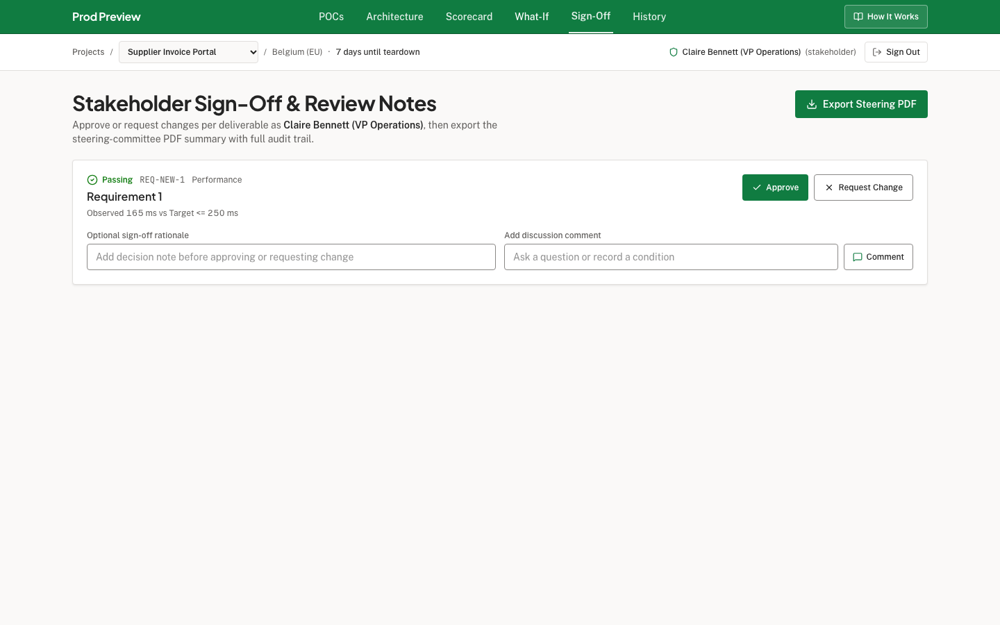

---

## Architecture & Adapters

- **`EnvironmentProvider` (`backend/app/env_providers.py`, `server/domain/providers.ts`)**:
  - `MockProvider` (default): Credential-free seeded dataset covering 3 POCs, 5 check types, and realistic telemetry.
  - `GcpProvider`: Queries Cloud Asset Inventory (resource locations), Cloud Monitoring (p95 latency & uptime probes), Resource Manager `getIamPolicy` (broad/public access), Cloud Billing Catalog SKUs, Cloud Run v2 service URLs, and reads `infra/terraform.tfstate`.
- **Check Evaluators (`latency_p95`, `uptime`, `data_region`, `iam_exposure`, `monthly_cost`)**: Every output is explicitly tagged `measured` or `projected` and includes source API, resource ID, policy line, and raw excerpt evidence.
- **Terraform Template (`infra/`)**: Short-lived per-POC template provisioning Cloud Run v2, Cloud SQL PostgreSQL, a hard-cap `google_billing_budget`, POC labels, and a 7-day `google_cloud_scheduler_job` teardown hook. The app reads template state; it does not run `terraform apply`.

### Environment Variables

| Variable | Default | Purpose |
| :--- | :--- | :--- |
| `ENVIRONMENT_PROVIDER` | `mock` | `mock` for credential-free demo; `gcp` for live GCP APIs. |
| `DATABASE_URL` | `postgresql://...` | PostgreSQL connection string in Docker/Cloud Run deployments. |
| `SESSION_TOKEN_SECRET` | *(dev default)* | 32-byte HMAC-SHA256 secret signing user login session cookies and Bearer tokens (generated locally via `make keys`). |
| `INVITE_TOKEN_SECRET` | *(dev default)* | 32-byte HMAC-SHA256 secret signing expiring single-POC invite links (generated locally via `make keys`). |
| `BYOK_ENCRYPTION_KEY` | *(dev default)* | AES-256-GCM encryption key for optional per-workspace BYOK provider credentials (generated locally via `make keys`). |
| `DEFAULT_LLM_PROVIDER` | `vertex_gemini` | Default drafting provider (`none` disables LLM completely). |
| `GEMINI_API_KEY` | `""` | Server-side key for Gemini / Vertex adapter (never exposed to browser). |
| `ANTHROPIC_API_KEY` | `""` | Server-side key for Anthropic API adapter. |
| `OPENAI_API_KEY` | `""` | Server-side key for OpenAI API adapter. |
| `AZURE_OPENAI_API_KEY` | `""` | Server-side key for Azure OpenAI adapter. |
| `OPENAI_COMPAT_BASE_URL` | `http://localhost:11434/v1` | Self-hosted Ollama or vLLM endpoint URL. |

### First-Time Secret & Key Setup Guide

You can run Prod Preview right away in mock mode with zero external API keys. When setting up your local `.env` or production Cloud Run deployment for the first time, follow these steps to obtain every value defined in `.env.example`:

#### 1. Internal App Cryptographic Keys *(Required for signing sessions, invites & BYOK)*

- **`SESSION_TOKEN_SECRET`**, **`INVITE_TOKEN_SECRET`**, **`BYOK_ENCRYPTION_KEY`**
  - **Fastest setup (recommended):** Run the built-in generator from the project root:
    ```bash
    make keys
    ```
    This creates a gitignored `.env` (`chmod 600`) with fresh 256-bit (64-hex-character) random secrets for all three variables without overwriting any vendor keys you already configured.
  - **Manual alternative:** Run `openssl rand -hex 32` three separate times and paste each 64-character value into `.env` (or Google Cloud Secret Manager).

#### 2. Google Cloud & Workspace Sign-In *(Optional — needed for `ENVIRONMENT_PROVIDER=gcp` or live Google OAuth)*

- **`GCP_PROJECT_ID`** & **`VERTEX_PROJECT_ID`**
  - Open **Google Cloud Console → Project Picker** (or run `gcloud config get-value project`) and copy your POC Project ID.
  - Enable the required APIs on that project: Cloud Run Admin (`run.googleapis.com`), Cloud Asset Inventory (`cloudasset.googleapis.com`), Cloud Monitoring (`monitoring.googleapis.com`), Cloud Resource Manager (`cloudresourcemanager.googleapis.com`), Cloud Billing (`cloudbilling.googleapis.com`), and Vertex AI (`aiplatform.googleapis.com`).
- **`GCP_ACCESS_TOKEN`** *(local development only)*
  - Run `gcloud auth login && gcloud auth print-access-token`. Note that short-lived `gcloud` tokens expire after ~1 hour.
  - On **Cloud Run**, leave `GCP_ACCESS_TOKEN` unset—attach a service account with the viewer roles listed below instead.
- **`GOOGLE_IDENTITY_CLIENT_ID`**
  - Go to **Google Cloud Console → APIs & Services → Credentials → Create Credentials → OAuth client ID**.
  - Choose **Web application**, add `http://localhost:3000` and `http://localhost:8080` (plus your Cloud Run URL) to **Authorized JavaScript origins**, and copy the `*.apps.googleusercontent.com` Client ID.

#### 3. Optional LLM Drafting Provider Keys *(App works 100% with `DEFAULT_LLM_PROVIDER=none`)*

| Variable(s) | Where to Get It | Notes |
| :--- | :--- | :--- |
| `GEMINI_API_KEY` | **Google AI Studio** → *Get API key → Create API key* | Used by `vertex_gemini`. On Cloud Run in `europe-west1`, you can instead rely on Vertex AI ADC (`VERTEX_PROJECT_ID`). |
| `VERTEX_PROJECT_ID`, `VERTEX_LOCATION` | **Google Cloud Console** → *Vertex AI → Model Garden* | Used by `vertex_claude` (enable **Claude** in Model Garden in `europe-west1`). No separate Anthropic API key required. |
| `ANTHROPIC_API_KEY` | **Anthropic Console** → *API Keys → Create Key* | Used by `anthropic` (US processing region; blocked automatically on `eu_only` POCs). |
| `OPENAI_API_KEY` | **OpenAI Platform** → *Dashboard → API keys → Create new secret key* | Used by `openai` (US processing region; blocked automatically on `eu_only` POCs). |
| `AZURE_OPENAI_API_KEY`, `AZURE_OPENAI_ENDPOINT`, `AZURE_OPENAI_DEPLOYMENT` | **Azure Portal** → your *Azure OpenAI* resource → *Keys and Endpoint* (and deployment name from *Azure AI Foundry*) | Provision the resource in **Sweden Central** (`eu-north`) to satisfy EU residency rules. |
| `OPENAI_COMPAT_BASE_URL`, `OPENAI_COMPAT_API_KEY`, `OPENAI_COMPAT_MODEL` | Local **Ollama** (`ollama serve` + `ollama pull llama3.1:8b`) or self-hosted **vLLM** (`--api-key`) | Default URL `http://localhost:11434/v1` works with Ollama using any non-empty placeholder key. |

#### 4. Database & Readiness Verification

- **`DATABASE_URL`**: In `docker compose up`, the preconfigured Postgres URL works out of the box. For Cloud Run + Cloud SQL, use `postgresql://<USER>:<PASSWORD>@/<DB>?host=/cloudsql/<PROJECT>:<REGION>:<INSTANCE>`.
- **Verify safely (never exposes secrets):** Sign in as an Engineer and expand **Workspace Provider Enablement & Server Key Readiness (Admin)** in the **Console** tab, or call `GET /api/workspace/keys` to confirm boolean readiness (`app_secrets` and per-provider `has_server_key` / `has_byok_key`).
- **Optional server-side BYOK:** Engineers can also store per-workspace provider keys encrypted with `BYOK_ENCRYPTION_KEY` via `POST /api/workspace/byok` (and remove them with `DELETE /api/workspace/byok/:providerId`).

### Security Model

- **Zero Anonymous Access**: Every API route requires a valid signed user session (`POST /api/auth/login` / `register` / `google`) or a signed, expiring `x-invite-token`.
- **RBAC & Single-POC Scoping**: Invite links are cryptographically bound to a single `poc_id` and `stakeholder` role; engineers cannot be impersonated via invite links, and stakeholders receive HTTP `403` on any mapping, provider-switch, or approval mutation.
- **Draft Isolation**: LLM-generated requirement mappings stay in `pending_drafts` and are stripped from all stakeholder responses until an engineer approves them.
- **Zero Secret Leakage**: API keys reside strictly server-side (env vars, Secret Manager, or AES/Fernet-encrypted BYOK storage). Response middleware blocks any HTTP JSON payload containing a server secret, and exported PDFs never contain credentials.

### Deploying to Cloud Run

1. Build and push the backend and frontend container images to Artifact Registry (`europe-west1`).
2. Provision a Cloud SQL PostgreSQL instance and store `SESSION_TOKEN_SECRET`, `INVITE_TOKEN_SECRET`, `BYOK_ENCRYPTION_KEY`, and LLM keys in Secret Manager.
3. Deploy the backend with `ENVIRONMENT_PROVIDER=gcp` and attach a service account granted `roles/cloudasset.viewer`, `roles/monitoring.viewer`, `roles/iam.securityReviewer`, and `roles/run.viewer`.

### Limitations (Simulated vs. Measured)

- **Measured**: In `GcpProvider` mode, resource locations, IAM bindings, Cloud Run URLs, and 24h latency/uptime time series come directly from GCP APIs.
- **Simulated / Projected**: The What-If engine models scaling, cold starts, DB connection saturation, and Billing Catalog SKU pricing mathematically; it does not execute live load tests or modify cloud infrastructure.

---

## LLM Providers

Prod Preview treats LLMs strictly as optional **drafting assistants** behind the `LLMProvider` interface (`config/llm_providers.yaml`). The entire application—including YAML/text requirement parsing and manual requirement creation—works cleanly with **`None (manual mapping)`**.

### Supported Providers

| Provider ID | Adapter | Config Keys / Env Vars | Structured Output | Data Region |
| :--- | :--- | :--- | :--- | :--- |
| `none` | Manual / YAML parser | *(none)* | Yes (deterministic) | `local` |
| `vertex_gemini` | Vertex AI Gemini | `VERTEX_GEMINI_MODEL`, `GEMINI_API_KEY` | Yes (native schema) | `europe-west1` (EU) |
| `vertex_claude` | Partner Claude on Vertex | `VERTEX_CLAUDE_MODEL`, `VERTEX_PROJECT_ID` | Yes | `europe-west1` (EU) |
| `anthropic` | Anthropic Messages API | `ANTHROPIC_MODEL`, `ANTHROPIC_API_KEY` | Yes | `us-east` (US) |
| `openai` | OpenAI Responses API | `OPENAI_MODEL`, `OPENAI_API_KEY` | Yes (strict JSON) | `us` (US) |
| `azure_openai` | Azure OpenAI | `AZURE_OPENAI_DEPLOYMENT`, `AZURE_OPENAI_API_KEY` | Yes | `eu-north` (EU) |
| `openai_compatible` | Ollama / vLLM | `OPENAI_COMPAT_BASE_URL`, `OPENAI_COMPAT_MODEL` | Prompt + Zod/Pydantic | `local` |

### Switching Providers Per POC

Engineers switch providers anytime from the **Active Drafting Provider** dropdown in the Engineer Console (`PUT /api/pocs/:id/llm/provider`), taking effect immediately on the next draft without restarting the server. Workspace-disabled providers and policy-blocked providers (e.g., US-hosted models on an `eu_only` POC) are disabled in the UI with a plain-language reason and rejected with HTTP `403` by the API.

### LLM Governance & Reliability Flow

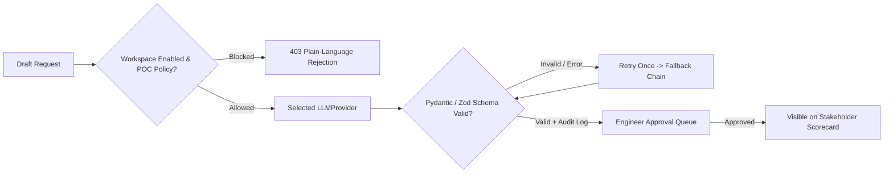

### Adding a New Provider Adapter in Under 50 Lines

1. Add an entry under `providers:` in `config/llm_providers.yaml` with `id`, `model_env`, `default_model`, `region`, `eu_data_residency`, and `cost_per_1k_*_usd`.
2. Subclass `LLMProvider` (Python) or `LLMProviderAdapter` (TypeScript) implementing `health()`, `capabilities()`, and `draft_mappings()`:

```python
class CustomProvider(LLMProvider):
    def __init__(self, cfg: dict):
        self.id, self.model = cfg["id"], cfg["default_model"]
    def health(self): return {"ok": True}
    def capabilities(self): return {"structured_output": True, "region": "europe-west1", "eu_data_residency": True}
    async def draft_mappings(self, requirements_text: str, context: dict, byok_secret=None):
        items = call_your_model(requirements_text, api_key=byok_secret)
        return {"items": items, "input_tokens": 200, "output_tokens": 120, "model": self.model}
```
