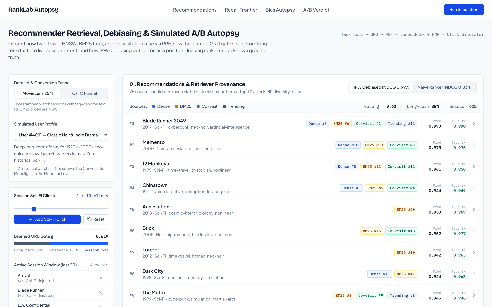
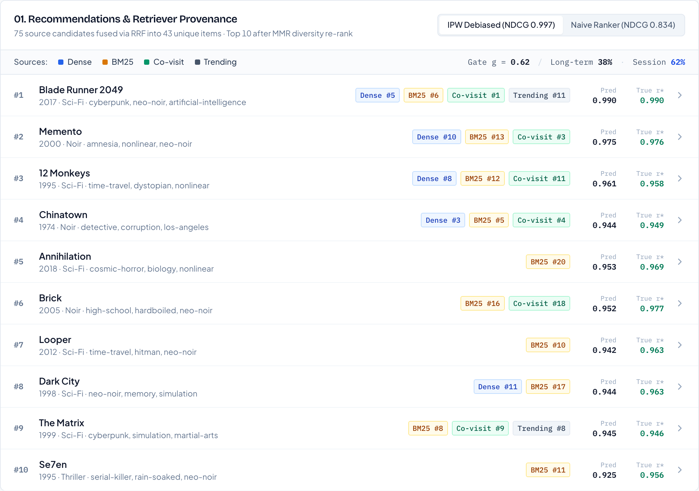
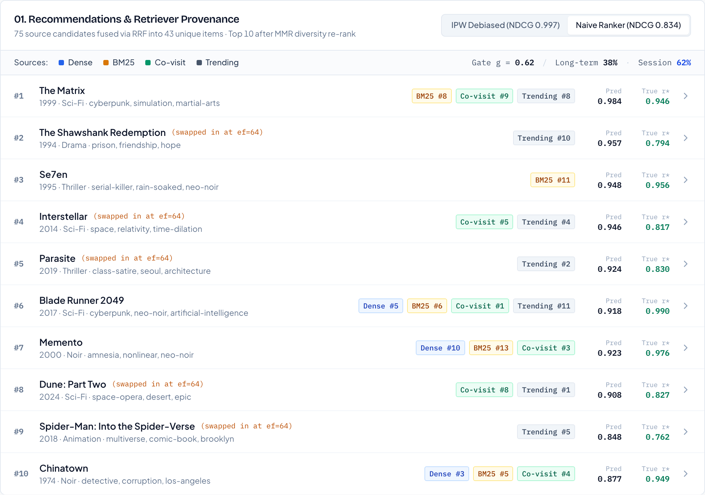
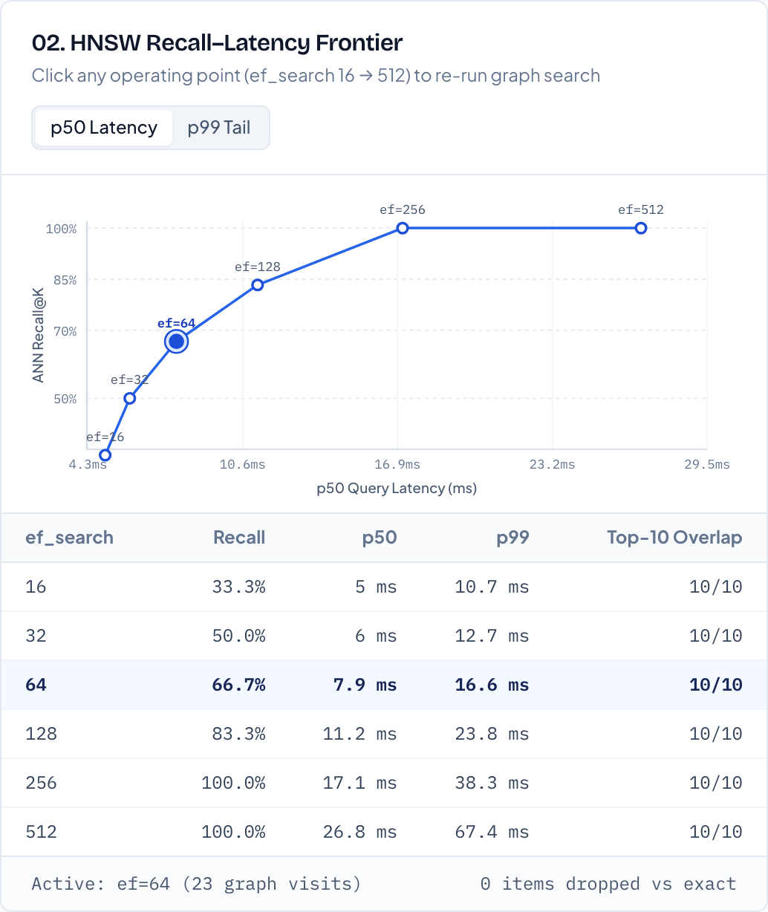
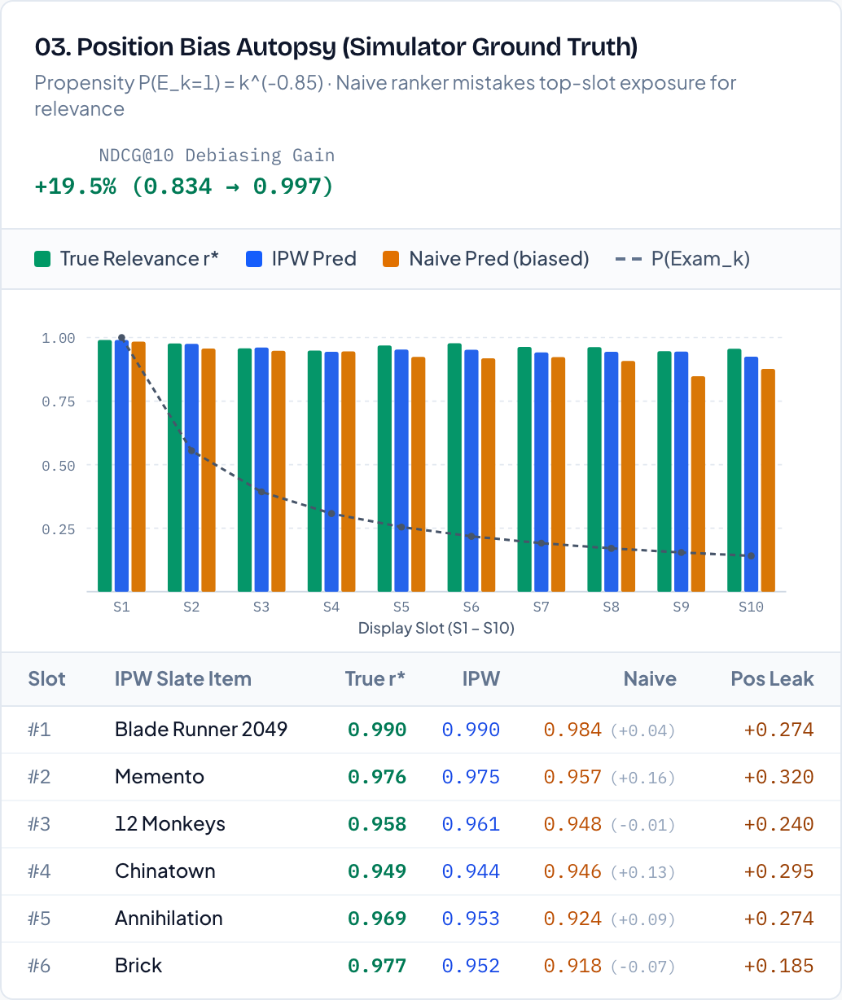
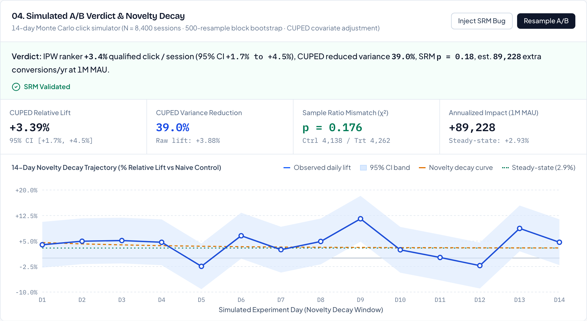
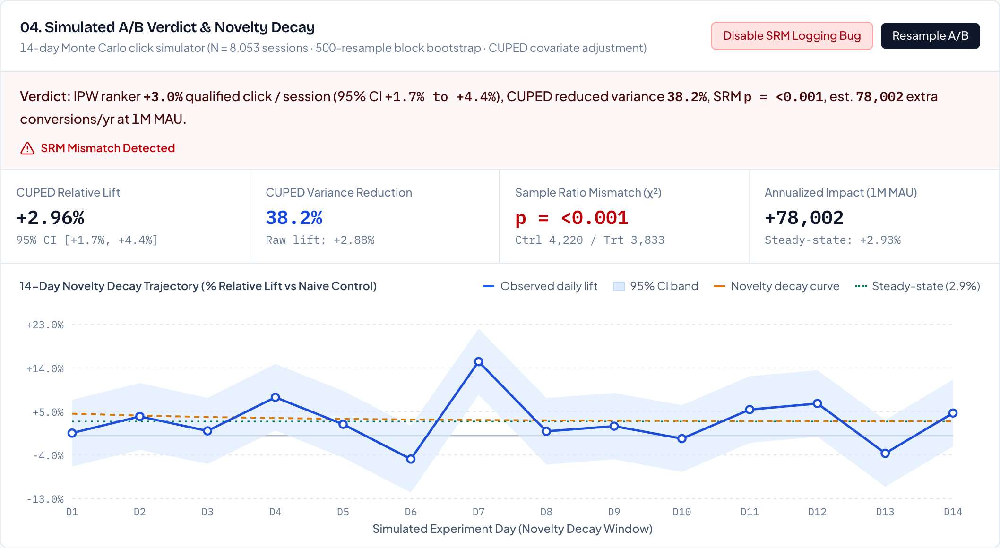
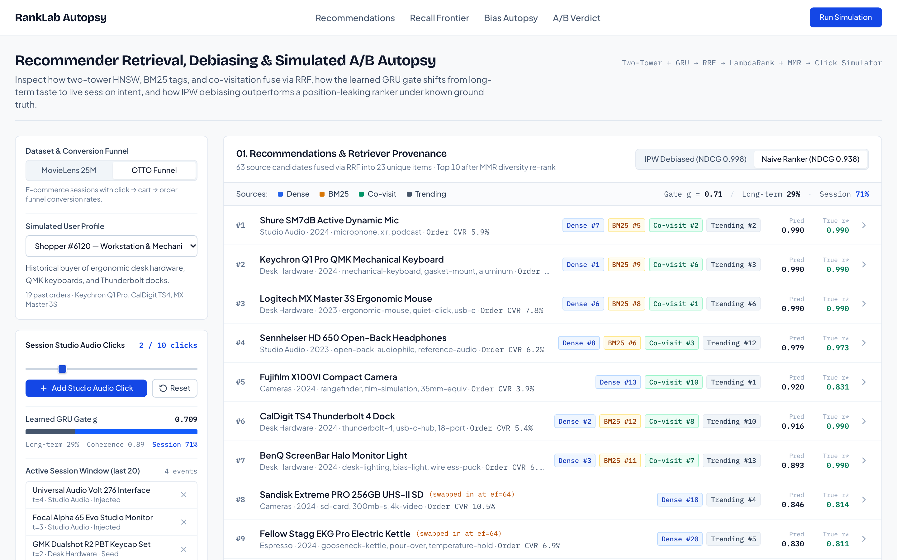
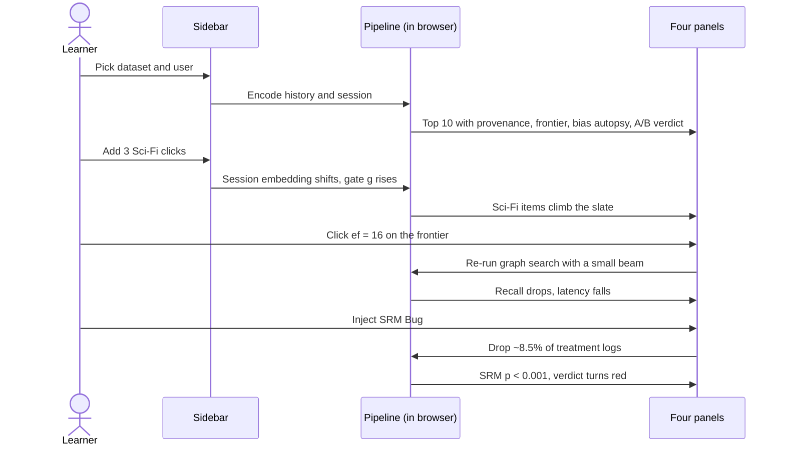

# RankLab Autopsy

**RankLab Autopsy** is a browser workbench that dissects a recommender system one stage at a time. Pick a user, add a few session clicks, and watch the whole chain react: candidate retrieval from four sources, Reciprocal Rank Fusion, an HNSW recall-versus-latency trade-off, a ranker with and without position-bias correction, and a simulated 14-day A/B test with CUPED, bootstrap confidence intervals and a sample-ratio check. Everything runs in your browser from a fixed, seeded simulator, so every number can be traced to the formula that produced it.



> **Honest boundaries (read first):**
> - **It's a simulator, not a production system.** The catalogues are small and hand-built: 80 films in *MovieLens-style* mode and 30 products in *OTTO-style* mode, each with a 12-dimensional taste vector. The mode names describe the flavour of the data; the real MovieLens 25M and OTTO datasets aren't loaded.
> - **The models are formulas, not trained networks.** The "two-tower" embeddings, the "learned" session gate *g* and the naive and IPW rankers are deterministic scoring functions designed to behave like their real counterparts.
> - **Latency is modelled, not measured.** p50/p99 come from the number of graph nodes visited, not from timing a real index.
> - **Ground truth is known on purpose.** The simulator knows each user's true preferences, which is impossible in real life. That's what makes the "autopsy" possible: you can see exactly how far each ranker is from the truth.

---

## What it teaches

| Topic | Where you see it | What to look for |
| :--- | :--- | :--- |
| **Candidate generation** (multi-source retrieval) | 01 · Recommendations & Retriever Provenance | Each slot shows which retrievers found it (Dense, BM25, Co-visitation, Trending), its rank in each source, and its RRF contribution. |
| **Hybrid retrieval with RRF** (k = 60) | 01 · Provenance chips | Items found by several sources rise; items found by only one sink. |
| **Approximate nearest neighbour (ANN) search** | 02 · HNSW Recall–Latency Frontier | Raising `ef_search` from 16 to 512 buys recall with latency. |
| **Short-term vs long-term personalisation** | Sidebar: session clicks, gate *g* | More coherent session clicks raise *g*, shifting the query from history (`1 − g`) to the session (`g`). |
| **Position bias and IPW debiasing** | 03 · Position Bias Autopsy | The naive ranker mistakes top-slot exposure for relevance; IPW with propensity `1 / k^η` recovers it. |
| **Diversity re-ranking (MMR)** | Sidebar: MMR λ | Lower λ trades relevance for variety in the top 10. |
| **Offline metric** | 03 · NDCG@10 debiasing gain | NDCG@10 of each ranker against the simulator's true relevance. |
| **Online experiment design** | 04 · Simulated A/B Verdict | Raw vs CUPED lift, variance reduction, 95% bootstrap CI, novelty decay, annualised impact. |
| **Experiment health checks** | 04 · Inject SRM Bug | A logging bug drops ~8.5% of treatment logs; the χ² sample-ratio test flags it. |

---

## Installation

### Prerequisites
- **Node.js 20 or later** (tested with Node 24) and npm.
- No API keys, accounts or network services. Everything runs in the browser.

### Install and run
```bash
cd ranklab-autopsy
npm install
npm run dev
```

Open <http://localhost:3000>.

### Production build
```bash
npm run build
npm run preview
```

`npm run build` writes a static site to `dist/`, which you can host anywhere: GitHub Pages, Netlify, Cloud Run or any static file server.

> The project started from a Google AI Studio template, so `.env.example` mentions `GEMINI_API_KEY` and `package.json` lists `@google/genai` and `express`. The app doesn't use any of them; you can leave the key unset.

---

## How to use it

The screen has a control sidebar on the left and four diagnostic panels on the right. Every control re-runs the whole pipeline instantly.

### Sidebar controls

| Control | What it changes |
| :--- | :--- |
| **Dataset & Conversion Funnel** | *MovieLens-style* (films, metric: qualified clicks per session) or *OTTO-style* (shop products, metric: order conversion per user). |
| **Simulated User Profile** | Four personas per mode, including a cold-start user with almost no history. |
| **Session clicks** | Add or remove injected clicks from a category the user has never touched (Sci-Fi or Studio Audio) and watch personalisation adapt. Remove individual clicks from the session window. |
| **Learned GRU Gating *g*** | Read-only: how much the query leans on the session vs long-term history. |
| **HNSW `ef_search`** | ANN search breadth (16 → 512). |
| **Propensity η** | How steeply attention falls with slot position (`P(examine slot k) = 1 / k^η`). |
| **MMR λ** | Relevance vs diversity in the final top 10. |
| **Run Simulation** (header) | Re-runs the A/B test with a new random seed. |

### The four panels

#### 01 · Recommendations & Retriever Provenance


The final top 10 with each item's sources, RRF score and feature attribution (long-term affinity, session similarity, popularity, recency, position leak). Switch between **IPW Debiased** and **Naive Ranker** at the top right to compare slates.



#### 02 · HNSW Recall–Latency Frontier


Six operating points from `ef_search = 16` to `512`. Click a point or a table row to re-run the graph search there. Toggle between p50 and p99 latency.

#### 03 · Position Bias Autopsy


For each slot: the true relevance *r\**, the IPW estimate, the naive estimate and the examination probability curve. The table shows how much of the naive score is "position leak".

#### 04 · Simulated A/B Verdict & Novelty Decay


A 14-day Monte Carlo experiment: naive ranker (control) vs IPW ranker (treatment). The panel shows:
- **Verdict:** a one-sentence summary of the result.
- **Lift:** raw and CUPED-adjusted, with a 500-resample block-bootstrap 95% CI.
- **Variance reduction** from CUPED.
- **SRM χ² p-value**, testing whether users were split evenly between control and treatment.
- **Extra conversions per year** at 1 million monthly active users.
- **Daily lift chart**, with a novelty-decay curve and the steady-state level.

Click **Inject SRM Bug** to break the 50/50 split and watch the health check fail:



#### E-commerce mode


Switch to **OTTO Funnel** for shop products and a click → cart → order funnel.

---

## Data flow

```mermaid
flowchart LR
    subgraph Inputs["Inputs (sidebar)"]
        U[User profile<br/>long-term history]
        S[Session clicks<br/>organic + injected]
        K[Knobs<br/>ef_search · η · MMR λ · seed]
    end

    subgraph Encode["Encode"]
        EL[Long-term embedding e_long]
        ES[Session embedding e_short<br/>recency-decayed]
        G{{Gate g<br/>session length, coherence, history}}
        Q[Fused query<br/>1−g · e_long + g · e_short]
    end

    subgraph Retrieve["Candidate generation"]
        D[Dense ANN<br/>HNSW-style graph, quota 28]
        B[BM25 on tags<br/>quota 20]
        C[Co-visitation<br/>quota 18]
        T[Trending prior<br/>quota 14]
        R[RRF fusion k = 60<br/>+ provenance]
    end

    subgraph Rank["Rank and re-rank"]
        N[Naive ranker<br/>absorbs position leak]
        I[IPW ranker<br/>weights by 1 / k^η]
        M[MMR diversity → top 10]
    end

    subgraph Measure["Measure"]
        F[Recall–latency frontier]
        NDCG[NDCG@10 vs true relevance]
        AB[14-day A/B simulator<br/>CUPED · bootstrap CI · SRM χ²]
    end

    U --> EL --> Q
    S --> ES --> Q
    EL --> G
    ES --> G --> Q
    Q --> D
    S --> B & C
    U --> B
    T --> R
    D & B & C --> R
    K -. ef_search .-> D
    R --> N & I
    K -. η .-> I
    N & I --> M
    K -. λ .-> M
    D --> F
    M --> NDCG
    M --> AB
    K -. seed .-> AB
```

Nothing leaves the browser: there are no network calls, and the simulator is seeded, so the same settings always give the same results.

## User interaction



---

## Check that it works

The type check and the production build must both pass:

```bash
npm run lint
npm run build
```

Then try these experiments. The expected results come from the default settings: MovieLens-style mode, user #4091 (Classic Noir & Indie Drama), 2 injected clicks, `ef_search = 64`, η = 0.85, MMR λ = 0.78.

| # | Experiment | Expected result |
| ---: | :--- | :--- |
| 1 | Open the app with default settings. | Panel 03 shows **NDCG@10 debiasing gain ≈ +19.5% (0.834 → 0.997)**; panel 04 shows **SRM Validated** and CUPED variance reduction of about **39%**. |
| 2 | In panel 02, click `ef = 16`. | Recall falls to **33.3%** and p50 latency to **~5 ms**; at `ef = 256` recall reaches **100%**. |
| 3 | Click **Inject SRM Bug**. | Treatment users drop below control (e.g. 4,220 vs 3,833), the SRM p-value becomes **< 0.001** and the verdict banner turns red. |
| 4 | Press **Add Sci-Fi Click** until there are 6 injected clicks, then **Reset**. | For a user with zero Sci-Fi history, gate *g* goes **0.485 (0 clicks) → 0.619 (2) → 0.761 (6)** and Sci-Fi titles in the top 10 go **1 → 6 → 10**. |
| 5 | Move η from 1.3 down to its minimum, 0.3. | Weaker position bias leaves less to correct: naive NDCG@10 rises **0.827 → 0.885** while IPW stays at **0.997**, and the average naive-vs-IPW score gap shrinks from **0.141 to 0.041**. |
| 6 | Click **Run Simulation** several times. | The lift and CI move a little each time; the steady-state lift stays the same. That's sampling noise, not a change in the ranker. |

There are no automated tests yet (see Known limitations).

---

## Project structure

```
ranklab-autopsy/
├── src/
│   ├── App.tsx                     # State, layout, wiring of the four panels
│   ├── engine/
│   │   ├── catalog.ts              # Synthetic films and products, 12-D vectors, personas
│   │   ├── pipeline.ts             # Encoders, gate g, 4 retrievers, RRF, rankers, MMR, frontier
│   │   ├── abSimulator.ts          # 14-day A/B simulation, CUPED, bootstrap CI, SRM
│   │   ├── math.ts                 # Seeded RNG, cosine, NDCG, χ² p-value
│   │   └── types.ts                # Shared types
│   └── components/
│       ├── ControlSidebar.tsx
│       ├── RecommendationsPanel.tsx
│       ├── FrontierPanel.tsx
│       ├── BiasAutopsyPanel.tsx
│       └── AbVerdictPanel.tsx
└── docs/frames/                    # README screenshots
```

### The maths in one place

| Quantity | Formula used |
| :--- | :--- |
| Gate *g* | `sigmoid(−1.65 + 1.15·ln(1 + session length) + 1.25·coherence − 0.85·history strength)`, clamped to [0.05, 0.96] |
| Fused query | `normalize((1 − g)·e_long + g·e_short)` |
| RRF | `Σ_sources 1 / (60 + rank)` |
| Examination propensity | `P(E_k = 1) = 1 / k^η` |
| IPW weight | `1 / max(P(E_k), 0.12)` (clipped to limit variance) |
| CUPED | `Y_cuped = Y − θ(X − mean X)`, with `θ = Cov(Y, X) / Var(X)` and X = 7-day pre-period conversion |
| SRM | Pearson χ² with 1 degree of freedom against a 50/50 split |
| Novelty | Day-1 boost of +55% of the steady-state lift, decaying with τ = 3.6 days |

---

## Maintenance

- **Add items or personas:** edit `src/engine/catalog.ts`. Each item needs a 12-D vector (the axes are listed at the top of the file), tags, popularity and a historical average slot.
- **Change the simulator's assumptions:** retriever quotas and ranker scoring live in `executePipelineAtEf` in `pipeline.ts`; experiment size, novelty decay and the SRM bug rate live in `abSimulator.ts`.
- **Refresh the screenshots:** run the app and capture the four panels again into `docs/frames/` using the same file names.
- **Dependencies:** `npm outdated`, then update and re-run `npm run lint && npm run build`. Fresh installs previously failed because `esbuild@0.25` conflicted with Vite 8; the dev dependency is now `^0.28.0`.

## Known limitations

- **Small catalogue:** in the default setup, the top-10 overlap with exact search stays 10/10 even at low recall, so the frontier shows the cost of a narrow beam without changing the final slate.
- **Single-layer graph:** the "HNSW" index is a single-layer navigable small-world graph, not a multi-layer HNSW.
- **No automated tests:** no unit tests for the maths (NDCG, CUPED, χ²) and no end-to-end test.
- **Unused template leftovers:** `@google/genai`, `express` and `dotenv` are still listed in `package.json`.

## Roadmap

1. Unit tests for `math.ts` and `abSimulator.ts` against known textbook values.
2. Load a real MovieLens or OTTO sample and train a small two-tower model offline.
3. A multi-layer HNSW and a larger catalogue so low `ef_search` actually changes the slate.
4. Interleaving as a faster alternative to A/B testing.
5. A guided "lesson mode" that walks through the experiments above step by step.
