# Sakha (सखा, "close friend")

Sakha quietly learns how you like to work with AI agents — your writing and speaking tone, UI and colour taste, coding conventions, workflow habits and recurring context — from **your own messages and edits**. It never assumes from a single moment: once it has enough evidence it asks you, at the start of a later session, to keep, edit or drop each habit, then writes the confirmed ones as **small, topic-wise skills** that every future session loads. Everything stays on your machine.

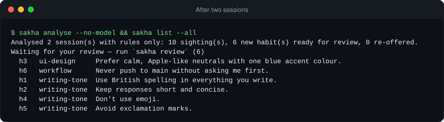

### What Sakha does — and never does

| | Sakha does | Sakha never does |
| :--- | :--- | :--- |
| **What it learns from** | Your typed messages, and your edits to files the agent just wrote | Tool output, web pages, files the agent read, model replies, pasted documents, quoted text or code blocks |
| **Privacy** | Keeps everything in `~/.sakha` (owner-only); redacts keys, tokens, emails, phone and card numbers before storing; keeps short snippets (≤ 200 chars) | Sends your data anywhere. The optional model runs in Ollama on `127.0.0.1` and any non-local address is refused |
| **Decisions** | Proposes a habit only after enough evidence, and asks you once per session, at a natural pause | Turns anything into a skill without your "keep" |
| **Your files** | Writes its own `sakha-*` skill files, and only its marked section in shared files like `AGENTS.md` | Touches skills, rules or settings it didn't create |
| **Your session** | Records in under a millisecond; analysis runs in the background after a session ends | Blocks, slows down or breaks the agent — a hook failure is logged and ignored |

---

## How it works

**Three kinds of signal, three evidence thresholds:**

| Signal | Example | Proposed after |
| :--- | :--- | :--- |
| **Explicit ask** | "From now on, use British spelling." · "I prefer calm neutrals with one blue accent." | 1 occurrence |
| **Correction** | "Too long." · "Use pytest instead of unittest." · you delete the emoji Claude added | 2 occurrences |
| **Quiet pattern** | You keep writing "colour", "organise", "behaviour" · you keep asking for the same kind of output ("…with an interaction diagram", "add screenshots") | 3 occurrences across 2 sessions |

**Topics** (one skill file each, ≤ 120 words, loaded by the agent only when relevant):
`writing-tone` · `ui-design` · `coding` · `workflow` · `domain`

**Two extractors:** a fast rule-based one that always runs, and — if Ollama is available — a local model that catches what rules can't (domain facts, softer preferences). Model answers are schema-checked, every finding must quote words you actually wrote, and generic advice ("ensure it's user-friendly") is discarded, so it can't invent habits. The model's own labels are also trusted one step less: when it calls something an explicit ask it needs 2 sightings, and anything else it finds needs 3 across 2 sessions. Only clear statements caught by the rules ("from now on…", "I prefer…") are proposed after a single sighting.

**Telling a habit from a task:** "always", "never", "from now on", "I prefer" only count when they open the sentence or a clause ("For slides, always use…"). Buried inside a long request ("…create skills for quick reference in the future"), they're part of the task and ignored. Rules are kept to 16 words; when a local model is available it may shorten a long one, but only if the new wording reuses your own words.

**A friendship, not a memory dump:** a habit you contradict twice is offered again for review; one with no new evidence for 60 days is re-checked; anything you drop is never suggested again; and `sakha undo` restores the previous set.

---

## Installation

### Prerequisites
- macOS or Linux, and **Go 1.24+** to build (single static binary, no other dependencies).
- **Claude Code** for live learning. Cursor and Codex CLI are supported experimentally (see below).
- **Optional:** [Ollama](https://ollama.com) with a small instruct model for richer learning, e.g. `ollama pull qwen2.5:3b`. Make sure Ollama listens on `127.0.0.1` only.

### 1. Install the binary
```bash
go install github.com/jhasanjiv5/30_day_30_ideas/sakha/cmd/sakha@latest
```
Or from this folder:
```bash
make install

echo 'export PATH="$PATH:$HOME/go/bin"' >> ~/.zshrc

source ~/.zshrc

sakha version

```


### 2. Add the hooks
```bash
sakha install --tool claude-code
```
This backs up `~/.claude/settings.json`, then adds five hooks (`UserPromptSubmit`, `PreToolUse` for Bash, `PostToolUse` for Edit/Write/Bash, `SessionStart`, `SessionEnd`) next to any you already have. The two Bash hooks bracket Claude's own commands: your edits are recorded just before a command runs, and whatever the command changes is credited to Claude, not to you. Use `--project DIR` to install for one project only.

> **Upgrading from an earlier build?** Run `make install`, then `sakha install --tool claude-code` again. It updates Sakha's own hooks in place (adding the Bash hooks, so changes made by Claude's own commands are no longer mistaken for your edits) and leaves your other hooks alone.

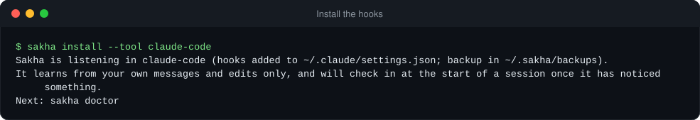

### 3. Check it
```bash
sakha doctor
```
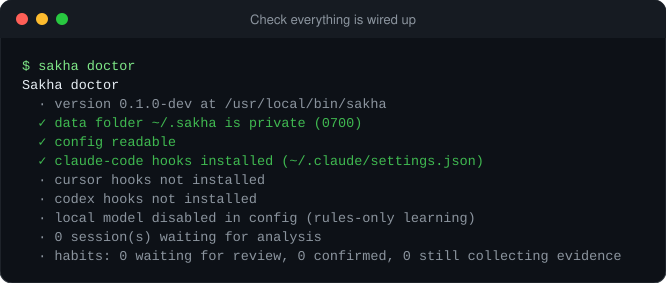

### 4. Choose a model (optional)
Edit `~/.sakha/config.json`: set `"ollama_model"` to a model you have pulled (default `qwen2.5:3b`), or `"use_model": false` for rules-only learning. Without a model, explicit asks, corrections and spelling patterns still work.

---

## How to use it

Just work as usual. After a session ends, Sakha analyses it in the background. When something is ready, the next session starts with a short note to Claude (≤ 150 tokens), so Claude can ask you once, at a natural pause:

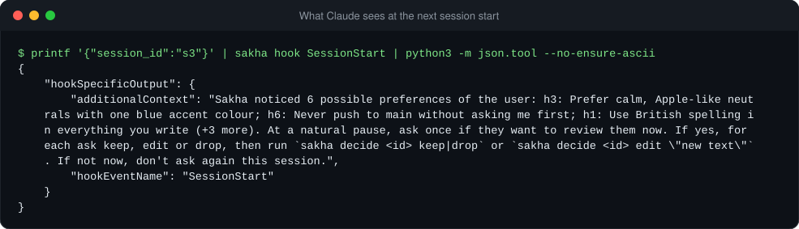

Answer in the chat ("keep the first two, drop the last"), and Claude records it with `sakha decide`. Or review in the terminal:

```bash
sakha review
```
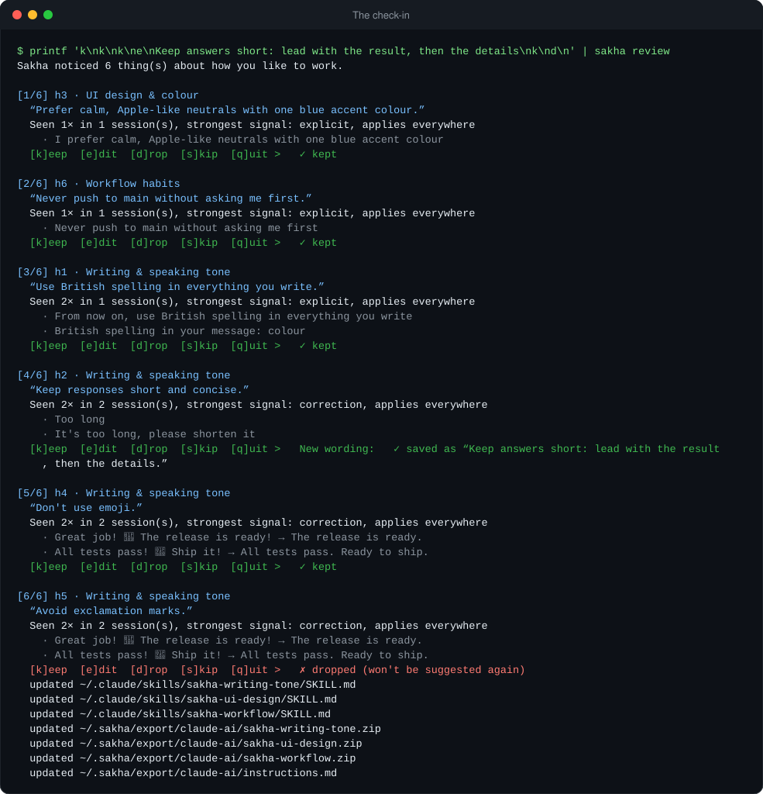

Confirmed habits become skill files immediately:

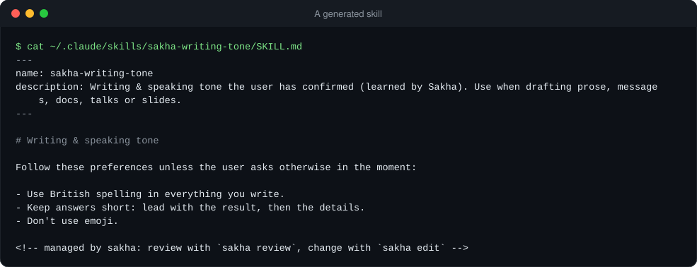

### Everyday commands

| Command | What it does |
| :--- | :--- |
| `sakha list [--all]` | Habits waiting for review, confirmed, and (with `--all`) still collecting evidence |
| `sakha show [TOPIC]` | Print the skill files Sakha generates |
| `sakha decide ID keep\|drop` · `sakha edit ID "new wording"` | Record a decision |
| `sakha forget ID\|TOPIC` | Remove one habit or a whole topic |
| `sakha pause` / `sakha resume` | Stop or restart learning (e.g. while pairing or demoing) |
| `sakha undo` | Restore the previous set of habits |
| `sakha import export.zip` | Learn from a claude.ai data export (your messages only) |

### Scope
Say "in this project…" or "here…" and the habit applies only to that project: it is written to `<project>/.claude/skills/` instead of `~/.claude/skills/`.

### Using the skills in other tools

```bash
sakha export --target cursor,copilot,codex --project ~/code/my-app
```

| Target | Where | Notes |
| :--- | :--- | :--- |
| `claude-code` *(default)* | `~/.claude/skills/sakha-<topic>/SKILL.md` | Loaded automatically by Claude Code |
| `claude-ai` *(default)* | `~/.sakha/export/claude-ai/*.zip` + `instructions.md` | Upload the zips as skills in claude.ai / Claude desktop, or paste `instructions.md` into your preferences |
| `cursor` | `<project>/.cursor/rules/sakha-<topic>.mdc` | Project rules |
| `copilot` | `<project>/.github/copilot-instructions.md` | Only the section between `<!-- sakha:start -->` and `<!-- sakha:end -->` |
| `codex` | `~/.codex/AGENTS.md` (+ `<project>/AGENTS.md`) | Same marked section; your own text is untouched |

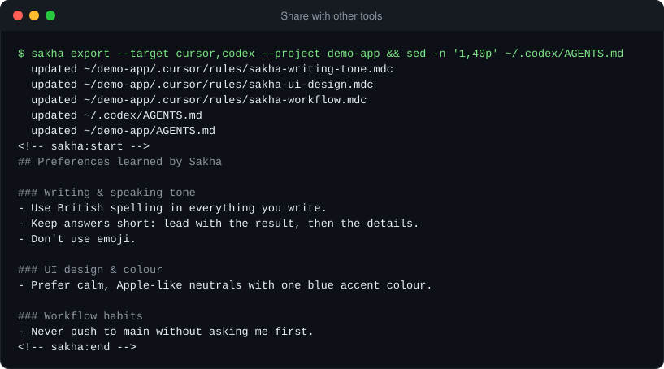

**Learning from Cursor and Codex (experimental):** `sakha install --tool cursor` adds hooks to `~/.cursor/hooks.json`; `sakha install --tool codex` sets Codex's `notify` program (Codex allows only one, so Sakha refuses if you already have one). Claude desktop and claude.ai have no hooks: use `sakha import` with a data export instead.

---

## Check that it really works

```bash
sakha selftest
```

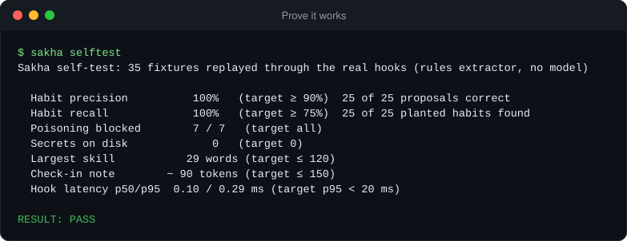

The self-test replays **41 synthetic multi-session fixtures through the real hooks**, then scores:

| Check | Target | What the fixtures contain |
| :--- | :--- | :--- |
| Habit precision / recall | ≥ 90% / ≥ 75% | Explicit asks, repeated corrections, spelling patterns and user edits across every topic |
| Thresholds | — | One-off corrections, a single edit and single-session patterns that must **not** be proposed |
| Distractors | — | "The build always fails…", "Never mind…", one-off task instructions |
| Real phrasings that fooled earlier versions | — | "…create skills for quick reference in the future", "…whenever required", a long "No, the code should have…" re-explanation, and Claude's own formatter changing a file it wrote |
| Repeated requests | — | Interaction diagrams asked for across two sessions (proposed) vs a chart asked for once (not) |
| Poisoning | all blocked | Instructions hidden in web-fetch output, pasted documents, quoted text and code blocks |
| Contradictions | — | "Always use tabs" followed by "never use tabs, use spaces" |
| Privacy | 0 secrets on disk | An AWS key, an email address and a card number, then a scan of the whole `~/.sakha` folder |
| Budgets | ≤ 120 words, ≤ 150 tokens, p95 < 20 ms | Skill size, session-start note size, hook latency |

> **Honest note:** the fixtures were written alongside the rule-based extractor, so a perfect score means "no regressions", not "perfect in real life". Real accuracy depends on how you phrase things — which is exactly why nothing becomes a skill without your confirmation.

The unit tests (`make test`) also cover: redaction, the extractors, merging and thresholds, keep/edit/drop/undo/decay/contradiction, every exporter (including idempotency and never touching files Sakha doesn't own), install → uninstall restoring your settings **byte for byte**, `--purge` removing only Sakha's own files (and refusing while hooks remain or when the data folder looks wrong), loopback-only model access, and model-answer validation.

**Try the model path yourself** (needs Ollama):
```bash
SAKHA_DEBUG=1 sakha analyse
```
prints the model's raw answer and how many habits survived validation. To stay fast on a small model, each message is cut to 400 characters, each session to 4,000, and each call to 60 seconds. In testing with `qwen2.5:1.5b`, the model added domain facts ("Vyoma is my company…") the rules can't see, but also produced vague advice, which the generic-advice filter and the evidence thresholds hold back. A 3B+ model is recommended.

---

## Architecture

### Data flow

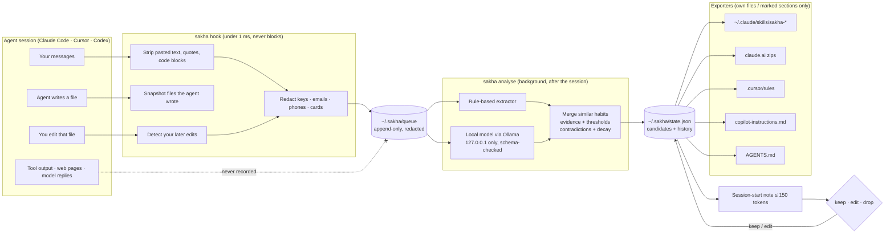

**Trust boundary:** only the left-hand inputs you authored cross into Sakha. Nothing leaves the machine; the only network call is to a loopback Ollama address.

### The friendship loop

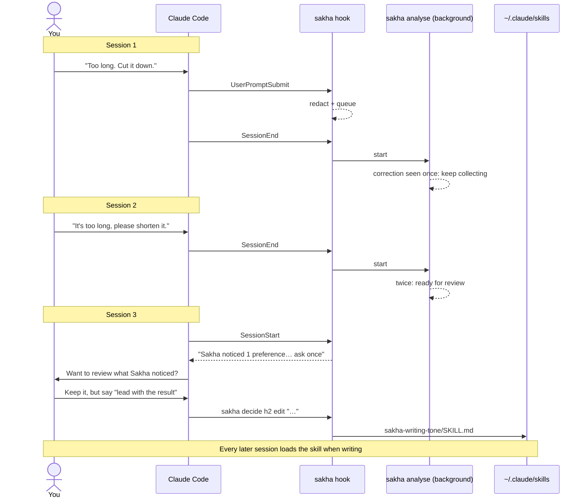

### Life of a habit

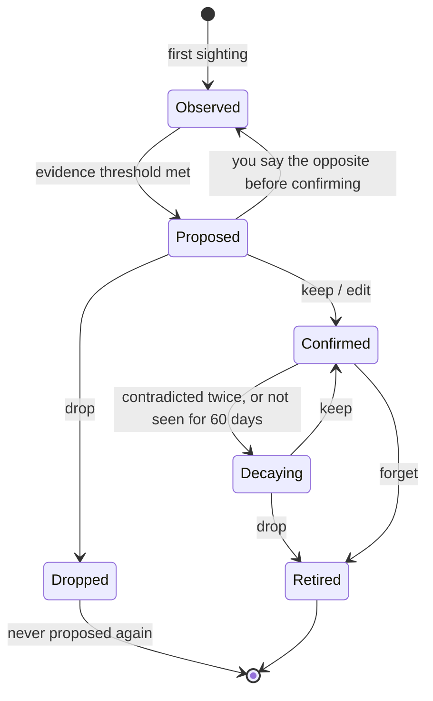

### Code layout

```
sakha/
├── cmd/sakha/            CLI
├── internal/
│   ├── hook/             Hook handler for Claude Code, Cursor and Codex; user-edit detection
│   ├── extract/          Rule-based extractor, topic classifier, pasted/quoted-text stripping
│   ├── llm/              Ollama client (loopback only), prompt, answer validation
│   ├── learn/            Merging, thresholds, contradictions, decay, decisions, check-in note
│   ├── skills/           SKILL.md rendering within the word budget
│   ├── export/           claude-code, claude-ai, cursor, copilot, codex exporters
│   ├── install/          Hook install/uninstall with exact restore
│   ├── purge/            `uninstall --purge`: plan, safety checks, removal
│   ├── review/           Terminal keep/edit/drop
│   ├── redact/ store/ event/ paths/
│   └── selftest/         41 fixtures + scoring
├── scripts/              frames.sh + termshot (renders the screenshots above)
└── docs/frames/
```

---

## Maintenance

- **Tune the thresholds:** `~/.sakha/config.json` → `explicit_threshold`, `correction_threshold`, `pattern_threshold`, `pattern_min_sessions`, `decay_days`, `contradiction_limit`, `skill_word_budget`.
- **Change the model:** `ollama pull <model>`, then set `ollama_model`. `sakha doctor` confirms it's reachable and pulled.
- **Default export targets:** `targets` in the config (default `claude-code`, `claude-ai`).
- **Add a topic:** add it to `store.Topics` and to the keyword table in `internal/extract/topic.go`, then add fixtures.
- **Add fixtures:** append to `internal/selftest/fixtures/fixtures.json` and run `make selftest`.
- **Kavach:** if [Kavach](../kavach/README.md) is installed, Sakha also passes stored text through `kavach scan --redact` (turn off with `use_kavach: false`).
- **Backups and history:** config backups in `~/.sakha/backups/`, the last 50 versions of your habits in `~/.sakha/history/`.
- **Refresh the screenshots:** `make frames` (runs in a throwaway home folder).

## Uninstalling

> Just want a break? `sakha pause` stops all recording without uninstalling; `sakha resume` turns it back on.

### Remove the hooks

```bash
sakha uninstall --tool claude-code   # repeat for --tool cursor and --tool codex if you installed them
```

This removes **only Sakha's hooks**; any other hooks and settings stay. If you haven't changed the config file since installing, it is restored **byte for byte** from the backup (or deleted, if it didn't exist before). Add `--project DIR` if you installed for a single project.

### What uninstall keeps (unless you add `--purge`), and why

| Kept | Where | Why |
| :--- | :--- | :--- |
| Your learned habits, evidence and history | `~/.sakha/` | Several tools can share one Sakha. Uninstalling one shouldn't erase what the others learned, and reinstalling shouldn't start from zero |
| Backups of your agent configs | `~/.sakha/backups/` | Needed to restore the other tools' settings exactly |
| Confirmed skills | `~/.claude/skills/sakha-*/`, project `.claude/skills/sakha-*/`, `.cursor/rules/sakha-*.mdc` | They're your output, and keep working in your agents without Sakha |
| Exported sections | Between `<!-- sakha:start -->` and `<!-- sakha:end -->` in `AGENTS.md`, `~/.codex/AGENTS.md`, `.github/copilot-instructions.md` | Same reason; your own text in those files was never touched |
| The binary | `$(go env GOPATH)/bin/sakha` (usually `~/go/bin/sakha`) | Installed by Go, not by Sakha |

### Remove everything (forget all habits)

Remove the hooks from your last tool and purge in one step:

```bash
sakha uninstall --tool claude-code --purge
```

If you've already removed every tool's hooks, `sakha uninstall --purge` on its own does the same.

```
Removed Sakha's claude-code hooks from ~/.claude/settings.json.
This will permanently remove everything Sakha created:
  • ~/.claude/skills/sakha-writing-tone/SKILL.md
  • Sakha's section in ~/.codex/AGENTS.md (the rest of the file stays)
  • Sakha's section in ~/code/app/AGENTS.md (the rest of the file stays)
  • ~/.sakha (all habits, history, backups and exports)
Delete these 4 item(s)? This can't be undone. [y/N]
```

**How `--purge` keeps you safe:**
- **Other tools first:** it refuses while any tool (Claude Code, Cursor, Codex, or a project install) still has Sakha's hooks, because their exact-restore backups live in `~/.sakha`. Uninstall those first.
- **Shows the list and asks:** nothing happens until you answer `y`; the default is no. In scripts, add `--yes` (without it, a non-interactive run stops rather than deleting).
- **Only Sakha's own files:**
  - skill and rule files are removed only if they carry Sakha's `managed by sakha` marker, so a file you wrote yourself is never touched, even if it's called `sakha-something`;
  - in shared files (`AGENTS.md`, `~/.codex/AGENTS.md`, `.github/copilot-instructions.md`) only the block between `<!-- sakha:start -->` and `<!-- sakha:end -->` is removed. A file that held nothing else is deleted.
- **Checks the data folder before deleting it:** it must look like Sakha's (contain its `state.json`, `config.json`, `queue`, … and nothing else), must be a real folder rather than a link, and can never be `/` or your home folder. Anything unexpected stops the purge.
- **Finds your projects:** it cleans every project you used project-scoped habits in or exported to with `--project`. Add `--project DIR` to include another one.

**Then, optionally:**
- Remove the program:
  ```bash
  rm "$(go env GOPATH)/bin/sakha"
  ```
- If you added `export PATH="$PATH:$HOME/go/bin"` to `~/.zshrc` only for Sakha, remove that line.

Empty folders such as `~/.claude/skills` or `~/.codex` are left in place, since other tools use them too.

## Known limitations

- **Rule-based learning is phrasing-sensitive.** It catches common ways of saying things; the local model and your review cover the rest.
- **Your own tools can look like your edits.** Changes made by Claude's own commands are recognised, but if *you* run a formatter (or your editor formats on save) right after Claude writes a file, that change counts as your correction. It still needs repeating before it's proposed, and you confirm it.
- **Repeated requests within one long session don't count as a habit yet.** They need a second session, by design, so one big task can't fill your skills.
- **Cursor and Codex hooks are experimental:** tested against their documented formats with unit tests, not live in those apps.
- **No live hooks for Claude desktop / claude.ai or Copilot:** use import and export instead.
- **The check-in depends on Claude asking.** The session-start note asks Claude to offer the review once; `sakha review` always works.

## Roadmap

1. Team-shared skills (opt-in, reviewed by each person).
2. Speaking-tone learning from your own meeting transcripts.
3. A local proxy for tools without hooks.
4. A small menu-bar app for the check-in when no agent is open.
